# Marvedge V3 AI/ML Architecture & Operations Guide

**Document:** `docs/V3_AI_ARCHITECTURE_AND_OPERATIONS.md`  
**Task:** Task-00106 — V3 AI Architecture & Operations Documentation  
**Version:** 3.0.0 (Production & Operational Reference)  
**Date:** November 2026  
**Audience:** Platform Engineers, ML Engineers, SRE / On-Call Engineers, and Engineering Leadership  
**Status:** Authoritative Engineering Reference (Ground Truth Reconciled)

---

## Table of Contents

1. [System Overview](#1-system-overview)
   - 1.1 [Pipeline Purpose & Capabilities](#11-pipeline-purpose--capabilities)
   - 1.2 [Core Processing Stages](#12-core-processing-stages)
   - 1.3 [Synchronous Ingestion vs. Asynchronous Worker Execution](#13-synchronous-ingestion-vs-asynchronous-worker-execution)
   - 1.4 [Queue Orchestration via BullMQ & Redis](#14-queue-orchestration-via-bullmq--redis)
   - 1.5 [Result Propagation & State Persistence](#15-result-propagation--state-persistence)
   - 1.6 [External Services & Cloud Topology](#16-external-services--cloud-topology)
2. [Architecture](#2-architecture)
   - 2.1 [End-to-End System Topology (Mermaid Diagram)](#21-end-to-end-system-topology-mermaid-diagram)
   - 2.2 [Component Classification & Lifecycle Status](#22-component-classification--lifecycle-status)
3. [Service Input/Output Contracts](#3-service-inputoutput-contracts)
   - 3.1 [Service Master Directory](#31-service-master-directory)
   - 3.2 [Queue Lifecycle, Job Names & Retry Policies](#32-queue-lifecycle-job-names--retry-policies)
   - 3.3 [Next.js Ingestion & Webhook Endpoints](#33-nextjs-ingestion--webhook-endpoints)
   - 3.4 [ML Gateway Internal Contracts (`ml-gateway`)](#34-ml-gateway-internal-contracts-ml-gateway)
   - 3.5 [AutoFlip Crop Target Contract (`autoflip`)](#35-autoflip-crop-target-contract-autoflip)
   - 3.6 [TalkNet Active Speaker Detection Contract (`talknet`)](#36-talknet-active-speaker-detection-contract-talknet)
   - 3.7 [Dubbing Provider Abstraction (ElevenLabs & VoiceStudio)](#37-dubbing-provider-abstraction-elevenlabs--voicestudio)
   - 3.8 [Cloud Run Worker API (`cloudrun-worker`)](#38-cloud-run-worker-api-cloudrun-worker)
4. [Environment Variable Reference](#4-environment-variable-reference)
   - 4.1 [Application & Database](#41-application--database)
   - 4.2 [Redis & BullMQ Infrastructure](#42-redis--bullmq-infrastructure)
   - 4.3 [ML Gateway & Worker Execution](#43-ml-gateway--worker-execution)
   - 4.4 [AutoFlip & TalkNet Pipeline](#44-autoflip--talknet-pipeline)
   - 4.5 [Captioning & Speech Transcription](#45-captioning--speech-transcription)
   - 4.6 [Dubbing Providers & VoiceStudio](#46-dubbing-providers--voicestudio)
   - 4.7 [Cloud Storage & CDN](#47-cloud-storage--cdn)
   - 4.8 [AWS & GPU Infrastructure](#48-aws--gpu-infrastructure)
   - 4.9 [Monitoring & Alerting Infrastructure](#49-monitoring--alerting-infrastructure)
   - 4.10 [Benchmark Execution Parameters](#410-benchmark-execution-parameters)
5. [Benchmark Execution](#5-benchmark-execution)
   - 5.1 [Prerequisites & Host Requirements](#51-prerequisites--host-requirements)
   - 5.2 [Cloud Cost Benchmark Harness (`scripts/benchmark/cloudCostBenchmark.ts`)](#52-cloud-cost-benchmark-harness-scriptsbenchmarkcloudcostbenchmarkts)
   - 5.3 [Concurrent Load Testing Harness (`scripts/benchmark/concurrentLoadRunner.ts`)](#53-concurrent-load-testing-harness-scriptsbenchmarkconcurrentloadrunnerts)
   - 5.4 [In-VPC GPU Load Testing (`infra/gpu-deployment/in_vpc_load_test.mjs`)](#54-in-vpc-gpu-load-testing-infragpu-deploymentin_vpc_load_testmjs)
   - 5.5 [VoiceStudio Benchmark Scripts](#55-voicestudio-benchmark-scripts)
   - 5.6 [Interpreting Performance Telemetry](#56-interpreting-performance-telemetry)
   - 5.7 [Measured Benchmarks vs. Modeled Economic Projections](#57-measured-benchmarks-vs-modeled-economic-projections)
6. [Stuck-Job Diagnosis and Recovery](#6-stuck-job-diagnosis-and-recovery)
   - 6.1 [Operational Principles & Safety Guardrails](#61-operational-principles--safety-guardrails)
   - 6.2 [Step 1: Identify Affected Job, Queue & Pipeline](#62-step-1-identify-affected-job-queue--pipeline)
   - 6.3 [Step 2: Inspect Job State, Attempts & Stall Timers](#63-step-2-inspect-job-state-attempts--stall-timers)
   - 6.4 [Step 3: Analyze Worker Logs & Error Signatures](#64-step-3-analyze-worker-logs--error-signatures)
   - 6.5 [Step 4: Verify Redis Reachability & Network Saturation](#65-step-4-verify-redis-reachability--network-saturation)
   - 6.6 [Step 5: Verify Application & ML Service Health](#66-step-5-verify-application--ml-service-health)
   - 6.7 [Step 6: Diagnose GPU Worker Host & Preflight Gates](#67-step-6-diagnose-gpu-worker-host--preflight-gates)
   - 6.8 [Step 7: Isolate External Vendor & API Failures](#68-step-7-isolate-external-vendor--api-failures)
   - 6.9 [Step 8: Evaluate Retry Safety & Idempotency Boundary](#69-step-8-evaluate-retry-safety--idempotency-boundary)
   - 6.10 [Step 9: Safe Job Recovery via BullMQ / Service Restarts](#610-step-9-safe-job-recovery-via-bullmq--service-restarts)
   - 6.11 [Step 10: Verify Successful Callback & Metric Resolution](#611-step-10-verify-successful-callback--metric-resolution)
7. [Monitoring and Observability](#7-monitoring-and-observability)
   - 7.1 [Prometheus Metrics Endpoint (`GET /api/monitoring/metrics`)](#71-prometheus-metrics-endpoint-get-apimonitoringmetrics)
   - 7.2 [Queue Depth & Stuck-Queue Latency Alerts](#72-queue-depth--stuck-queue-latency-alerts)
   - 7.3 [Terminal Failure Rate Accounting](#73-terminal-failure-rate-accounting)
   - 7.4 [GPU Compute & Vendor Spend Anomaly Tracking](#74-gpu-compute--vendor-spend-anomaly-tracking)
   - 7.5 [Notification Dispatch & Webhook Masking](#75-notification-dispatch--webhook-masking)
   - 7.6 [Alert State Persistence & Atomic Redis Transitions](#76-alert-state-persistence--atomic-redis-transitions)
   - 7.7 [Systemd Supervision of Alert Evaluator](#77-systemd-supervision-of-alert-evaluator)
   - 7.8 [Telemetry Limitations & Data Granularity](#78-telemetry-limitations--data-granularity)
8. [Known Limitations and Caveats](#8-known-limitations-and-caveats)
   - 8.1 [AutoFlip I-Frame Decoding & Camera Motion](#81-autoflip-i-frame-decoding--camera-motion)
   - 8.2 [VoiceStudio Legal, Licensing & Model Checkpoints](#82-voicestudio-legal-licensing--model-checkpoints)
   - 8.3 [Commercial Fallback Prevention & Billing Bounds](#83-commercial-fallback-prevention--billing-bounds)
   - 8.4 [Provisional Concurrency & Full-Pipeline Assumptions](#84-provisional-concurrency--full-pipeline-assumptions)
   - 8.5 [GPU EC2 Cold-Start & Standby State](#85-gpu-ec2-cold-start--standby-state)
   - 8.6 [Cloud Run Subtitle Job Cancellation Semantics](#86-cloud-run-subtitle-job-cancellation-semantics)
   - 8.7 [Cross-Cloud Egress & Multi-Region Topology](#87-cross-cloud-egress--multi-region-topology)
   - 8.8 [Development vs. Production Operational Parity](#88-development-vs-production-operational-parity)
9. [Deployment and Operational Reference](#9-deployment-and-operational-reference)
   - 9.1 [Local Developer Setup](#91-local-developer-setup)
   - 9.2 [Docker Compose Services](#92-docker-compose-services)
   - 9.3 [GPU Host Systemd Services](#93-gpu-host-systemd-services)
   - 9.4 [Health Check Verification](#94-health-check-verification)
   - 9.5 [Safe Shutdown, Drain & Restart Sequences](#95-safe-shutdown-drain--restart-sequences)
   - 9.6 [Production Security Architecture](#96-production-security-architecture)
10. [Source-of-Truth References](#10-source-of-truth-references)

---

## 1. System Overview

### 1.1 Pipeline Purpose & Capabilities

Marvedge V3 is an automated, AI-accelerated media transformation engine. It ingests widescreen, landscape-format source videos ($16:9$, $4:3$, or arbitrary dimensions) and converts them into short-form, mobile-optimized, high-engagement formats ($9:16$, $1:1$, $4:5$, or $16:9$) tailored for social platforms (TikTok, YouTube Shorts, Instagram Reels, LinkedIn).

The platform executes three primary automated transformations:

1. **Intelligent Dynamic Video Reframing:** Analyzes source frames to detect human subjects and track active speakers using computer vision (YuNet ONNX and Google MediaPipe AutoFlip). Applies spatial slew-rate limiting, bounding box smoothing, and bipartite speaker tracking to generate crop coordinates that keep primary subjects centered without nauseating camera jitter.
2. **Automated Captioning & Styled Subtitle Burn-In:** Transcribes conversational speech into timestamped cue structures via Deepgram Nova-2 or Groq Whisper. Formats and validates Advanced SubStation Alpha (`.ass`) karaoke subtitle streams with line wrapping, bounding-box collision avoidance, and font styling.
3. **Multilingual Dubbing & Audio Alignment:** Synthesizes voiceovers in target languages using ElevenLabs Scale Tier APIs or self-hosted neural speech engines (VoiceStudio OmniVoice), time-aligning dubbed audio segments to source video scenes while preserving background audio or burning in composite watermarks.

### 1.2 Core Processing Stages

The pipeline executes through sequential and parallelized stages:

```
[ Ingest & Validate ] -> [ Scene & Face Detection ] -> [ Active Speaker Tracking ]
                                                                |
[ Subtitle / Dub Path ] <----------------------------------------+
         |
         +--> [ ASR Transcription (Deepgram / Whisper) ] -> [ ASS Subtitle Formatting ]
         |
         +--> [ TTS Synthesis (ElevenLabs / VoiceStudio) ] -> [ AVS Audio-Video Dub Sync ]
                                                                |
                                                                v
                                              [ FFmpeg Filtergraph Crop & Burn-in ]
                                                                |
                                                                v
                                            [ Cloudinary / S3 / R2 Asset Delivery ]
```

- **Stage 1 (Audio Extraction & Ingestion):** The source media is validated against SSRF rules (`isSafeUrl`). Audio is demuxed into $16\text{ kHz}$ mono WAV format for speech processing.
- **Stage 2 (Visual Saliency & Face Detection):** AutoFlip decodes keyframes (I-frames) with `-skip_frame nokey` and applies CPU-side YuNet ONNX face detection to track facial landmarks without consuming GPU VRAM.
- **Stage 3 (Active Speaker Identification):** TalkNet evaluates audio spectrograms alongside cropped face tracks on NVIDIA Tesla T4 GPUs to score speaker activity, resolving multi-speaker framing ambiguities.
- **Stage 4 (Trajectory Smoothing & Crop Fusion):** AutoFlip's kinematic graph interpolates bounding boxes across scene cuts, applying slew-rate constraints to produce standard `CropTargetData` coordinates.
- **Stage 5 (Speech Transcription & Translation):** Audio streams are transcribed into word-level timestamped cues via Deepgram Nova-2 (or Groq Whisper) and optionally translated into alternate languages.
- **Stage 6 (Subtitle Compilation):** Word cues are converted into `.ass` subtitle files configured with font families, colors, margins, and karaoke `\k` tags.
- **Stage 7 (Voice Synthesis & Audio Synchronization):** Target language voice tracks are synthesized via ElevenLabs (or VoiceStudio) and time-aligned with source video steps via `cloudrun-worker` or FFmpeg stretch/compress filters.
- **Stage 8 (Final Video Render & Upload):** FFmpeg applies video filtergraphs (`crop`, `subtitles`, `amix`) to encode H.264/AAC MP4 assets with `faststart` flags, uploading final deliverables to Cloudinary, AWS S3, or Cloudflare R2.

### 1.3 Synchronous Ingestion vs. Asynchronous Worker Execution

To guarantee resilience under load and maintain strict SLA boundaries on client-facing APIs, Marvedge enforces an absolute boundary between synchronous HTTP ingestion and asynchronous background processing:

- **Synchronous Ingestion (Next.js Edge / Serverless API on Vercel):**
  - Authenticates the client via NextAuth session tokens (`getServerSession`).
  - Verifies subscription plan entitlements (e.g., AVS dubbing restricted to PRO/ENTERPRISE).
  - Enforces per-user sliding-window rate limiting (e.g., 5 dubbing requests per hour).
  - Performs bounded JSON payload parsing (limiting body sizes to $8\text{ KB}$–$64\text{ KB}$ to prevent payload DOS).
  - Validates remote media URLs using `isSafeUrl()` to reject private IPs, localhost, AWS metadata endpoints (`169.254.169.254`), and non-HTTP protocols.
  - Creates a tracking record in PostgreSQL (`VideoJob`) with `status: "PENDING"`.
  - Enqueues a typed job descriptor into Redis via BullMQ.
  - Flushes an immediate `HTTP 200` response containing `{ success: true, jobId: "cmu...", status: "pending" }` within $<150\text{ ms}$.
- **Asynchronous Execution (BullMQ Workers on AWS EC2 / Container Hosts):**
  - Workers run as dedicated Node.js/Python daemons outside the HTTP request path.
  - Workers acquire job locks from Redis, preventing concurrent duplicate processing.
  - Job execution spans several seconds to multiple minutes depending on source duration.
  - Workers stream intermediate progress ($10\% \to 25\% \to 50\% \to 80\% \to 100\%$) back to PostgreSQL.
  - Upon completion or terminal failure, workers notify the application via HMAC-authenticated callbacks (`POST /api/jobs/callback`).
  - Web clients poll `GET /api/jobs/[id]` at 5-second intervals (with a 15-minute ceiling) to observe state transitions.

### 1.4 Queue Orchestration via BullMQ & Redis

Queue orchestration relies on BullMQ backed by a centralized Redis instance (AWS ElastiCache Redis cluster or Upstash Redis with TLS):

- **Job Distribution:** Decouples Next.js API producers from background worker consumers. Workers pull jobs based on configured concurrency limits.
- **Lock Management:** Workers maintain distributed locks in Redis (with automatic renewal loops) during heavy FFmpeg or ML operations to prevent jobs from being incorrectly marked as stalled.
- **Exponential Backoff:** Transient network timeouts or downstream rate limits trigger bounded retries with exponential backoff rather than immediate job termination.
- **Outcome Metrics Partitioning:** Worker completion and failure events record telemetry in one-minute Redis buckets (`marvedge:monitoring:...`), powering sliding-window latency and failure rate alarms without impacting database I/O.

### 1.5 Result Propagation & State Persistence

Job state transitions follow a strict lifecycle recorded in PostgreSQL:

$$\text{PENDING} \longrightarrow \text{PROCESSING} \longrightarrow \begin{cases} \text{COMPLETED} & (\text{with } exportedUrl \text{ and } jobData) \\ \text{FAILED} & (\text{with sanitized error description}) \end{cases}$$

- **State Persistence:** All operational records live in the `VideoJob` table managed by Prisma ORM.
- **Progress Reporting:** Workers update the `progress` integer ($0$ to $100$) and update BullMQ job progress.
- **Authenticated Callbacks:** When worker processing terminates, the worker sends an HTTP `POST` to `/api/jobs/callback` guarded by a constant-time HMAC bearer token (`CALLBACK_SECRET`). The callback handler updates `VideoJob`, links artifacts to the corresponding `Demo` record, and marks the job terminal.
- **Client Polling:** Frontend hooks (`useReframeJob`, `useDubbingJob`, `useSubtitles`) poll `/api/jobs/[id]` until `COMPLETED` or `FAILED` is received, triggering video canvas refresh.

### 1.6 External Services & Cloud Topology

| Provider       | Service / Resource             | Purpose in V3 Pipeline                                     | Criticality | Fallback Mechanism            |
| :------------- | :----------------------------- | :--------------------------------------------------------- | :---------- | :---------------------------- |
| **AWS**        | EC2 `g4dn.xlarge` (Tesla T4)   | GPU inference (AutoFlip, TalkNet, Reframe, Video Workers)  | Critical    | None (Primary compute engine) |
| **AWS**        | ElastiCache / Upstash Redis    | BullMQ queues, rate limiting, alert state & metric buckets | Critical    | None (Fail-closed)            |
| **AWS**        | RDS PostgreSQL 16              | Relational persistence (`User`, `Demo`, `VideoJob`)        | Critical    | None (Primary data store)     |
| **AWS**        | S3 (`marvedge-raw-ap2`, etc.)  | Permanent media asset storage, raw inputs & rendered MP4s  | High        | Cold-standby GCS              |
| **Cloudinary** | Media CDN & Direct Upload      | Browser direct unsigned uploads, video hosting & previews  | High        | Direct S3 storage fallback    |
| **ElevenLabs** | Speech Synthesis & Dubbing API | Multilingual text-to-speech and turnkey video dubbing      | High        | Optional in-house VoiceStudio |
| **Deepgram**   | Nova-2 Speech-to-Text API      | Word-level speech transcription for subtitle generation    | High        | Groq Whisper API              |
| **Groq**       | Whisper Large v3 / Translation | Subtitle transcription and multi-language translation      | Medium      | Deepgram / OpenAI             |
| **Resend**     | Transactional Email API        | User authentication OTPs and external monitoring alerts    | Medium      | Chat webhook alerts           |
| **GCP**        | Cloud Run (`cloudrun-worker`)  | Containerized legacy dub-sync, HLS packaging & subtitles   | Medium      | AWS EC2 worker processing     |
| **Cloudflare** | R2 Object Storage              | S3-compatible HLS chunk delivery & signed media assets     | Medium      | AWS S3                        |

---

## 2. Architecture

### 2.1 End-to-End System Topology (Mermaid Diagram)

```mermaid
flowchart TD
    subgraph ClientLayer ["Client & Ingestion Tier"]
        Browser["Next.js Web Client<br/>(React / Canvas Editor)"]
        CloudinaryCDN["Cloudinary CDN<br/>(Direct Unsigned Upload)"]
    end

    subgraph AppTier ["Application Tier (Vercel Serverless)"]
        NextAPI["Next.js API Routes<br/>(/api/reframe, /api/avs/dub, /api/dubbing)"]
        NextAuth["NextAuth & RBAC<br/>(Session & Plan Guardrails)"]
        CallbackRoute["Callback Endpoint<br/>(POST /api/jobs/callback)"]
        MetricsEndpoint["Prometheus Endpoint<br/>(GET /api/monitoring/metrics)"]
    end

    subgraph PersistenceTier ["Data & Queue Tier"]
        RDS[("AWS RDS PostgreSQL 16<br/>(VideoJob, Demo, User)")]
        Redis[("Redis (ElastiCache / Upstash)<br/>(BullMQ Queues & Metrics)")]
    end

    subgraph WorkerTier ["Worker & Execution Tier (AWS EC2 / Hosts)"]
        ReframeWorker["Reframe Worker<br/>(Node.js 20 - BullMQ Consumer)"]
        VideoWorker["Video Worker<br/>(Node.js 20 - Video, Dub, Sub, Audio)"]
        AlertEvaluator["Monitoring Alert Evaluator<br/>(Node.js TS Daemon)"]
    end

    subgraph MLTier ["ML Inference Tier (EC2 Local Loopback 127.0.0.1)"]
        MLGateway["ML API Gateway (FastAPI)<br/>Port 8000"]
        AutoFlip["AutoFlip Service (YuNet ONNX)<br/>Port 8002"]
        TalkNet["TalkNet AVS (PyTorch CUDA)<br/>Port 8001"]
        VoiceStudio["VoiceStudio Container (AGPL-3.0)<br/>Port 3900 (Optional Opt-In)"]
    end

    subgraph ExternalServices ["External Cloud Services & APIs"]
        ElevenLabs["ElevenLabs TTS API<br/>(Commercial Dubbing)"]
        Deepgram["Deepgram Nova-2 API<br/>(Speech-to-Text)"]
        Groq["Groq Whisper API<br/>(Transcription / Translation)"]
        CloudRunWorker["GCP Cloud Run Worker<br/>(Legacy AVS Dub Sync)"]
        S3Buckets["AWS S3 Buckets<br/>(marvedge-raw / processed)"]
        ResendWebhooks["External Alerts<br/>(Email & Webhooks)"]
    end

    %% Client Ingestion Flow
    Browser -->|"1. Direct Unsigned Upload"| CloudinaryCDN
    CloudinaryCDN -->|"Returns secure_url"| Browser
    Browser -->|"2. POST Ingest Job"| NextAPI
    NextAPI --> NextAuth
    NextAPI -->|"Create VideoJob (PENDING)"| RDS
    NextAPI -->|"Enqueue Job"| Redis

    %% Worker Consumption
    Redis -->|"reframe-processing"| ReframeWorker
    Redis -->|"dubbing-processing / subtitle-processing"| VideoWorker

    %% Reframe Worker Flow
    ReframeWorker -->|"POST /reframe (x-gateway-token)"| MLGateway
    MLGateway -->|"Proxy /reframe"| AutoFlip
    MLGateway -->|"Proxy /detect"| TalkNet
    AutoFlip -->|"CropTargetData JSON"| MLGateway
    TalkNet -->|"Speaker Tracks JSON"| MLGateway
    MLGateway -->|"Fused Crop Target Data"| ReframeWorker
    ReframeWorker -->|"FFmpeg Crop & Encode"| S3Buckets
    ReframeWorker -->|"Upload Final Media"| CloudinaryCDN

    %% Video & Dubbing Worker Flow
    VideoWorker -->|"Dubbing API Call"| ElevenLabs
    VideoWorker -.->|"Optional In-House Dubbing"| VoiceStudio
    VideoWorker -->|"STT Audio Dispatch"| Deepgram
    VideoWorker -.->|"Whisper Fallback"| Groq
    VideoWorker -.->|"Legacy Dub Sync"| CloudRunWorker
    VideoWorker -->|"Upload Artifacts"| S3Buckets

    %% Callback & Polling Flow
    ReframeWorker -->|"POST /api/jobs/callback (HMAC)"| CallbackRoute
    VideoWorker -->|"POST /api/jobs/callback (HMAC)"| CallbackRoute
    CallbackRoute -->|"Update VideoJob (COMPLETED/FAILED)"| RDS
    Browser -->|"Poll GET /api/jobs/:id"| NextAPI
    NextAPI -->|"Read Job Progress"| RDS

    %% Observability Flow
    AlertEvaluator -->|"Evaluate Queue Ages & Outcome Buckets"| Redis
    AlertEvaluator -->|"Dispatch Alerts (Email / Webhook)"| ResendWebhooks
    MetricsEndpoint -->|"Scrape Queue & Latency Histograms"| Redis
```



### 2.2 Component Classification & Lifecycle Status

To prevent architectural ambiguity, Marvedge explicitly classifies every component into one of four operational lifecycle tiers:

| Component                       | Architecture Role                     | Lifecycle Status          | Deployment Model                               | Notes                                                         |
| :------------------------------ | :------------------------------------ | :------------------------ | :--------------------------------------------- | :------------------------------------------------------------ |
| **Next.js API & App**           | Frontend, API Gateway & Orchestration | **Production Active**     | Vercel Serverless                              | Enforces rate limits, authentication, and bounded validation. |
| **PostgreSQL 16 (RDS)**         | System of Record                      | **Production Active**     | AWS RDS Multi-AZ (`ap-southeast-2`)            | Stores user identities, demo projects, and video job states.  |
| **BullMQ & Redis**              | Distributed Job Queue & Metrics       | **Production Active**     | AWS ElastiCache / Upstash TLS                  | Orchestrates async workers; holds time-bucketed telemetry.    |
| **Reframe Worker**              | Intelligent Crop Video Pipeline       | **Production Active**     | Systemd on AWS EC2 (`g4dn.xlarge`)             | Consumes `reframe-processing`; invokes ML Gateway.            |
| **Video Worker**                | Subtitles, Dubbing & Audio Prep       | **Production Active**     | Systemd on AWS EC2 (`g4dn.xlarge`)             | Consumes `dubbing-processing`, `subtitle-processing`, etc.    |
| **ML API Gateway**              | Local Python Reverse Proxy            | **Production Active**     | Systemd on AWS EC2 (`127.0.0.1:8000`)          | Internal VPC gateway; proxies to AutoFlip and TalkNet.        |
| **AutoFlip Service**            | Facial Detection & Saliency Crop      | **Production Active**     | Systemd on AWS EC2 (`127.0.0.1:8002`)          | CPU-side YuNet ONNX face detection + MediaPipe AutoFlip.      |
| **ElevenLabs Integration**      | Commercial Dubbing Provider           | **Production Active**     | Vendor Managed SaaS API                        | Default dubbing engine; Scale Tier pricing model.             |
| **Deepgram Integration**        | Speech Transcription Engine           | **Production Active**     | Vendor Managed SaaS API                        | Primary transcription provider for timestamped subtitles.     |
| **Monitoring Alerts Evaluator** | System SRE Alert Daemon               | **Production Active**     | Systemd Daemon (`scripts/monitoringAlerts.ts`) | Evaluates Redis state; dispatches Resend emails & webhooks.   |
| **TalkNet Service**             | Active Speaker Detection              | **Operational (Opt-In)**  | Systemd on AWS EC2 (`127.0.0.1:8001`)          | PyTorch CUDA on Tesla T4; invoked via `/talknet` or combined. |
| **VoiceStudio Service**         | Self-Hosted In-House TTS              | **Experimental / Opt-In** | Docker on Host (`127.0.0.1:3900`)              | GNU AGPL-3.0 application; OmniVoice CC-BY-NC 4.0 weights.     |
| **Cloud Run Worker**            | Legacy Dub-Sync & Subtitles           | **Separately Deployed**   | GCP Cloud Run Container                        | Legacy service for `/avs-sync`, `/avs-dub`, and `/subtitles`. |
| **Google Cloud Storage**        | Cold-Standby Object Storage           | **Standby Fallback**      | GCP Cloud Storage                              | Inactive by default; enabled only during AWS S3 outages.      |
| **AWS Lambda Splitter**         | Chunk-Based Video Splitter            | **Planned / Inactive**    | AWS Lambda                                     | `USE_AWS_SPLITTER="false"`; pending serverless ffmpeg build.  |

---

## 3. Service Input/Output Contracts

### 3.1 Service Master Directory

| Service Name         | Primary Responsibility                                 | Runtime / Language      | Entry Point / Executable      | Network Bind / Queue                                                    | Health Check Mechanism             |
| :------------------- | :----------------------------------------------------- | :---------------------- | :---------------------------- | :---------------------------------------------------------------------- | :--------------------------------- |
| **Next.js API**      | Ingestion, validation, job dispatch, status polling    | Node.js 20 (Next.js 15) | `app/api/.../route.ts`        | HTTPS Port 443 / 3000                                                   | `GET /api/monitoring/metrics`      |
| **Reframe Worker**   | Coordinates reframe execution, downloads, renders      | Node.js 20 LTS          | `reframe-worker/index.ts`     | BullMQ: `reframe-processing`                                            | BullMQ Redis heartbeat             |
| **Video Worker**     | Executes dubbing, subtitles, and audio jobs            | Node.js 20 LTS          | `video-worker/index.ts`       | BullMQ: `dubbing-processing`, `subtitle-processing`, `audio-processing` | BullMQ Redis heartbeat             |
| **ML API Gateway**   | Authenticates worker calls, routes to AutoFlip/TalkNet | Python 3.10+ (FastAPI)  | `ml-gateway/server.py`        | HTTP `127.0.0.1:8000`                                                   | `GET http://127.0.0.1:8000/health` |
| **AutoFlip Service** | Decodes I-frames, runs YuNet ONNX, calculates crop     | Python 3.10+ (FastAPI)  | `autoflip/server.py`          | HTTP `127.0.0.1:8002`                                                   | `GET http://127.0.0.1:8002/health` |
| **TalkNet Service**  | S3FD face tracking + TalkNet active speaker scoring    | Python 3.10+ (PyTorch)  | `talknet/server.py`           | HTTP `127.0.0.1:8001`                                                   | `GET http://127.0.0.1:8001/health` |
| **VoiceStudio**      | Neural TTS speech synthesis                            | Python 3.11 (FastAPI)   | Container `ghcr.io/...`       | HTTP `127.0.0.1:3900`                                                   | `GET http://127.0.0.1:3900/health` |
| **Cloud Run Worker** | Legacy video stitching, HLS packaging, AVS sync        | Node.js 20 LTS          | `cloudrun-worker/server.js`   | HTTP Port 8080                                                          | `GET http://<host>:8080/healthz`   |
| **Alert Evaluator**  | Background anomaly evaluation and alert dispatch       | Node.js 20 LTS          | `scripts/monitoringAlerts.ts` | Process loop (interval 60s)                                             | Process liveness / Redis keys      |

### 3.2 Queue Lifecycle, Job Names & Retry Policies

Queue definitions are centralized in `app/lib/queue.ts` and consumed across workers.

| Queue Identifier      | BullMQ Job Name                | Max Attempts | Backoff Policy                      | Retention (Complete) | Retention (Failed) | Dead-Letter / Fallback Action                      |
| :-------------------- | :----------------------------- | :----------: | :---------------------------------- | :------------------: | :----------------: | :------------------------------------------------- |
| `reframe-processing`  | `"reframe"`                    |    **3**     | Exponential (base $2000\text{ ms}$) |       100 jobs       |      500 jobs      | Immediate center-crop fallback on terminal failure |
| `dubbing-processing`  | `"dubbing"`                    |    **2**     | Exponential (base $5000\text{ ms}$) |       200 jobs       |     1000 jobs      | Fail closed; record terminal failure in `VideoJob` |
| `dubbing-processing`  | `"avs-dub"`                    |    **2**     | Exponential (base $5000\text{ ms}$) |       200 jobs       |     1000 jobs      | Graceful degradation to original source audio      |
| `subtitle-processing` | `"subtitle-processing"`        |    **3**     | Exponential (base $5000\text{ ms}$) |       200 jobs       |     1000 jobs      | Fail closed; record terminal failure in `VideoJob` |
| `audio-processing`    | `"trim"`, `"extract-metadata"` |    **3**     | Exponential (base $5000\text{ ms}$) |       200 jobs       |     1000 jobs      | Fail closed; discard clip updates                  |
| `video-processing`    | `"clip-scoring"`               |    **3**     | Exponential (base $5000\text{ ms}$) |       200 jobs       |     1000 jobs      | Fail closed                                        |

### 3.3 Next.js Ingestion & Webhook Endpoints

#### 1. Ingest Reframe Job (`POST /api/reframe`)

- **Headers:** `Content-Type: application/json`, Cookie (NextAuth Session)
- **Request Schema:**
  ```json
  {
    "videoUrl": "https://res.cloudinary.com/marvedge/video/upload/v12345/reframe_sources/source.mp4",
    "targetAspectRatio": "9:16",
    "demoId": "cmu123abc456",
    "source": {
      "width": 1920,
      "height": 1080,
      "fps": 30.0,
      "durationSec": 45.2
    }
  }
  ```
- **Validation Rules:**
  - `videoUrl`: Mandatory HTTPS/HTTP string, verified by `isSafeUrl()` (rejects loopback, AWS metadata, private subnets).
  - `targetAspectRatio`: Must match `"9:16" | "1:1" | "4:5" | "16:9"` (defaults to `"9:16"`).
  - `demoId`: Optional string; if provided, verifies project ownership against session user ID.
- **Response (`HTTP 200 OK`):**
  ```json
  {
    "success": true,
    "jobId": "cm3a1b2c3d4e5f6g7h8i9j0k",
    "status": "pending"
  }
  ```

#### 2. Ingest Dubbing Job (`POST /api/dubbing/create`)

- **Headers:** `Content-Type: application/json`, Cookie (NextAuth Session)
- **Request Schema:**
  ```json
  {
    "sourceUrl": "https://res.cloudinary.com/marvedge/video/upload/v12345/source.mp4",
    "targetLanguage": "es"
  }
  ```
- **Validation Rules:**
  - Gated by `isAvsAllowed(user.plan)`: Rejects Free plan users with `HTTP 403`.
  - Rate limited to 5 requests/hour/user via Redis sliding window (`HTTP 429`).
  - Request body size strictly capped at $8\text{ KB}$ (`HTTP 413` if exceeded).
  - `targetLanguage`: ISO language code string (`/^[a-z]{2,5}$/`).
- **Response (`HTTP 200 OK`):**
  ```json
  {
    "success": true,
    "jobId": "cm3dub1234567890abcdef",
    "status": "pending"
  }
  ```

#### 3. Worker Callback Endpoint (`POST /api/jobs/callback`)

- **Headers:** `Content-Type: application/json`, `Authorization: Bearer <CALLBACK_SECRET>`
- **Request Schema (`COMPLETED`):**
  ```json
  {
    "jobId": "cm3a1b2c3d4e5f6g7h8i9j0k",
    "status": "COMPLETED",
    "exportedUrl": "https://res.cloudinary.com/marvedge/video/upload/v12345/reframed_exports/cmu_out.mp4",
    "cropTargets": {
      "schema_version": 1,
      "source": { "width": 1920, "height": 1080 },
      "output": { "aspect_ratio": "9:16", "width": 608, "height": 1080 },
      "crop_targets": [
        {
          "timestamp_sec": 0.0,
          "crop": { "x": 656, "y": 0, "width": 608, "height": 1080 },
          "confidence": 0.95
        }
      ]
    }
  }
  ```
- **Request Schema (`FAILED`):**
  ```json
  {
    "jobId": "cm3a1b2c3d4e5f6g7h8i9j0k",
    "status": "FAILED",
    "error": "AutoFlip binary execution timed out after 150 seconds"
  }
  ```
- **Response (`HTTP 200 OK`):**
  ```json
  {
    "received": true,
    "jobId": "cm3a1b2c3d4e5f6g7h8i9j0k",
    "status": "COMPLETED"
  }
  ```

### 3.4 ML Gateway Internal Contracts (`ml-gateway`)

The ML Gateway is a FastAPI application running on loopback (`127.0.0.1:8000`). All endpoints validate the shared secret `x-gateway-token: <ML_GATEWAY_TOKEN>` if configured in production.

#### 1. Liveness & Health Probe (`GET /health`)

- **Response (`HTTP 200 OK`):**
  ```json
  {
    "status": "ok",
    "services": {
      "autoflip": { "status": "ok", "url": "http://127.0.0.1:8002" },
      "talknet": { "status": "ok", "url": "http://127.0.0.1:8001" }
    }
  }
  ```

#### 2. Reframe Execution (`POST /reframe`)

- **Payload (`ReframeRequest`):**
  ```json
  {
    "videoUrl": "https://res.cloudinary.com/marvedge/video/upload/source.mp4",
    "targetAspectRatio": "9:16",
    "source": { "width": 1920, "height": 1080, "fps": 30.0 }
  }
  ```
- **Execution:** Proxies request directly to AutoFlip service on port 8002 (`POST http://127.0.0.1:8002/reframe`).
- **Response (`HTTP 200 OK`):** Returns canonical `CropTargetData` envelope.

#### 3. Active Speaker Proxy (`POST /talknet`)

- **Payload:**
  ```json
  {
    "videoUrl": "https://res.cloudinary.com/marvedge/video/upload/source.mp4",
    "minTrackFrames": 10,
    "confidenceThreshold": 0.0
  }
  ```
- **Execution:** Proxies request directly to TalkNet service on port 8001 (`POST http://127.0.0.1:8001/detect`).

#### 4. Combined Crop Fusion (`POST /reframe-combined`)

- **Execution:** Concurrently dispatches requests to AutoFlip and TalkNet via `asyncio.gather`. Fuses visual crop boxes with active speaker bounding boxes using `crop_fusion.py`. If TalkNet fails or finds zero active speakers, gracefully falls back to AutoFlip crop coordinates.

### 3.5 AutoFlip Crop Target Contract (`autoflip`)

- **Endpoint:** `POST http://127.0.0.1:8002/reframe`
- **Output Schema (`CropTargetData` - Schema Version 1):**
  ```json
  {
    "schema_version": 1,
    "source": {
      "width": 1920,
      "height": 1080,
      "fps": 30.0,
      "duration_sec": 15.2
    },
    "output": {
      "aspect_ratio": "9:16",
      "width": 608,
      "height": 1080
    },
    "crop_targets": [
      {
        "timestamp_sec": 0.0,
        "crop": {
          "x": 656,
          "y": 0,
          "width": 608,
          "height": 1080
        },
        "confidence": 0.98
      },
      {
        "timestamp_sec": 0.5,
        "crop": {
          "x": 660,
          "y": 0,
          "width": 608,
          "height": 1080
        },
        "confidence": 0.96
      }
    ]
  }
  ```
- **Client Validation:** Enforced via `validateCropTargetData()` in `app/types/editor/crop-target.ts`. Rejects negative coordinates, crops exceeding source bounds, or non-finite numbers before invoking FFmpeg.

### 3.6 TalkNet Active Speaker Detection Contract (`talknet`)

- **Endpoint:** `POST http://127.0.0.1:8001/detect`
- **Response Schema:**
  ```json
  {
    "ok": true,
    "video_url": "https://res.cloudinary.com/.../source.mp4",
    "speakers": [
      {
        "track_id": 1,
        "score": 0.84,
        "speaking": true,
        "segments": [{ "start_sec": 1.2, "end_sec": 4.8 }],
        "bbox": { "x": 450, "y": 180, "width": 240, "height": 300 }
      }
    ]
  }
  ```

### 3.7 Dubbing Provider Abstraction (ElevenLabs & VoiceStudio)

The pipeline abstracts speech synthesis across commercial SaaS and self-hosted open models:

```typescript
export interface DubbingProviderAdapter {
  createDub(request: DubbingCreateRequest): Promise<DubbingCreateResponse>;
  pollStatus(dubbingId: string): Promise<DubbingStatusResponse>;
  getAudioStream(dubbingId: string, language: string): Promise<ReadableStream | Buffer>;
}
```

#### 1. ElevenLabs Provider (`app/lib/elevenlabs/dubbing.ts`)

- **API Call:** `POST https://api.elevenlabs.io/v1/dubbing`
- **Headers:** `xi-api-key: <ELEVENLABS_API_KEY>`
- **Polling:** `GET https://api.elevenlabs.io/v1/dubbing/{dubbing_id}`
- **Audio Retrieval:** `GET https://api.elevenlabs.io/v1/dubbing/{dubbing_id}/audio/{language_code}`
- **Usage Reporting:** Tracks `characters_used` and audio duration; records to Redis cost window metrics.

#### 2. VoiceStudio Provider (`app/lib/voicestudio/dubbingAdapter.ts`)

- **API Call:** `POST http://127.0.0.1:3900/v1/audio/speech`
- **Headers:** `Authorization: Bearer <VOICESTUDIO_API_KEY>`, `Content-Type: application/json`
- **Payload (`SpeechRequest`):**
  ```json
  {
    "model": "omnivoice",
    "input": "Transcript text segment to synthesize...",
    "voice": "alloy",
    "response_format": "wav",
    "speed": 1.0,
    "duration": 5.2,
    "num_step": 16,
    "language": "en"
  }
  ```
- **Output:** Raw binary audio stream (`audio/wav`) validated by RIFF header inspection (`validateAudioStream`).
- **Fail-Safe Behavior:** If VoiceStudio is unavailable, fails closed (`VOICESTUDIO_UNAVAILABLE`). Does **not** fall back to paid ElevenLabs unless `VOICESTUDIO_FALLBACK_TO_PAID="true"` is explicitly set.

### 3.8 Cloud Run Worker API (`cloudrun-worker`)

Legacy containerized service deployed on Google Cloud Run for specialized audio-video alignment and HLS video packaging.

- **`GET /healthz`:** Returns `HTTP 200 { "status": "ok" }`.
- **`POST /avs-sync`:** Time-aligns audio clips to video steps; returns `{ alignedVideoUrl: "...", duration: 45.2 }`.
- **`POST /avs-dub`:** Composites dubbed audio with ducked source audio and applies watermarks.
- **`POST /subtitles`:** Transcribes audio using Deepgram Nova-2 and formats timestamped cue structures.
- **`POST /package-hls`:** Transcodes source video into multi-bitrate HLS streams (`.m3u8` playlist and `.ts` segments) delivered to Cloudflare R2.

---

## 4. Environment Variable Reference

This reference documents the complete operational configuration across Marvedge V3. Variables are categorized into ten functional domains.

### 4.1 Application & Database

| Variable Name          | Purpose                             | Required / Optional | Consuming Service         | Default Value           | Secret  | Configuration Notes                                             |
| :--------------------- | :---------------------------------- | :------------------ | :------------------------ | :---------------------- | :-----: | :-------------------------------------------------------------- |
| `NODE_ENV`             | Sets execution runtime mode         | Required            | All services              | `development`           |   No    | `production` enables strict security checks.                    |
| `DATABASE_URL`         | PostgreSQL connection string        | Required            | Next.js API, Video Worker | None                    | **Yes** | AWS RDS PostgreSQL 16 connection string with `sslmode=require`. |
| `NEXTAUTH_URL`         | Canonical origin URL for NextAuth   | Required            | Next.js API               | `http://localhost:3000` |   No    | Must match production domain (e.g., `https://marvedge.com`).    |
| `NEXTAUTH_SECRET`      | Key used to encrypt session cookies | Required            | Next.js API               | None                    | **Yes** | Random 32+ byte string generated via `openssl rand -hex 32`.    |
| `NEXT_PUBLIC_APP_URL`  | Client-accessible base URL          | Required            | Web Client                | `http://localhost:3000` |   No    | Exposed to browser for constructing absolute share links.       |
| `GOOGLE_CLIENT_ID`     | Google OAuth Client ID              | Optional            | Next.js API               | None                    |   No    | Used for Google Social Login.                                   |
| `GOOGLE_CLIENT_SECRET` | Google OAuth Client Secret          | Optional            | Next.js API               | None                    | **Yes** | Guarded in secrets manager; never expose to client.             |

### 4.2 Redis & BullMQ Infrastructure

| Variable Name                         | Purpose                                | Required / Optional | Consuming Service         | Default Value | Secret  | Configuration Notes                                                           |
| :------------------------------------ | :------------------------------------- | :------------------ | :------------------------ | :------------ | :-----: | :---------------------------------------------------------------------------- |
| `REDIS_URL`                           | Redis connection URL                   | Required            | API, Workers, Evaluator   | None          | **Yes** | `rediss://...` for TLS (ElastiCache / Upstash). Production rejects localhost. |
| `ALLOW_LOCALHOST_REDIS_IN_PRODUCTION` | Bypasses localhost Redis check in prod | Optional            | Reframe Worker, Evaluator | `false`       |   No    | Must remain `false` in production. Only for local Docker integration testing. |

### 4.3 ML Gateway & Worker Execution

| Variable Name                | Purpose                                   | Required / Optional | Consuming Service       | Default Value             | Secret  | Configuration Notes                                                              |
| :--------------------------- | :---------------------------------------- | :------------------ | :---------------------- | :------------------------ | :-----: | :------------------------------------------------------------------------------- |
| `BACKEND_URL`                | Application root for worker callbacks     | Required            | Reframe / Video Workers | `http://localhost:3000`   |   No    | Target URL where `/api/jobs/callback` is hosted.                                 |
| `CALLBACK_SECRET`            | HMAC bearer secret for worker callbacks   | Required            | API, Workers            | None                      | **Yes** | Shared secret verifying worker authenticity. Production fails closed if missing. |
| `REFRAME_ML_SERVICE_URL`     | Endpoint of the ML Gateway                | Required            | Reframe Worker          | `http://127.0.0.1:8000`   |   No    | Worker connects to Gateway on host loopback.                                     |
| `REFRAME_ML_TIMEOUT_MS`      | ML inference timeout in milliseconds      | Optional            | Reframe Worker          | `180000` ($3\text{ min}$) |   No    | Bounded request timeout preventing stalled jobs.                                 |
| `ML_GATEWAY_TOKEN`           | Shared secret header for ML Gateway       | Optional            | Worker, ML Gateway      | None                      | **Yes** | Passed via `x-gateway-token`. Required in production to secure gateway.          |
| `ML_GATEWAY_ALLOW_INSECURE`  | Allows unauthenticated gateway calls      | Optional            | ML Gateway              | `false`                   |   No    | Development only. Fails closed in production if token is absent.                 |
| `REFRAME_WORKER_CONCURRENCY` | Maximum concurrent jobs in Reframe Worker | Optional            | Reframe Worker          | `1`                       |   No    | Strict concurrency guardrail to prevent GPU VRAM exhaustion.                     |
| `WORKER_CONCURRENCY`         | Maximum concurrent jobs in Video Worker   | Optional            | Video Worker            | `1`                       |   No    | Controls concurrency for video rendering and AVS dubbing.                        |
| `AUDIO_WORKER_CONCURRENCY`   | Concurrency for audio metadata & trim     | Optional            | Video Worker            | `1`                       |   No    | Lightweight CPU tasks; can scale to 2–4 on multi-core hosts.                     |

### 4.4 AutoFlip & TalkNet Pipeline

| Variable Name           | Purpose                                      | Required / Optional | Consuming Service | Default Value                                          | Secret | Configuration Notes                                      |
| :---------------------- | :------------------------------------------- | :------------------ | :---------------- | :----------------------------------------------------- | :----: | :------------------------------------------------------- |
| `AUTOFILP_SERVICE_URL`  | Downstream URL for AutoFlip microservice     | Optional            | ML Gateway        | `http://127.0.0.1:8002`                                |   No   | Gateway proxies `/reframe` calls to this address.        |
| `TALKNET_SERVICE_URL`   | Downstream URL for TalkNet microservice      | Optional            | ML Gateway        | `http://127.0.0.1:8001`                                |   No   | Gateway proxies `/talknet` calls to this address.        |
| `AUTOFILP_BINARY_PATH`  | Path to compiled AutoFlip C++ binary         | Optional            | AutoFlip Service  | `/usr/local/bin/run_autoflip_to_json`                  |   No   | Standard location on GPU deployment host.                |
| `AUTOFILP_GRAPH_PATH`   | Path to AutoFlip headless pbtxt graph        | Optional            | AutoFlip Service  | `/mediapipe/.../autoflip_headless_graph.pbtxt`         |   No   | Configures face detection & trajectory smoothing.        |
| `AUTOFILP_TIMEOUT_SEC`  | AutoFlip sub-process timeout in seconds      | Optional            | AutoFlip Service  | `150`                                                  |   No   | Terminated via `SIGKILL` if execution exceeds threshold. |
| `TALKNET_S3FD_WEIGHTS`  | Path to S3FD PyTorch face detector weights   | Optional            | TalkNet Service   | `/opt/marvedge/talknet/weights/sfd_face.pth`           |   No   | Checked during preflight gate.                           |
| `TALKNET_MODEL_WEIGHTS` | Path to TalkNet active speaker model weights | Optional            | TalkNet Service   | `/opt/marvedge/talknet/weights/pretrain_TalkSet.model` |   No   | Checked during preflight gate.                           |
| `TALKNET_TIMEOUT_SEC`   | TalkNet inference timeout in seconds         | Optional            | TalkNet Service   | `150`                                                  |   No   | Bounded execution for speaker track scoring.             |

### 4.5 Captioning & Speech Transcription

| Variable Name                         | Purpose                                      | Required / Optional | Consuming Service       | Default Value | Secret  | Configuration Notes                                        |
| :------------------------------------ | :------------------------------------------- | :------------------ | :---------------------- | :------------ | :-----: | :--------------------------------------------------------- |
| `DEEPGRAM_API_KEY`                    | Deepgram Nova-2 speech-to-text API key       | Required            | Video Worker, Cloud Run | None          | **Yes** | Primary transcription engine for word-level subtitle cues. |
| `GROQ_API_KEY`                        | Groq API key for Whisper transcription       | Optional            | Subtitle Module         | None          | **Yes** | Fallback Whisper STT and translation engine.               |
| `OPENAI_API_KEY`                      | OpenAI API key for script rewriting          | Optional            | AVS Module              | None          | **Yes** | Used for tone adjustments and translation structuring.     |
| `SUBTITLE_TRANSLATE_ENABLED`          | Feature flag enabling subtitle translation   | Optional            | Next.js API             | `false`       |   No    | Toggles `/api/subtitles/translate` route availability.     |
| `NEXT_PUBLIC_SUBTITLE_EDITOR_ENABLED` | UI flag enabling interactive subtitle editor | Optional            | Web Client              | `false`       |   No    | Exposes subtitle editing canvas in browser sidebar.        |

### 4.6 Dubbing Providers & VoiceStudio

| Variable Name                  | Purpose                                     | Required / Optional | Consuming Service       | Default Value             | Secret  | Configuration Notes                                                    |
| :----------------------------- | :------------------------------------------ | :------------------ | :---------------------- | :------------------------ | :-----: | :--------------------------------------------------------------------- |
| `DUBBING_PROVIDER`             | Active speech synthesis provider            | Optional            | Video Worker, Benchmark | `elevenlabs`              |   No    | Values: `elevenlabs` (default) or `voicestudio` (opt-in).              |
| `ELEVENLABS_API_KEY`           | ElevenLabs commercial dubbing API key       | Required            | Video Worker, API       | None                      | **Yes** | Scale Tier account key. Never expose with `NEXT_PUBLIC_`.              |
| `VOICESTUDIO_BASE_URL`         | Base URL of self-hosted VoiceStudio service | Optional            | VoiceStudio Adapter     | `http://127.0.0.1:3900`   |   No    | Bound to loopback interface on GPU host.                               |
| `VOICESTUDIO_API_KEY`          | Bearer token for VoiceStudio container      | Optional            | VoiceStudio Adapter     | None                      | **Yes** | Shared authentication token for container API.                         |
| `VOICESTUDIO_DEFAULT_MODEL`    | Default TTS model identifier                | Optional            | VoiceStudio Adapter     | `omnivoice`               |   No    | Default model checkpoint loaded in container.                          |
| `VOICESTUDIO_DEFAULT_VOICE`    | Default speaker voice identifier            | Optional            | VoiceStudio Adapter     | `alloy`                   |   No    | Voice profile mapped in speech synthesis requests.                     |
| `VOICESTUDIO_NUM_STEP`         | Diffusion / generation inference steps      | Optional            | VoiceStudio Adapter     | `16`                      |   No    | Tradeoff between RTF speed (16 steps) and audio quality.               |
| `VOICESTUDIO_TIMEOUT_MS`       | VoiceStudio HTTP request timeout            | Optional            | VoiceStudio Adapter     | `120000` ($2\text{ min}$) |   No    | Aborts if container fails to respond within limit.                     |
| `VOICESTUDIO_FALLBACK_TO_PAID` | Allows fallback to ElevenLabs on error      | Optional            | VoiceStudio Adapter     | `false`                   |   No    | **Must remain false** to prevent unexpected commercial billing surges. |

### 4.7 Cloud Storage & CDN

| Variable Name                          | Purpose                                  | Required / Optional | Consuming Service    | Default Value            | Secret  | Configuration Notes                                            |
| :------------------------------------- | :--------------------------------------- | :------------------ | :------------------- | :----------------------- | :-----: | :------------------------------------------------------------- |
| `STORAGE_PROVIDER`                     | Active cloud storage driver              | Required            | Storage Module       | `aws`                    |   No    | Values: `aws` (primary S3) or `gcs` (cold-standby only).       |
| `CLOUDINARY_CLOUD_NAME`                | Cloudinary tenant account name           | Required            | API, Workers         | None                     |   No    | Backend configuration for media asset uploads.                 |
| `CLOUDINARY_API_KEY`                   | Cloudinary backend API key               | Required            | API, Workers         | None                     | **Yes** | Used to sign admin asset management calls.                     |
| `CLOUDINARY_API_SECRET`                | Cloudinary backend API secret            | Required            | API, Workers         | None                     | **Yes** | Guarded secret; never expose to frontend.                      |
| `NEXT_PUBLIC_CLOUDINARY_CLOUD_NAME`    | Public Cloudinary cloud name             | Required            | Web Client           | None                     |   No    | Public browser client direct upload identifier.                |
| `NEXT_PUBLIC_CLOUDINARY_UPLOAD_PRESET` | Unsigned upload preset for source videos | Required            | Web Client           | None                     |   No    | Direct client-to-Cloudinary upload preset (`reframe_sources`). |
| `RAW_BUCKET`                           | AWS S3 Bucket for raw ingested videos    | Required            | S3 Storage Module    | `marvedge-raw-ap2`       |   No    | Ingestion bucket in Sydney (`ap-southeast-2`).                 |
| `PROCESSED_BUCKET`                     | AWS S3 Bucket for final rendered outputs | Required            | S3 Storage Module    | `marvedge-processed-ap2` |   No    | Export delivery bucket in Sydney (`ap-southeast-2`).           |
| `R2_ACCOUNT_ID`                        | Cloudflare account ID for R2 storage     | Optional            | HLS Packaging Module | None                     |   No    | S3-compatible storage for video chunk streaming.               |
| `R2_ACCESS_KEY_ID`                     | Cloudflare R2 access key ID              | Optional            | HLS Packaging Module | None                     | **Yes** | Authenticates R2 object uploads.                               |
| `R2_SECRET_ACCESS_KEY`                 | Cloudflare R2 secret access key          | Optional            | HLS Packaging Module | None                     | **Yes** | Authenticates R2 object uploads.                               |

### 4.8 AWS & GPU Infrastructure

| Variable Name           | Purpose                              | Required / Optional | Consuming Service   | Default Value    | Secret  | Configuration Notes                                       |
| :---------------------- | :----------------------------------- | :------------------ | :------------------ | :--------------- | :-----: | :-------------------------------------------------------- |
| `AWS_REGION`            | Target AWS deployment region         | Required            | All AWS SDK callers | `ap-southeast-2` |   No    | Sydney region for RDS, S3, and EC2 workers.               |
| `AWS_ACCESS_KEY_ID`     | AWS IAM Access Key                   | Optional (Prod/CI)  | AWS SDK             | None             | **Yes** | Left blank locally (uses `aws login --profile marvedge`). |
| `AWS_SECRET_ACCESS_KEY` | AWS IAM Secret Access Key            | Optional (Prod/CI)  | AWS SDK             | None             | **Yes** | Injected via AWS Secrets Manager or IAM instance profile. |
| `AWS_SESSION_TOKEN`     | Temporary STS credentials token      | Optional            | AWS SDK             | None             | **Yes** | Required only when authenticating via temporary STS role. |
| `USE_AWS_SPLITTER`      | Feature flag for AWS Lambda splitter | Optional            | Ingest Module       | `false`          |   No    | Kept `false` until serverless ffmpeg layer is cleared.    |

### 4.9 Monitoring & Alerting Infrastructure

| Variable Name                                        | Purpose                                     | Required / Optional | Consuming Service         | Default Value              | Secret  | Configuration Notes                                             |
| :--------------------------------------------------- | :------------------------------------------ | :------------------ | :------------------------ | :------------------------- | :-----: | :-------------------------------------------------------------- |
| `OVERLAYS_ROLLUP_SECRET`                             | Header secret for Prometheus metrics scrape | Required            | `/api/monitoring/metrics` | None                       | **Yes** | Sent in `x-marvedge-rollup-secret` header.                      |
| `MONITORING_ALERT_EVALUATION_INTERVAL_SECONDS`       | Cadence of alert evaluation loop            | Optional            | Alert Evaluator           | `60` ($1\text{ min}$)      |   No    | Process loop interval for `scripts/monitoringAlerts.ts`.        |
| `MONITORING_ALERT_COOLDOWN_SECONDS`                  | Cooldown period between firing alerts       | Optional            | Alert Evaluator           | `300` ($5\text{ min}$)     |   No    | Suppresses duplicate notifications during continuous breach.    |
| `MONITORING_FAILURE_RATE_OBSERVATION_WINDOW_SECONDS` | Sliding window for job failure rates        | Optional            | Evaluator, Workers        | `300` ($5\text{ min}$)     |   No    | Must be configured as a whole-minute multiple.                  |
| `MONITORING_FAILURE_RATE_MINIMUM_JOBS`               | Minimum job count before alerting on rate   | Optional            | Alert Evaluator           | `10`                       |   No    | Prevents single-job failures from spiking failure alarm.        |
| `MONITORING_REFRAME_FAILURE_RATE_THRESHOLD`          | Failure ratio threshold for Reframe jobs    | Optional            | Alert Evaluator           | `0.2` ($20\%$)             |   No    | Breaches when failed / (completed + failed) exceeds ratio.      |
| `MONITORING_DUBBING_FAILURE_RATE_THRESHOLD`          | Failure ratio threshold for Dubbing jobs    | Optional            | Alert Evaluator           | `0.2` ($20\%$)             |   No    | Breaches when failed / (completed + failed) exceeds ratio.      |
| `MONITORING_REFRAME_STUCK_QUEUE_THRESHOLD_SECONDS`   | Age threshold for uncompleted reframe jobs  | Optional            | Alert Evaluator           | `300` ($5\text{ min}$)     |   No    | Ignores delayed retry backoffs; reports 0 when queue is empty.  |
| `MONITORING_DUBBING_STUCK_QUEUE_THRESHOLD_SECONDS`   | Age threshold for uncompleted dubbing jobs  | Optional            | Alert Evaluator           | `600` ($10\text{ min}$)    |   No    | Accounts for longer turnaround of commercial dubbing APIs.      |
| `MONITORING_REFRAME_QUEUE_DEPTH_THRESHOLD`           | Maximum waiting jobs in reframe queue       | Optional            | Alert Evaluator           | `100`                      |   No    | Queue backlog threshold.                                        |
| `MONITORING_DUBBING_QUEUE_DEPTH_THRESHOLD`           | Maximum waiting jobs in dubbing queue       | Optional            | Alert Evaluator           | `50`                       |   No    | Queue backlog threshold.                                        |
| `MONITORING_GPU_HOURLY_RATE_USD`                     | Hourly GPU compute rate for cost alerts     | Optional            | Alert Evaluator           | `0.7104`                   |   No    | AWS EC2 `g4dn.xlarge` Linux On-Demand rate in Sydney.           |
| `MONITORING_GPU_SPEND_THRESHOLD_USD`                 | Cumulative GPU spend threshold in window    | Optional            | Alert Evaluator           | `25.0`                     |   No    | Operational estimate: $(runtime\_seconds / 3600) \times rate$.  |
| `MONITORING_DUBBING_VENDOR_ESTIMATED_UNIT_COST_USD`  | Estimated unit cost per character for TTS   | Optional            | Alert Evaluator           | `0.0003`                   |   No    | Operational estimate rate for ElevenLabs character usage.       |
| `MONITORING_DUBBING_VENDOR_SPEND_THRESHOLD_USD`      | Cumulative vendor spend threshold           | Optional            | Alert Evaluator           | `50.0`                     |   No    | Operational estimate: $characters \times unit\_cost$.           |
| `MONITORING_ALERT_WEBHOOK_URL`                       | Outbound chat webhook endpoint              | Optional            | Alert Evaluator           | None                       | **Yes** | Slack, Discord, or Teams webhook URL. Masked in log output.     |
| `MONITORING_ALERT_EMAIL_RECIPIENT`                   | Recipient email addresses for alerts        | Optional            | Alert Evaluator           | None                       |   No    | Comma-separated list (e.g. `oncall@marvedge.com`).              |
| `MONITORING_ALERT_EMAIL_SENDER`                      | Verified sender email address               | Optional            | Alert Evaluator           | `alerts@marvedge.com`      |   No    | Must be a verified sender domain in Resend.                     |
| `MONITORING_ALERT_DRY_RUN`                           | Disables network dispatch of alerts         | Optional            | Alert Evaluator           | `false`                    |   No    | When `true`, formats alerts and logs to stdout without sending. |
| `MONITORING_ALERT_STATE_TTL_SECONDS`                 | Redis TTL for persisted alert state keys    | Optional            | Alert Evaluator           | `604800` ($7\text{ days}$) |   No    | Prevents unbounded Redis memory growth for state keys.          |

### 4.10 Benchmark Configuration Parameters

| Variable Name           | Purpose                              | Required / Optional | Consuming Service | Default Value | Secret | Configuration Notes                              |
| :---------------------- | :----------------------------------- | :------------------ | :---------------- | :------------ | :----: | :----------------------------------------------- |
| `BENCHMARK_CONCURRENCY` | Concurrency for simulated load tests | Optional            | Benchmark Scripts | `1`           |   No   | Levels 1, 2, or 4 supported in load harness.     |
| `BENCHMARK_ITERATIONS`  | Iteration count per benchmark stage  | Optional            | Benchmark Scripts | `1`           |   No   | Number of measurement cycles executed.           |
| `BENCHMARK_WARMUP`      | Number of unmeasured warmup cycles   | Optional            | Benchmark Scripts | `0`           |   No   | Warms model weights in GPU VRAM prior to timing. |

---

## 5. Benchmark Execution

### 5.1 Prerequisites & Host Requirements

Executing benchmarks requires appropriate host tooling depending on whether offline fixtures or live GPU acceleration is being measured:

- **Offline / Dry-Run Benchmarks (Zero Cloud Cost):**
  - Node.js 20 LTS and `npx tsx` installed.
  - Python 3.10+ with `virtualenv` or `uv`.
  - FFmpeg 5.x+ installed and available on system `$PATH`.
  - Zero network access or AWS credentials required.
- **In-VPC / Live GPU Benchmarks:**
  - Dedicated AWS EC2 `g4dn.xlarge` instance (Ubuntu 22.04 LTS / Amazon Linux 2023).
  - NVIDIA Driver 535+ with CUDA 12.1+ toolkit.
  - MediaPipe AutoFlip binary and TalkNet PyTorch checkpoints pre-staged in `/opt/marvedge`.

> [!WARNING]
> **Strict Operational Safeguard — Do Not Execute Live GPU Benchmarks Arbitrarily**:  
> Live GPU benchmarks incur active AWS compute billing ($0.7104/hr) and vendor API consumption ($0.00018–$0.00024/char). Never start the EC2 GPU instance or run live benchmarks without explicit CTO / Engineering Lead approval. For routine verification and CI/CD validation, use the offline fixture mode.

### 5.2 Cloud Cost Benchmark Harness (`scripts/benchmark/cloudCostBenchmark.ts`)

The primary end-to-end benchmark harness measures throughput, latency percentiles, memory consumption, GPU metrics, and cost per minute across pipeline stages.

#### 1. Zero-Cost Offline Fixture Run (Recommended for CI & Local Validation)

Runs all four pipeline stages (`reframe`, `avs`, `captions`, `dubbing`) using deterministic synthetic fixtures without network calls or cloud spend:

```bash
# Execute offline benchmark via npm script
npm run benchmark:cloud-cost -- \
  --stages reframe,avs,captions,dubbing \
  --concurrency 1 \
  --iterations 3 \
  --warmup 1 \
  --gpu-type none \
  --output-json benchmark_results/offline_cost_report.json \
  --output-markdown benchmark_results/offline_cost_report.md
```

#### 2. Live Reframe & Speech Benchmark Execution (Requires Active GPU Host)

Executes real AutoFlip inference and local VoiceStudio speech synthesis on an NVIDIA Tesla T4:

```bash
# Run on GPU worker host inside /opt/marvedge
npx tsx scripts/benchmark/cloudCostBenchmark.ts \
  --input /opt/marvedge/test_assets/sample_1080p.mp4 \
  --stages reframe,dubbing \
  --provider-reframe autoflip \
  --provider-dubbing voicestudio \
  --gpu-type T4 \
  --hourly-rate 0.7104 \
  --concurrency 1 \
  --iterations 3 \
  --output-json benchmark_results/live_t4_benchmark.json \
  --output-markdown benchmark_results/live_t4_benchmark.md
```

### 5.3 Concurrent Load Testing Harness (`scripts/benchmark/concurrentLoadRunner.ts`)

Tests concurrency safety, queue drain behavior, and graceful degradation under load using in-memory test doubles:

```bash
# Execute local simulated concurrent load test
npx tsx scripts/benchmark/concurrentLoadRunner.ts
```

- **What It Exercises:** Evaluates concurrency levels 1, 2, and 4; injects transient HTTP 504 gateway timeouts to verify BullMQ retry loops; injects malformed crop boxes to verify automatic center-crop fallback.
- **Outputs:** Generates structured latency percentiles (P50, P90, P95, P99) and writes a markdown summary to `benchmark_results/concurrent_load_report.md`.

### 5.4 In-VPC GPU Load Testing (`infra/gpu-deployment/in_vpc_load_test.mjs`)

Executed directly on the AWS EC2 instance inside the private VPC to measure real hardware performance:

```bash
# SSH into EC2 worker host inside VPC
ssh -i /path/to/key.pem ec2-user@172.31.8.120

cd /opt/marvedge
node infra/gpu-deployment/in_vpc_load_test.mjs \
  --concurrency 1 \
  --total-jobs 4 \
  --video-url https://marvedge-raw-ap2.s3.ap-southeast-2.amazonaws.com/test/1.mp4 \
  --output-json /tmp/in_vpc_load_test_results.json
```

### 5.5 VoiceStudio Benchmark Scripts

To measure isolated VoiceStudio neural speech synthesis on Tesla T4 hardware:

```bash
# On GPU host: Ensure VoiceStudio container is healthy on port 3900
python3 scripts/check_voicestudio_readiness.py --url http://127.0.0.1:3900 --timeout 60

# Execute isolated VoiceStudio speech benchmark runner
bash scripts/benchmark/run_voicestudio_host.sh
```

### 5.6 Interpreting Performance Telemetry

Benchmark reports emit standardized metrics defined as follows:

- **Real-Time Factor (RTF):**
  $$\text{RTF} = \frac{\text{Processing Execution Duration (seconds)}}{\text{Input Media Duration (seconds)}}$$
  - $\text{RTF} < 1.0$: Faster than real-time (e.g., $0.08\text{x}$ means a 60-second video processes in $4.8$ seconds).
  - $\text{RTF} > 1.0$: Slower than real-time.
- **Throughput Multiplier ($\text{Speedup}$):**
  $$\text{Speedup} = \frac{1}{\text{RTF}}$$
  (e.g., AutoFlip on T4 achieves $\sim 12.4\text{x}$ real-time speedup).
- **Latency Percentiles ($P50$, $P95$, $P99$):** Measured in seconds. P95 represents the latency boundary that 95% of processed jobs fell beneath.
- **VRAM Utilization (MiB):** Peak GPU memory allocated by CUDA processes during model execution (monitored via non-blocking `nvidia-smi` queries).
- **Resident Set Size (RSS):** Peak host RAM allocated by the Node.js or Python worker processes.
- **Estimated Cost per Media Minute:**
  $$\text{Cost / min} = (\text{Worker RTF} \times \text{Hourly Compute Rate} / 60) + \text{Vendor Unit Rate}$$

### 5.7 Measured Benchmarks vs. Modeled Economic Projections

Engineering documentation must rigorously distinguish empirical measurements from modeled assumptions:

| Pipeline Stage               | Metric             | Empirical Measurement                               | Modeled Economic Projection   | Provenance & Validation                                                               |
| :--------------------------- | :----------------- | :-------------------------------------------------- | :---------------------------- | :------------------------------------------------------------------------------------ |
| **AutoFlip (Reframing)**     | Throughput / RTF   | **$12.4\text{x}$ real-time ($0.0806\text{x}$ RTF)** | —                             | Measured on Tesla T4 across 8 regression videos ($6.8\text{ hrs}$).                   |
| **YuNet ONNX Face Detect**   | Peak GPU VRAM      | **$3\text{ MiB}$ VRAM**                             | —                             | Measured: YuNet runs CPU-side; leaves GPU VRAM for TalkNet.                           |
| **VoiceStudio (TTS)**        | Speed / RTF        | **$0.3806\text{x}$ RTF ($2.63\text{x}$ real-time)** | —                             | Empirically measured: $380.3\text{ s}$ compute for $999.3\text{ s}$ speech on T4.     |
| **VoiceStudio Unit Cost**    | Compute Cost / min | —                                                   | **`$0.0045 / min`**           | Modeled: $(0.3806 / 60) \times \$0.7104\text{/hr}$ at Sydney Linux On-Demand.         |
| **Hybrid Dubbing (TTS)**     | TTS Cost / min     | —                                                   | **`$0.1620 / min`**           | Modeled: $900\text{ chars/min} \times \$0.00018\text{/char}$ (ElevenLabs Scale Tier). |
| **Hybrid Dubbing (Non-TTS)** | Compute RTF        | —                                                   | **`0.25x RTF (Provisional)`** | **Provisional engineering assumption** pending live production traffic.               |
| **Hybrid Dubbing (Non-TTS)** | Compute Cost / min | —                                                   | **`$0.0030 / min`**           | Modeled: $(0.25 / 60) \times \$0.7104\text{/hr}$ at Sydney Linux On-Demand.           |
| **Total Hybrid Dubbing**     | All-in COGS / min  | —                                                   | **`~$0.1650 / min`**          | Sum of modeled ElevenLabs TTS + provisional GPU compute.                              |
| **Turnkey Dubbing (v1)**     | SaaS Cost / min    | —                                                   | **`$0.33 to $0.50 / min`**    | Official ElevenLabs SaaS turnkey pricing documentation.                               |
| **Turnkey Dubbing (v2)**     | SaaS Cost / min    | —                                                   | **`$2.20 / min`**             | Official ElevenLabs SaaS high-fidelity dubbing pricing.                               |

---

## 6. Stuck-Job Diagnosis and Recovery

### 6.1 Operational Principles & Safety Guardrails

When diagnosing pipeline incidents, on-call operators must uphold strict operational guardrails:

> [!CAUTION]
> **Strict Operational Recovery Safeguards**:
>
> 1. **Never Flush Redis:** Do not run `FLUSHALL` or `FLUSHDB`. Indiscriminately flushing Redis destroys active job locks, job outcome metrics, and active BullMQ state across all queues.
> 2. **Never Delete Internal BullMQ Keys:** Do not manually delete keys matching `bull:reframe-processing:*` or `bull:dubbing-processing:*`.
> 3. **Never Blindly Restart All Services:** Restarting healthy services interrupts in-flight encoding jobs and forces unneeded retry backoffs. Restart only the specific unhealthy service.
> 4. **Never Start EC2 Without Authorization:** The GPU worker host (`i-02aa4578f3790bae1`) is intentionally stopped to control cloud costs ($0.7104/hr). Starting it requires explicit incident owner approval.
> 5. **Never Commit or Log Credentials:** Redact all API keys, database passwords, and signed URLs from incident tickets and logs.

### 6.2 Step 1: Identify Affected Job, Queue & Pipeline

Identify the failing job record from user reports or monitoring alerts:

```bash
# Query PostgreSQL via Prisma / psql for the job record
SELECT id, "userId", status, progress, "createdAt", "updatedAt"
FROM "VideoJob"
WHERE id = 'AFFECTED_JOB_ID';
```

Determine the corresponding BullMQ queue:

- Reframing jobs $\to$ `reframe-processing`
- Turnkey Dubbing / AVS Dubbing jobs $\to$ `dubbing-processing`
- Subtitle generation jobs $\to$ `subtitle-processing`
- Audio trim / metadata jobs $\to$ `audio-processing`

### 6.3 Step 2: Inspect Job State, Attempts & Stall Timers

Inspect job state inside Redis without modifying data:

```bash
# Verify job state via BullMQ CLI or Redis inspection
redis-cli -u "$REDIS_URL" HGETALL "bull:reframe-processing:AFFECTED_JOB_ID"
```

Check the following fields:

- `attemptsMade`: Number of executions attempted so far.
- `failedReason`: Detailed exception message from the last execution failure.
- `processedOn`: Timestamp when the active worker locked the job.
- `timestamp`: Timestamp when the job was initially enqueued.

Compare the elapsed active time against standard processing thresholds:

- Reframe job normal duration: $15\text{ s} - 60\text{ s}$ (Stuck threshold: $>300\text{ s}$).
- Dubbing job normal duration: $60\text{ s} - 180\text{ s}$ (Stuck threshold: $>600\text{ s}$).

### 6.4 Step 3: Analyze Worker Logs & Error Signatures

Inspect systemd logs on the worker host for unhandled exceptions or crash loops:

```bash
# Inspect reframe worker logs over the last 30 minutes
sudo journalctl -u marvedge-reframe-worker --since "30 minutes ago" --no-pager | tail -n 100

# Inspect video worker logs
sudo journalctl -u marvedge-video-worker --since "30 minutes ago" --no-pager | tail -n 100
```

Common error signatures:

- `ML inference timed out after 180000ms`: ML Gateway or AutoFlip binary hung on corrupt media.
- `ECONNREFUSED 127.0.0.1:8000`: ML Gateway daemon is stopped or crashed.
- `Invalid CropTargetData`: AutoFlip generated out-of-bounds coordinates; worker safely rejected.
- `QuotaExceeded / 429 Too Many Requests`: ElevenLabs or Deepgram API rate limit breached.

### 6.5 Step 4: Verify Redis Reachability & Network Saturation

Confirm that workers can communicate with the Redis broker:

```bash
# Test Redis round-trip latency and authentication
redis-cli -u "$REDIS_URL" ping
# Expected output: PONG

# Inspect memory pressure and connected clients
redis-cli -u "$REDIS_URL" info memory
redis-cli -u "$REDIS_URL" info clients
```

If connection times out or resets, verify security group ingress on port 6379 between the worker EC2 security group and the ElastiCache cluster.

### 6.6 Step 5: Verify Application & ML Service Health

On the EC2 worker host, execute local health checks:

```bash
# 1. Verify ML Gateway health
curl -fsS http://127.0.0.1:8000/health

# 2. Verify TalkNet microservice health
curl -fsS http://127.0.0.1:8001/health

# 3. Verify AutoFlip microservice health
curl -fsS http://127.0.0.1:8002/health

# 4. Verify VoiceStudio container health (if opt-in enabled)
curl -fsS http://127.0.0.1:3900/health
```

If any service returns non-200 or connection refused, inspect that service's logs before taking restart action.

### 6.7 Step 6: Diagnose GPU Worker Host & Preflight Gates

Check whether the AWS EC2 GPU instance is running:

```bash
# Query instance state from administrative workstation
aws ec2 describe-instances \
  --instance-ids i-02aa4578f3790bae1 \
  --region ap-southeast-2 \
  --profile marvedge \
  --query 'Reservations[0].Instances[0].[State.Name,PrivateIpAddress]' \
  --output table
```

If the instance is stopped and compute execution is authorized by the incident lead:

```bash
# Start GPU instance (REQUIRES AUTHORIZATION)
aws ec2 start-instances \
  --instance-ids i-02aa4578f3790bae1 \
  --region ap-southeast-2 \
  --profile marvedge
```

Once running, SSH into the host and execute the automated preflight gate:

```bash
cd /opt/marvedge
sudo ./infra/gpu-deployment/preflight-gate.sh
```

The preflight script authoritatively validates:

- Environment file `/etc/marvedge/worker.env` presence and permissions (0600).
- TalkNet S3FD and model weight checkpoint integrity.
- AutoFlip executable existence and execute permissions.
- Shared Redis connectivity (rejecting unintended localhost targets).
- NVIDIA driver presence and GPU device initialization.

### 6.8 Step 7: Isolate External Vendor & API Failures

If worker logs point to third-party APIs:

- **ElevenLabs Issues:** Check [ElevenLabs Status](https://status.elevenlabs.io/). Verify character quotas and billing tier status in the management console.
- **Deepgram Issues:** Check [Deepgram Status](https://status.deepgram.com/).
- **Cloudinary Issues:** Verify upload preset configurations and administrative bandwidth caps.

### 6.9 Step 8: Evaluate Retry Safety & Idempotency Boundary

Before retrying a stuck or failed job, determine whether re-execution is safe:

| Pipeline                  | Idempotency Safe? | Billing Impact on Retry                                         | Safe Action                                                                                                    |
| :------------------------ | :---------------: | :-------------------------------------------------------------- | :------------------------------------------------------------------------------------------------------------- |
| **Reframe**               |      **Yes**      | Zero external API cost (runs on existing EC2 compute).          | **Safe to retry** once ML Gateway / AutoFlip health is verified.                                               |
| **Subtitles**             |      **Yes**      | Re-incurs Deepgram transcription charges per minute.            | Verify audio quality; safe to retry if transient network failure.                                              |
| **Dubbing (ElevenLabs)**  |    **Caution**    | **Re-incurs character billing charges ($0.18–$0.24/1k chars).** | **Check provider console first:** If ElevenLabs already finished, retrieve audio; do not resynthesize blindly. |
| **Dubbing (VoiceStudio)** |      **Yes**      | Zero external billing cost (runs on in-house GPU).              | **Safe to retry** once container port 3900 is ready.                                                           |

### 6.10 Step 9: Safe Job Recovery via BullMQ / Service Restarts

If an individual worker service is hung or degraded, restart only that affected service:

```bash
# Authorized restart of reframe worker only
sudo systemctl restart marvedge-reframe-worker

# Verify service status and recent journal logs
sudo systemctl status marvedge-reframe-worker --no-pager
sudo journalctl -u marvedge-reframe-worker --since "2 minutes ago" --no-pager
```

To retry a specific failed job safely without touching Redis keys directly, use the application's supported BullMQ recovery script:

```bash
# Re-queue failed job through BullMQ's sanctioned retry API
node -e '
const { Queue } = require("bullmq");
const Redis = require("ioredis");
const redis = new Redis(process.env.REDIS_URL);
const queue = new Queue("reframe-processing", { connection: redis });
queue.getJob("AFFECTED_JOB_ID").then(job => {
  if (job) return job.retry();
  console.log("Job not found");
}).then(() => process.exit(0));
'
```

### 6.11 Step 10: Verify Successful Callback & Metric Resolution

Confirm that the recovered job transitions to completion:

1. Verify worker logs confirm successful rendering and Cloudinary/S3 upload.
2. Verify `POST /api/jobs/callback` returned `HTTP 200 { "received": true }`.
3. Check PostgreSQL: `SELECT status, progress, "exportedUrl" FROM "VideoJob" WHERE id = 'AFFECTED_JOB_ID';` verifies `COMPLETED`.
4. Confirm Prometheus gauge `marvedge_queue_depth{state="active"}` decrements.

---

## 7. Monitoring and Observability

### 7.1 Prometheus Metrics Endpoint (`GET /api/monitoring/metrics`)

Marvedge exposes operational Prometheus metrics from the Next.js API server. The route is guarded by a shared secret comparison using `crypto.timingSafeEqual` to prevent timing attacks.

- **Endpoint:** `GET /api/monitoring/metrics`
- **Required Header:** `x-marvedge-rollup-secret: <OVERLAYS_ROLLUP_SECRET>`
- **Response Format:** Standard Prometheus OpenMetrics plaintext format (`Content-Type: text/plain; version=0.0.4`).

```bash
# Scrape metrics securely using curl
curl -fsS -H "x-marvedge-rollup-secret: $OVERLAYS_ROLLUP_SECRET" \
  http://localhost:3000/api/monitoring/metrics
```

#### Core Metrics Catalog

| Metric Identifier                             | Metric Type | Label Dimensions     | Description                                                                                                       |
| :-------------------------------------------- | :---------: | :------------------- | :---------------------------------------------------------------------------------------------------------------- |
| `marvedge_jobs_total`                         |   Counter   | `pipeline`, `status` | Total jobs processed, partitioned by pipeline (`reframe`, `dubbing`) and terminal status (`completed`, `failed`). |
| `marvedge_queue_depth`                        |    Gauge    | `pipeline`, `state`  | Current BullMQ job count partitioned by pipeline and state (`waiting`, `active`, `delayed`, `failed`).            |
| `marvedge_reframe_inference_duration_seconds` |  Histogram  | `status`             | Duration of AutoFlip ML inference calls (buckets: $0.1\text{ s}$ to $120\text{ s}$).                              |
| `marvedge_dubbing_duration_seconds`           |  Histogram  | `status`             | Duration of dubbing jobs from start to completion (buckets: $1\text{ s}$ to $600\text{ s}$).                      |

### 7.2 Queue Depth & Stuck-Queue Latency Alerts

Queue health evaluation ensures on-call engineers are notified of pipeline stalls without generating false alarms during off-peak inactivity:

- **Zero False Alarms When Empty:** When a queue has zero waiting and zero active jobs, its latency is evaluated as exactly $0.0\text{ seconds}$. It will **never** trigger a stuck-queue alert when idle.
- **Exclusion of Delayed Retries:** Jobs in `delayed` state (undergoing exponential backoff delays) are excluded from stuck queue calculations to prevent normal retry delays from appearing as stalls.
- **Thresholds:**
  - `reframe_stuck_queue`: Oldest uncompleted job age $>300\text{ seconds}$ (`MONITORING_REFRAME_STUCK_QUEUE_THRESHOLD_SECONDS`).
  - `dubbing_stuck_queue`: Oldest uncompleted job age $>600\text{ seconds}$ (`MONITORING_DUBBING_STUCK_QUEUE_THRESHOLD_SECONDS`).

### 7.3 Terminal Failure Rate Accounting

Failure rate alarms monitor worker quality while preventing single-job glitches from spamming on-call engineers:

- **Formula:**
  $$\text{Failure Rate} = \frac{\text{Failed Terminal Jobs}}{\text{Completed Jobs} + \text{Failed Jobs}}$$
- **Observation Window:** Evaluated over a rolling 5-minute window (`MONITORING_FAILURE_RATE_OBSERVATION_WINDOW_SECONDS=300`) stored in Redis one-minute buckets.
- **Minimum Volume Guardrail:** The alarm is suppressed unless total completed plus failed jobs in the window meets or exceeds `MONITORING_FAILURE_RATE_MINIMUM_JOBS=10`.
- **Threshold:** Triggers when the terminal failure ratio breaches $0.20$ ($20\%$).

### 7.4 GPU Compute & Vendor Spend Anomaly Tracking

The monitoring engine calculates operational cost estimates to catch runaway processing loops before they escalate into massive cloud invoices:

- **Measured Runtime vs. Estimated Spend:** Workers track real compute execution seconds in Redis minute buckets (`category: "gpu_worker"`, `provider: "reframe"`). This measures worker compute time, not EC2 instance uptime (EC2 instances incur costs while idle until stopped).
- **GPU Spend Formula:**
  $$\text{Estimated GPU Spend} = \left(\frac{\text{Worker Runtime Seconds}}{3600}\right) \times \text{MONITORING\_GPU\_HOURLY\_RATE\_USD}$$
  (Baseline rate: $\$0.7104\text{/hr}$ for Sydney `g4dn.xlarge`).
- **Vendor Spend Formula:**
  $$\text{Estimated Dubbing Spend} = \text{Characters Consumed} \times \text{MONITORING\_DUBBING\_VENDOR\_ESTIMATED\_UNIT\_COST\_USD}$$
  (Baseline rate: $\$0.0003\text{/char}$ conservative estimate).
- **Notice:** These metrics are **operational estimates** for real-time anomaly detection. They are distinct from official monthly invoices issued by AWS Cost Explorer or ElevenLabs.

### 7.5 Notification Dispatch & Webhook Masking

Outbound notifications are dispatched across two independent channels:

1. **Transactional Email via Resend:** Formats an HTML/text summary and sends to configured recipients (`MONITORING_ALERT_EMAIL_RECIPIENT`).
2. **Chat Webhooks:** Formats structured Markdown cards dispatched via HTTP POST to Slack, Discord, or Microsoft Teams (`MONITORING_ALERT_WEBHOOK_URL`).

- **Security & Fault Tolerance:**
  - **URL Secret Masking:** If a webhook URL contains query parameters or embedded tokens, credentials are automatically masked in log outputs (`https://hooks.slack.com/services/T.../***`).
  - **Bounded Execution:** Outbound dispatches enforce a strict 5-second timeout with bounded exponential retries. Notification delivery errors can **never** block background worker queues or crash monitoring loops.
  - **Delivery Failure Cooldown Reset:** If dispatch fails on all configured channels (e.g., transient network drop), the evaluator resets the cooldown so the subsequent cycle immediately retries notification delivery.

### 7.6 Alert State Persistence & Atomic Redis Transitions

To coordinate multi-process deployments and survive process restarts without duplicate notification storms, alert states are tracked atomically in Redis:

- **State Key Schema:** `marvedge:monitoring:alert:v1:state:${alertName}`
- **Atomic Lua Transitions (`transitionLuaScript`):** Evaluators execute an atomic Lua script in Redis that evaluates thresholds, compares timestamps against `lastFiringAt`, and returns one of four deterministic actions:
  - `EMIT_FIRING`: Condition breaches threshold and cooldown has elapsed.
  - `EMIT_RESOLVED`: Condition returns below threshold; emits recovery notification **exactly once**.
  - `SUPPRESSED`: Condition remains firing but within cooldown, or concurrent evaluation was already recorded.
  - `NOOP`: Condition is healthy and was already resolved; no duplicate messages.
- **In-Memory Fallback & Degraded Mode:** If Redis is temporarily unreachable, the evaluator logs a diagnostic warning and delegates to a process-local in-memory store. Evaluators never crash or unhandled-reject due to Redis disconnections.
- **TTL Expiration:** All Redis alert keys use a 7-day TTL (`MONITORING_ALERT_STATE_TTL_SECONDS=604800`) to guarantee zero unbounded memory growth.

### 7.7 Systemd Supervision of Alert Evaluator

The external monitoring alert evaluator runs as a supervised systemd service on the host:

- **Service File:** `infra/gpu-deployment/marvedge-monitoring-alerts.service`
- **Execution Command:** `node node_modules/tsx/dist/cli.mjs scripts/monitoringAlerts.ts`
- **Restart Policy:** `Restart=always` with `RestartSec=10s`.
- **Environment File:** `/etc/marvedge/monitoring.env` (permissions 0600).

```bash
# Inspect monitoring service status
sudo systemctl status marvedge-monitoring-alerts --no-pager

# Stream monitoring logs
sudo journalctl -u marvedge-monitoring-alerts -f
```

### 7.8 Telemetry Limitations & Data Granularity

- **Bucket Quantization:** BullMQ outcome metrics and cost observations are quantized into one-minute Redis buckets. Moving averages are approximate within a $\pm 60\text{ second}$ boundary.
- **Worker Runtime vs. Instance Uptime:** GPU spend metrics reflect active worker task processing, not idle EC2 instance uptime.
- **Missing Telemetry Guardrail:** If Redis or metrics sources cannot be scraped, pipeline alerts are skipped (never assumed to be healthy or zero), and an immediate `monitoring_data_unavailable` alert is triggered.

---

## 8. Known Limitations and Caveats

### 8.1 AutoFlip I-Frame Decoding & Camera Motion

- **Mechanism:** AutoFlip passes `-skip_frame nokey -flags2 fast` to FFmpeg during frame extraction. This decodes keyframes (I-frames) only, reducing decode workloads by $\sim 37\text{x}$.
- **Limitation:** In videos with very long GOP (Group of Pictures) intervals ($>2\text{ seconds}$ between keyframes) or rapid, abrupt pan movements, keyframe-only trajectory tracking may introduce slight visual framing latency before the bounding box catches up to a moving subject.

### 8.2 VoiceStudio Legal, Licensing & Model Checkpoints

- **Application License (GNU AGPL-3.0):** VoiceStudio is licensed under GNU AGPL-3.0. Although Marvedge runs VoiceStudio in an isolated Docker container communicating strictly over HTTP loopback (`127.0.0.1:3900`), AGPL-3.0 includes network-copyleft provisions. Prior to offering VoiceStudio in a commercial SaaS offering, independent legal counsel review is required.
- **Model Checkpoint License (CC-BY-NC 4.0):** The default `k2-fsa/OmniVoice` model checkpoint incorporates Boson AI Higgs Audio 2 and Meta Llama 3 tokenizer weights, licensed strictly under **CC-BY-NC 4.0 (Non-Commercial)**. It is authorized exclusively for internal evaluation, architectural validation, and benchmarking. **It must not be used for commercial production dubbing.** For commercial production, it must be replaced with an Apache-2.0 open model (such as `Kokoro-82M`).

### 8.3 Commercial Fallback Prevention & Billing Bounds

- Automatic fallback from VoiceStudio to paid ElevenLabs requests is disabled by default:
  `VOICESTUDIO_FALLBACK_TO_PAID="false"`.
- If VoiceStudio experiences a CUDA OOM or process hang, the job terminates with `VOICESTUDIO_UNAVAILABLE`. This fail-closed design prevents unexpected thousands-of-dollars billing spikes on ElevenLabs credit balances.

### 8.4 Provisional Concurrency & Full-Pipeline Assumptions

- **Worker Concurrency Limit:** Workers enforce a strict concurrency ceiling of `1` (`REFRAME_WORKER_CONCURRENCY=1`, `WORKER_CONCURRENCY=1`). Increasing concurrency on a single Tesla T4 GPU risks CUDA out-of-memory errors during concurrent TalkNet runs.
- **Provisional Dubbing Compute RTF:** The `0.25x RTF` non-TTS compute duration in the hybrid dubbing economic model is an explicit provisional assumption pending high-volume production telemetry.

### 8.5 GPU EC2 Cold-Start & Standby State

- To avoid idle cloud spend of $\$0.7104\text{/hr}$ ($\sim \$511\text{/month}$ per instance), the GPU worker EC2 instance is kept in the `stopped` state by default.
- Cold booting the instance via AWS CLI or SSM, initializing NVIDIA drivers, and mounting volumes requires $90 - 180\text{ seconds}$ before workers begin consuming Redis queue jobs.

### 8.6 Cloud Run Subtitle Job Cancellation Semantics

- The `/subtitles` endpoint invokes an HTTP request to Cloud Run. Because standard HTTP requests cannot be cancelled in flight, cancelling a subtitle job in the web client does not abort downstream Cloud Run execution.
- Cancellation marks the PostgreSQL `VideoJob` record as `CANCELLED`. When the Cloud Run worker finishes and returns cues, the application discards the result rather than attaching it to the demo project.

### 8.7 Cross-Cloud Egress & Multi-Region Topology

- Ingestion originates on Cloudinary CDN, application logic runs on Vercel (AWS us-east-1), primary compute runs on AWS Sydney (`ap-southeast-2`), and optional legacy workers run on Google Cloud Run.
- Transporting full-resolution 1080p video files across cloud boundaries introduces network transfer latency ($2\text{ s} - 8\text{ s}$) that must be accounted for in job timeout configurations.

### 8.8 Development vs. Production Operational Parity

- Local development uses Neon PostgreSQL poolers or local Docker Postgres, and local Redis.
- Production configurations strictly require AWS RDS PostgreSQL with SSL and shared Redis clusters. The reframe worker and alert evaluator actively reject accidental `localhost` Redis configurations in production unless overridden by explicit development flags.

---

## 9. Deployment and Operational Reference

### 9.1 Local Developer Setup

To run the core application and workers locally for development:

```bash
# 1. Install root dependencies
npm install

# 2. Synchronize Prisma database schema
npx prisma db push

# 3. Start Next.js development server
npm run dev

# 4. In a separate terminal, start the local Reframe Worker
npm run worker:reframe

# 5. In a separate terminal, start the local Video Worker
cd video-worker && npm run dev
```

### 9.2 Docker Compose Services

The repository provides Docker Compose definitions for running containerized ML and speech services:

#### 1. ML Inference Stack (`docker-compose.yml`)

Brings up ML Gateway, AutoFlip, and TalkNet in a shared bridge network (`marvedge-ml-net`):

```bash
# Start ML Gateway, AutoFlip, and TalkNet containers
docker compose up -d ml-gateway autoflip talknet

# Tail service logs
docker compose logs -f ml-gateway
```

#### 2. VoiceStudio Neural Speech Container (`docker-compose.voicestudio.yml`)

Brings up isolated VoiceStudio on host loopback port 3900:

```bash
# Start VoiceStudio with host GPU passthrough
docker compose -f docker-compose.voicestudio.yml up -d

# Verify container liveness
docker compose -f docker-compose.voicestudio.yml ps
```

### 9.3 GPU Host Systemd Services

On the production AWS EC2 worker host (`i-02aa4578f3790bae1`), services are managed by `systemd`:

| Service Unit File                    | Managed Process                   | Syslog Identifier            |
| :----------------------------------- | :-------------------------------- | :--------------------------- |
| `marvedge-ml-gateway.service`        | `uvicorn server:app --port 8000`  | `marvedge-ml-gateway`        |
| `marvedge-autoflip.service`          | `uvicorn server:app --port 8002`  | `marvedge-autoflip`          |
| `marvedge-talknet.service`           | `uvicorn server:app --port 8001`  | `marvedge-talknet`           |
| `marvedge-reframe-worker.service`    | `tsx reframe-worker/index.ts`     | `marvedge-reframe-worker`    |
| `marvedge-video-worker.service`      | `tsx video-worker/index.ts`       | `marvedge-video-worker`      |
| `marvedge-monitoring-alerts.service` | `tsx scripts/monitoringAlerts.ts` | `marvedge-monitoring-alerts` |

#### Service Management Commands

```bash
# Check status of all running Marvedge services
sudo systemctl --no-pager --type=service | grep marvedge

# Restart a specific service safely
sudo systemctl restart marvedge-reframe-worker

# Inspect live journal logs for a service
sudo journalctl -u marvedge-reframe-worker -f
```

### 9.4 Health Check Verification

Execute this automated health check verification script across all local endpoints:

```bash
#!/usr/bin/env bash
set -euo pipefail

echo "=== Verifying Marvedge V3 Service Endpoints ==="

echo -n "Checking ML Gateway (8000)... "
curl -fsS http://127.0.0.1:8000/health > /dev/null && echo "OK" || echo "FAILED"

echo -n "Checking AutoFlip Service (8002)... "
curl -fsS http://127.0.0.1:8002/health > /dev/null && echo "OK" || echo "FAILED"

echo -n "Checking TalkNet Service (8001)... "
curl -fsS http://127.0.0.1:8001/health > /dev/null && echo "OK" || echo "FAILED"

echo -n "Checking Next.js Metrics Endpoint (3000)... "
curl -fsS -H "x-marvedge-rollup-secret: ${OVERLAYS_ROLLUP_SECRET:-}" \
  http://localhost:3000/api/monitoring/metrics > /dev/null && echo "OK" || echo "FAILED"

echo "=== All Active Health Endpoints Operational ==="
```

### 9.5 Safe Shutdown, Drain & Restart Sequences

When performing host maintenance or applying system updates:

```bash
# 1. Stop queue workers first to allow active jobs to finish processing
sudo systemctl stop marvedge-reframe-worker
sudo systemctl stop marvedge-video-worker

# 2. Allow in-flight FFmpeg encoding processes to complete (wait ~30 seconds)
sleep 30

# 3. Stop downstream ML inference services
sudo systemctl stop marvedge-ml-gateway
sudo systemctl stop marvedge-autoflip
sudo systemctl stop marvedge-talknet

# 4. Perform host maintenance / package updates
# sudo dnf update -y

# 5. Bring services back up in reverse dependency order
sudo systemctl start marvedge-autoflip
sudo systemctl start marvedge-talknet
sudo systemctl start marvedge-ml-gateway

# 6. Verify gateway health before starting workers
curl -fsS http://127.0.0.1:8000/health

# 7. Start workers
sudo systemctl start marvedge-reframe-worker
sudo systemctl start marvedge-video-worker
sudo systemctl start marvedge-monitoring-alerts
```

### 9.6 Production Security Architecture

- **Private Subnet Isolation:** EC2 worker instances reside in private subnets with zero direct public internet ingress. Ingress is restricted to VPC-internal traffic.
- **Loopback Microservice Binds:** ML Gateway (`8000`), TalkNet (`8001`), AutoFlip (`8002`), and VoiceStudio (`3900`) bind strictly to `127.0.0.1`. They are inaccessible from outside the EC2 instance host.
- **Authentication Handshakes:**
  - Worker to Application: Bearer token HMAC authentication via `CALLBACK_SECRET`.
  - Worker to ML Gateway: Header authentication via `ML_GATEWAY_TOKEN`.
  - Application to Prometheus: Header authentication via `OVERLAYS_ROLLUP_SECRET`.
  - Client to Application: Encrypted NextAuth session JWTs.

---

## 10. Source-of-Truth References

This index maps every documented architecture layer, queue, API route, and configuration item to its concrete repository source file for ongoing maintenance.

| Architecture Layer   | Component / Feature                | Repository Implementation Path                                                                                                                                                                |
| :------------------- | :--------------------------------- | :-------------------------------------------------------------------------------------------------------------------------------------------------------------------------------------------- |
| **API Ingestion**    | Reframe Ingest Route               | [`app/api/reframe/route.ts`](file:///C:/Users/Shambhavi/OneDrive/Desktop/marvedge/marvedge-task-00103/app/api/reframe/route.ts)                                                               |
| **API Ingestion**    | Turnkey Dubbing Route              | [`app/api/dubbing/create/route.ts`](file:///C:/Users/Shambhavi/OneDrive/Desktop/marvedge/marvedge-task-00103/app/api/dubbing/create/route.ts)                                                 |
| **API Ingestion**    | AVS Dub-Sync Route                 | [`app/api/avs/dub/route.ts`](file:///C:/Users/Shambhavi/OneDrive/Desktop/marvedge/marvedge-task-00103/app/api/avs/dub/route.ts)                                                               |
| **API Ingestion**    | Subtitle Ingest Route              | [`app/api/subtitles/create/route.ts`](file:///C:/Users/Shambhavi/OneDrive/Desktop/marvedge/marvedge-task-00103/app/api/subtitles/create/route.ts)                                             |
| **API Ingestion**    | Job Callback Route                 | [`app/api/jobs/callback/route.ts`](file:///C:/Users/Shambhavi/OneDrive/Desktop/marvedge/marvedge-task-00103/app/api/jobs/callback/route.ts)                                                   |
| **API Ingestion**    | Job Status Polling Route           | [`app/api/jobs/[id]/route.ts`](file:///C:/Users/Shambhavi/OneDrive/Desktop/marvedge/marvedge-task-00103/app/api/jobs/%5Bid%5D/route.ts)                                                       |
| **Queues & Broker**  | BullMQ Queue Definitions           | [`app/lib/queue.ts`](file:///C:/Users/Shambhavi/OneDrive/Desktop/marvedge/marvedge-task-00103/app/lib/queue.ts)                                                                               |
| **Queues & Broker**  | Redis Client & TLS Config          | [`app/lib/redis.ts`](file:///C:/Users/Shambhavi/OneDrive/Desktop/marvedge/marvedge-task-00103/app/lib/redis.ts)                                                                               |
| **Worker Execution** | Reframe Worker Daemon              | [`reframe-worker/index.ts`](file:///C:/Users/Shambhavi/OneDrive/Desktop/marvedge/marvedge-task-00103/reframe-worker/index.ts)                                                                 |
| **Worker Execution** | Reframe Worker Orchestrator        | [`reframe-worker/orchestrator.ts`](file:///C:/Users/Shambhavi/OneDrive/Desktop/marvedge/marvedge-task-00103/reframe-worker/orchestrator.ts)                                                   |
| **Worker Execution** | Reframe Worker HTTP Client         | [`reframe-worker/client.ts`](file:///C:/Users/Shambhavi/OneDrive/Desktop/marvedge/marvedge-task-00103/reframe-worker/client.ts)                                                               |
| **Worker Execution** | Reframe Video Renderer (FFmpeg)    | [`reframe-worker/render.ts`](file:///C:/Users/Shambhavi/OneDrive/Desktop/marvedge/marvedge-task-00103/reframe-worker/render.ts)                                                               |
| **Worker Execution** | Video Worker Daemon                | [`video-worker/index.ts`](file:///C:/Users/Shambhavi/OneDrive/Desktop/marvedge/marvedge-task-00103/video-worker/index.ts)                                                                     |
| **Worker Execution** | Dubbing Background Processor       | [`app/lib/avs/dubbingProcessor.ts`](file:///C:/Users/Shambhavi/OneDrive/Desktop/marvedge/marvedge-task-00103/app/lib/avs/dubbingProcessor.ts)                                                 |
| **ML Inference**     | ML API Gateway Server              | [`ml-gateway/server.py`](file:///C:/Users/Shambhavi/OneDrive/Desktop/marvedge/marvedge-task-00103/ml-gateway/server.py)                                                                       |
| **ML Inference**     | AutoFlip & TalkNet Crop Fusion     | [`ml-gateway/crop_fusion.py`](file:///C:/Users/Shambhavi/OneDrive/Desktop/marvedge/marvedge-task-00103/ml-gateway/crop_fusion.py)                                                             |
| **ML Inference**     | AutoFlip FastAPI Server            | [`autoflip/server.py`](file:///C:/Users/Shambhavi/OneDrive/Desktop/marvedge/marvedge-task-00103/autoflip/server.py)                                                                           |
| **ML Inference**     | AutoFlip Process Orchestrator      | [`autoflip/service.py`](file:///C:/Users/Shambhavi/OneDrive/Desktop/marvedge/marvedge-task-00103/autoflip/service.py)                                                                         |
| **ML Inference**     | TalkNet FastAPI Server             | [`talknet/server.py`](file:///C:/Users/Shambhavi/OneDrive/Desktop/marvedge/marvedge-task-00103/talknet/server.py)                                                                             |
| **ML Inference**     | TalkNet Active Speaker Model       | [`talknet/service.py`](file:///C:/Users/Shambhavi/OneDrive/Desktop/marvedge/marvedge-task-00103/talknet/service.py)                                                                           |
| **Dubbing & Speech** | ElevenLabs Client Adapter          | [`app/lib/elevenlabs/dubbing.ts`](file:///C:/Users/Shambhavi/OneDrive/Desktop/marvedge/marvedge-task-00103/app/lib/elevenlabs/dubbing.ts)                                                     |
| **Dubbing & Speech** | VoiceStudio HTTP Client            | [`app/lib/voicestudio/client.ts`](file:///C:/Users/Shambhavi/OneDrive/Desktop/marvedge/marvedge-task-00103/app/lib/voicestudio/client.ts)                                                     |
| **Dubbing & Speech** | VoiceStudio Dubbing Adapter        | [`app/lib/voicestudio/dubbingAdapter.ts`](file:///C:/Users/Shambhavi/OneDrive/Desktop/marvedge/marvedge-task-00103/app/lib/voicestudio/dubbingAdapter.ts)                                     |
| **Subtitles & ASS**  | ASS Subtitle File Generator        | [`app/lib/subtitles/ass.ts`](file:///C:/Users/Shambhavi/OneDrive/Desktop/marvedge/marvedge-task-00103/app/lib/subtitles/ass.ts)                                                               |
| **Subtitles & ASS**  | Whisper Groq Transcription         | [`app/lib/subtitles/whisper.ts`](file:///C:/Users/Shambhavi/OneDrive/Desktop/marvedge/marvedge-task-00103/app/lib/subtitles/whisper.ts)                                                       |
| **Cloud Run Worker** | Legacy Dub-Sync & HLS Server       | [`cloudrun-worker/server.js`](file:///C:/Users/Shambhavi/OneDrive/Desktop/marvedge/marvedge-task-00103/cloudrun-worker/server.js)                                                             |
| **Monitoring & SRE** | Prometheus Metrics Route           | [`app/api/monitoring/metrics/route.ts`](file:///C:/Users/Shambhavi/OneDrive/Desktop/marvedge/marvedge-task-00103/app/api/monitoring/metrics/route.ts)                                         |
| **Monitoring & SRE** | Prometheus Metric Registry         | [`app/lib/monitoring/metrics.ts`](file:///C:/Users/Shambhavi/OneDrive/Desktop/marvedge/marvedge-task-00103/app/lib/monitoring/metrics.ts)                                                     |
| **Monitoring & SRE** | External Alerts Loop Daemon        | [`scripts/monitoringAlerts.ts`](file:///C:/Users/Shambhavi/OneDrive/Desktop/marvedge/marvedge-task-00103/scripts/monitoringAlerts.ts)                                                         |
| **Monitoring & SRE** | Alert Evaluation Core Logic        | [`app/lib/monitoring/alerts.ts`](file:///C:/Users/Shambhavi/OneDrive/Desktop/marvedge/marvedge-task-00103/app/lib/monitoring/alerts.ts)                                                       |
| **Monitoring & SRE** | Redis State Store & Lua Script     | [`app/lib/monitoring/alertStateStore.ts`](file:///C:/Users/Shambhavi/OneDrive/Desktop/marvedge/marvedge-task-00103/app/lib/monitoring/alertStateStore.ts)                                     |
| **Monitoring & SRE** | External Notification Dispatch     | [`app/lib/monitoring/externalNotifications.ts`](file:///C:/Users/Shambhavi/OneDrive/Desktop/marvedge/marvedge-task-00103/app/lib/monitoring/externalNotifications.ts)                         |
| **Monitoring & SRE** | Stuck Queue Metrics Collector      | [`app/lib/monitoring/stuckQueueMetrics.ts`](file:///C:/Users/Shambhavi/OneDrive/Desktop/marvedge/marvedge-task-00103/app/lib/monitoring/stuckQueueMetrics.ts)                                 |
| **Monitoring & SRE** | Systemd Alert Service Definition   | [`infra/gpu-deployment/marvedge-monitoring-alerts.service`](file:///C:/Users/Shambhavi/OneDrive/Desktop/marvedge/marvedge-task-00103/infra/gpu-deployment/marvedge-monitoring-alerts.service) |
| **Benchmarks**       | Cloud Cost Benchmark CLI           | [`scripts/benchmark/cloudCostBenchmark.ts`](file:///C:/Users/Shambhavi/OneDrive/Desktop/marvedge/marvedge-task-00103/scripts/benchmark/cloudCostBenchmark.ts)                                 |
| **Benchmarks**       | Concurrent Load Testing Harness    | [`scripts/benchmark/concurrentLoadRunner.ts`](file:///C:/Users/Shambhavi/OneDrive/Desktop/marvedge/marvedge-task-00103/scripts/benchmark/concurrentLoadRunner.ts)                             |
| **Benchmarks**       | In-VPC GPU Load Runner             | [`infra/gpu-deployment/in_vpc_load_test.mjs`](file:///C:/Users/Shambhavi/OneDrive/Desktop/marvedge/marvedge-task-00103/infra/gpu-deployment/in_vpc_load_test.mjs)                             |
| **Infrastructure**   | Host Preflight Gate Script         | [`infra/gpu-deployment/preflight-gate.sh`](file:///C:/Users/Shambhavi/OneDrive/Desktop/marvedge/marvedge-task-00103/infra/gpu-deployment/preflight-gate.sh)                                   |
| **Infrastructure**   | Host Worker Environment Template   | [`infra/gpu-deployment/worker.env.template`](file:///C:/Users/Shambhavi/OneDrive/Desktop/marvedge/marvedge-task-00103/infra/gpu-deployment/worker.env.template)                               |
| **Infrastructure**   | VoiceStudio Compose Manifest       | [`docker-compose.voicestudio.yml`](file:///C:/Users/Shambhavi/OneDrive/Desktop/marvedge/marvedge-task-00103/docker-compose.voicestudio.yml)                                                   |
| **Operations**       | On-Call Operational Runbook        | [`docs/ON_CALL_RUNBOOK.md`](file:///C:/Users/Shambhavi/OneDrive/Desktop/marvedge/marvedge-task-00103/docs/ON_CALL_RUNBOOK.md)                                                                 |
| **Operations**       | Reframe Integration Contract       | [`docs/INTEGRATION_CONTRACT.md`](file:///C:/Users/Shambhavi/OneDrive/Desktop/marvedge/marvedge-task-00103/docs/INTEGRATION_CONTRACT.md)                                                       |
| **Operations**       | Dubbing Integration Contract       | [`docs/AVS_DUBBING_INTEGRATION_CONTRACT.md`](file:///C:/Users/Shambhavi/OneDrive/Desktop/marvedge/marvedge-task-00103/docs/AVS_DUBBING_INTEGRATION_CONTRACT.md)                               |
| **Operations**       | Dubbing Economics & Margin Model   | [`docs/DUBBING_COST_AND_GROSS_MARGIN.md`](file:///C:/Users/Shambhavi/OneDrive/Desktop/marvedge/marvedge-task-00103/docs/DUBBING_COST_AND_GROSS_MARGIN.md)                                     |
| **Operations**       | External Monitoring & Alerts Guide | [`docs/EXTERNAL_MONITORING_AND_ALERTING.md`](file:///C:/Users/Shambhavi/OneDrive/Desktop/marvedge/marvedge-task-00103/docs/EXTERNAL_MONITORING_AND_ALERTING.md)                               |
