# Marvedge V3 AI/ML Architecture & Operations Guide

- **Document:** `docs/V3_AI_ARCHITECTURE_AND_OPERATIONS.md`
- **Task:** Task-00134 — V3 AI Architecture & Documentation Refresh
- **Version:** 3.1.0 (Canonical Architecture & Operational Reference)
- **Date:** November 2026
- **Audience:** Platform Engineers, ML Engineers, SRE / On-Call Engineers, and Engineering Leadership
- **Status:** Canonical Engineering Reference (Master Implementation Ground Truth)

---

## Table of Contents

1. [System Overview](#1-system-overview)
   - 1.1 [Pipeline Purpose & Capabilities](#11-pipeline-purpose--capabilities)
   - 1.2 [Core Processing Stages](#12-core-processing-stages)
   - 1.3 [Synchronous Ingestion vs. Asynchronous Worker Execution](#13-synchronous-ingestion-vs-asynchronous-worker-execution)
   - 1.4 [Queue Orchestration via BullMQ & Redis](#14-queue-orchestration-via-bullmq--redis)
   - 1.5 [Result Propagation & State Persistence](#15-result-propagation--state-persistence)
   - 1.6 [External Services & Cloud Topology](#16-external-services--cloud-topology)
2. [Architecture](#2-architecture)
   - 2.1 [End-to-End System Topology (Mermaid Diagram)](#21-end-to-end-system-topology-mermaid-diagram)
   - 2.2 [Component Classification & Lifecycle Status](#22-component-classification--lifecycle-status)
3. [Service Input/Output Contracts](#3-service-inputoutput-contracts)
   - 3.1 [Service Master Directory](#31-service-master-directory)
   - 3.2 [Queue Lifecycle, Job Names & Retry Policies](#32-queue-lifecycle-job-names--retry-policies)
   - 3.3 [Next.js Ingestion & Webhook Endpoints](#33-nextjs-ingestion--webhook-endpoints)
   - 3.4 [ML Gateway Internal Contracts (`ml-gateway`)](#34-ml-gateway-internal-contracts-ml-gateway)
   - 3.5 [AutoFlip Crop Target Contract (`autoflip`)](#35-autoflip-crop-target-contract-autoflip)
   - 3.6 [TalkNet Active Speaker Detection Contract (`talknet`)](#36-talknet-active-speaker-detection-contract-talknet)
   - 3.7 [Dubbing Provider Abstraction (ElevenLabs & VoiceStudio)](#37-dubbing-provider-abstraction-elevenlabs--voicestudio)
   - 3.8 [Cloud Run Worker API (`cloudrun-worker`)](#38-cloud-run-worker-api-cloudrun-worker)
4. [Environment Variable Reference](#4-environment-variable-reference)
   - 4.1 [Application & Database](#41-application--database)
   - 4.2 [Redis & BullMQ Infrastructure](#42-redis--bullmq-infrastructure)
   - 4.3 [Worker Concurrency Limits](#43-worker-concurrency-limits)
   - 4.4 [ML Gateway & Worker Execution](#44-ml-gateway--worker-execution)
   - 4.5 [AutoFlip & TalkNet Pipeline](#45-autoflip--talknet-pipeline)
   - 4.6 [Captioning & Speech Transcription](#46-captioning--speech-transcription)
   - 4.7 [Dubbing Providers & VoiceStudio](#47-dubbing-providers--voicestudio)
   - 4.8 [Cloud Storage & CDN](#48-cloud-storage--cdn)
   - 4.9 [AWS & GPU Infrastructure](#49-aws--gpu-infrastructure)
   - 4.10 [Monitoring & Alerting Infrastructure](#410-monitoring--alerting-infrastructure)
   - 4.11 [Benchmark Configuration Variables](#411-benchmark-configuration-variables)
5. [Benchmark Execution](#5-benchmark-execution)
   - 5.1 [Prerequisites & Host Requirements](#51-prerequisites--host-requirements)
   - 5.2 [Cloud Cost Benchmark Harness (`scripts/benchmark/cloudCostBenchmark.ts`)](#52-cloud-cost-benchmark-harness-scriptsbenchmarkcloudcostbenchmarkts)
   - 5.3 [Offline Fixture Benchmark (Zero Cloud Cost)](#53-offline-fixture-benchmark-zero-cloud-cost)
   - 5.4 [Live Cloud-Cost Benchmark (AWS / GCP / Azure / CPU)](#54-live-cloud-cost-benchmark-aws--gcp--azure--cpu)
   - 5.5 [Concurrent Load Testing Harness (`scripts/benchmark/concurrentLoadRunner.ts`)](#55-concurrent-load-testing-harness-scriptsbenchmarkconcurrentloadrunnerts)
   - 5.6 [In-VPC GPU Load Testing (`infra/gpu-deployment/in_vpc_load_test.mjs`)](#56-in-vpc-gpu-load-testing-infragpu-deploymentin_vpc_load_testmjs)
   - 5.7 [VoiceStudio-Specific Speech Benchmark](#57-voicestudio-specific-speech-benchmark)
   - 5.8 [Interpreting Performance Telemetry](#58-interpreting-performance-telemetry)
   - 5.9 [Measured Benchmarks vs. Modeled Economic Projections](#59-measured-benchmarks-vs-modeled-economic-projections)
6. [Stuck-Job Diagnosis and Recovery](#6-stuck-job-diagnosis-and-recovery)
   - 6.1 [Operational Principles & Safety Guardrails](#61-operational-principles--safety-guardrails)
   - 6.2 [Step 1: Identify Affected Job, Queue & Pipeline](#62-step-1-identify-affected-job-queue--pipeline)
   - 6.3 [Step 2: Inspect Job State, Attempts & Stall Timers](#63-step-2-inspect-job-state-attempts--stall-timers)
   - 6.4 [Step 3: Analyze Worker Logs & Error Signatures](#64-step-3-analyze-worker-logs--error-signatures)
   - 6.5 [Step 4: Verify Redis Reachability & Network Saturation](#65-step-4-verify-redis-reachability--network-saturation)
   - 6.6 [Step 5: Verify Application & ML Service Health](#66-step-5-verify-application--ml-service-health)
   - 6.7 [Step 6: Diagnose GPU Worker Host & Preflight Gates](#67-step-6-diagnose-gpu-worker-host--preflight-gates)
   - 6.8 [Step 7: Isolate External Vendor & API Failures](#68-step-7-isolate-external-vendor--api-failures)
   - 6.9 [Step 8: Evaluate Retry Safety & Idempotency Boundary](#69-step-8-evaluate-retry-safety--idempotency-boundary)
   - 6.10 [Step 9: Safe Job Recovery via BullMQ / Service Restarts](#610-step-9-safe-job-recovery-via-bullmq--service-restarts)
   - 6.11 [Step 10: Verify Successful Callback & Metric Resolution](#611-step-10-verify-successful-callback--metric-resolution)
7. [Monitoring and Observability](#7-monitoring-and-observability)
   - 7.1 [Prometheus Metrics Endpoint (`GET /api/monitoring/metrics`)](#71-prometheus-metrics-endpoint-get-apimonitoringmetrics)
   - 7.2 [Queue Depth & Stuck-Queue Latency Alerts](#72-queue-depth--stuck-queue-latency-alerts)
   - 7.3 [Terminal Failure Rate Accounting](#73-terminal-failure-rate-accounting)
   - 7.4 [GPU Compute & Vendor Spend Anomaly Tracking](#74-gpu-compute--vendor-spend-anomaly-tracking)
   - 7.5 [Notification Dispatch & Webhook Masking](#75-notification-dispatch--webhook-masking)
   - 7.6 [Alert State Persistence & Atomic Redis Transitions](#76-alert-state-persistence--atomic-redis-transitions)
   - 7.7 [Systemd Supervision of Alert Evaluator](#77-systemd-supervision-of-alert-evaluator)
   - 7.8 [Telemetry Limitations & Data Granularity](#78-telemetry-limitations--data-granularity)
8. [Known Limitations and Caveats](#8-known-limitations-and-caveats)
   - 8.1 [AutoFlip I-Frame Decoding & Camera Motion](#81-autoflip-i-frame-decoding--camera-motion)
   - 8.2 [TalkNet Model and GPU Dependencies](#82-talknet-model-and-gpu-dependencies)
   - 8.3 [VoiceStudio Legal, Licensing & Model Checkpoints](#83-voicestudio-legal-licensing--model-checkpoints)
   - 8.4 [Commercial Fallback Prevention & Billing Bounds](#84-commercial-fallback-prevention--billing-bounds)
   - 8.5 [Provisional Concurrency & Full-Pipeline Assumptions](#85-provisional-concurrency--full-pipeline-assumptions)
   - 8.6 [GPU EC2 Cold-Start & Standby State](#86-gpu-ec2-cold-start--standby-state)
   - 8.7 [AVS Alignment and Timing Requirements](#87-avs-alignment-and-timing-requirements)
   - 8.8 [Cloud Run Subtitle Job Cancellation Semantics](#88-cloud-run-subtitle-job-cancellation-semantics)
   - 8.9 [Cross-Cloud Egress & Multi-Region Topology](#89-cross-cloud-egress--multi-region-topology)
   - 8.10 [Benchmark Fixture Limitations vs. Real GPU Measurements](#810-benchmark-fixture-limitations-vs-real-gpu-measurements)
   - 8.11 [Development vs. Production Database & Operational Parity](#811-development-vs-production-database--operational-parity)
9. [Deployment and Operational Reference](#9-deployment-and-operational-reference)
   - 9.1 [Local Developer Setup](#91-local-developer-setup)
   - 9.2 [Docker Compose Services](#92-docker-compose-services)
   - 9.3 [GPU Host Systemd Services](#93-gpu-host-systemd-services)
   - 9.4 [Health Check Verification](#94-health-check-verification)
   - 9.5 [Safe Shutdown, Drain & Restart Sequences](#95-safe-shutdown-drain--restart-sequences)
   - 9.6 [Production Security Architecture](#96-production-security-architecture)
10. [Source-of-Truth References](#10-source-of-truth-references)

---

## 1. System Overview

### 1.1 Pipeline Purpose & Capabilities

Marvedge V3 is an automated, AI-accelerated media transformation engine. It ingests widescreen, landscape-format source videos ($16:9$, $4:3$, or arbitrary dimensions) and converts them into short-form, mobile-optimized, high-engagement formats ($9:16$, $1:1$, $4:5$, or $16:9$) tailored for social platforms (TikTok, YouTube Shorts, Instagram Reels, LinkedIn).

The platform executes three primary automated transformations:

1. **Intelligent Dynamic Video Reframing:** Analyzes source frames to detect human subjects and track active speakers using computer vision (YuNet ONNX and Google MediaPipe AutoFlip). Applies spatial slew-rate limiting, bounding box smoothing, and bipartite speaker tracking to generate crop coordinates that keep primary subjects centered without nauseating camera jitter.
2. **Automated Captioning & Styled Subtitle Burn-In:** Transcribes conversational speech into timestamped cue structures via Deepgram Nova-2 or Groq Whisper. Formats and validates Advanced SubStation Alpha (`.ass`) karaoke subtitle streams with line wrapping, bounding-box collision avoidance, and font styling.
3. **Multilingual Dubbing & Audio Alignment:** Synthesizes voiceovers in target languages using ElevenLabs Scale Tier APIs or self-hosted neural speech engines (VoiceStudio OmniVoice), time-aligning dubbed audio segments to source video scenes while preserving background audio or burning in composite watermarks.

### 1.2 Core Processing Stages

The pipeline executes through sequential and parallelized stages:

```
[ Ingest & Validate ] -> [ Scene & Face Detection ] -> [ Active Speaker Tracking ]
                                                                |
[ Subtitle / Dub Path ] <----------------------------------------+
         |
         +--> [ ASR Transcription (Deepgram / Whisper) ] -> [ ASS Subtitle Formatting ]
         |
         +--> [ TTS Synthesis (ElevenLabs / VoiceStudio) ] -> [ AVS Audio-Video Dub Sync ]
                                                                |
                                                                v
                                              [ FFmpeg Filtergraph Crop & Burn-in ]
                                                                |
                                                                v
                                            [ Cloudinary / S3 / R2 Asset Delivery ]
```

- **Stage 1 (Audio Extraction & Ingestion):** The source media is validated against SSRF rules (`isSafeUrl`). Audio is demuxed into $16\text{ kHz}$ mono WAV format for speech processing.
- **Stage 2 (Visual Saliency & Face Detection):** AutoFlip decodes keyframes (I-frames) with `-skip_frame nokey` and applies CPU-side YuNet ONNX face detection to track facial landmarks without consuming GPU VRAM.
- **Stage 3 (Active Speaker Identification):** TalkNet evaluates audio spectrograms alongside cropped face tracks on NVIDIA Tesla T4 GPUs to score speaker activity, resolving multi-speaker framing ambiguities.
- **Stage 4 (Trajectory Smoothing & Crop Fusion):** AutoFlip's kinematic graph interpolates bounding boxes across scene cuts, applying slew-rate constraints to produce standard `CropTargetData` coordinates.
- **Stage 5 (Speech Transcription & Translation):** Audio streams are transcribed into word-level timestamped cues via Deepgram Nova-2 (or Groq Whisper) and optionally translated into alternate languages.
- **Stage 6 (Subtitle Compilation):** Word cues are converted into `.ass` subtitle files configured with font families, colors, margins, and karaoke `\k` tags.
- **Stage 7 (Voice Synthesis & Audio Synchronization):** Target language voice tracks are synthesized via ElevenLabs (or VoiceStudio) and time-aligned with source video steps via `cloudrun-worker` or FFmpeg stretch/compress filters.
- **Stage 8 (Final Video Render & Upload):** FFmpeg applies video filtergraphs (`crop`, `subtitles`, `amix`) to encode H.264/AAC MP4 assets with `faststart` flags, uploading final deliverables to Cloudinary, AWS S3, or Cloudflare R2.

### 1.3 Synchronous Ingestion vs. Asynchronous Worker Execution

To guarantee resilience under load and maintain strict SLA boundaries on client-facing APIs, Marvedge enforces an absolute boundary between synchronous HTTP ingestion and asynchronous background processing:

- **Synchronous Ingestion (Next.js Edge / Serverless API on Vercel):**
  - Authenticates the client via NextAuth session tokens (`getServerSession`).
  - Verifies subscription plan entitlements (e.g., AVS dubbing restricted to PRO/ENTERPRISE).
  - Enforces per-user sliding-window rate limiting (e.g., 5 dubbing requests per hour).
  - Performs bounded JSON payload parsing (limiting body sizes to $8\text{ KB}$–$64\text{ KB}$ to prevent payload DOS).
  - Validates remote media URLs using `isSafeUrl()` to reject private IPs, localhost, AWS metadata endpoints (`169.254.169.254`), and non-HTTP protocols.
  - Creates a tracking record in PostgreSQL (`VideoJob`) with `status: "PENDING"`.
  - Enqueues a typed job descriptor into Redis via BullMQ.
  - Flushes an immediate `HTTP 200` response containing `{ success: true, jobId: "cmu...", status: "pending" }` within $<150\text{ ms}$.
- **Asynchronous Execution (BullMQ Workers on AWS EC2 / Container Hosts):**
  - Workers run as dedicated Node.js/Python daemons outside the HTTP request path.
  - Workers acquire job locks from Redis, preventing concurrent duplicate processing.
  - Job execution spans several seconds to multiple minutes depending on source duration.
  - Workers stream intermediate progress ($10\% \to 25\% \to 50\% \to 80\% \to 100\%$) back to PostgreSQL.
  - Upon completion or terminal failure, workers notify the application via HMAC-authenticated callbacks (`POST /api/jobs/callback`).
  - Web clients poll `GET /api/jobs/[id]` at 5-second intervals (with a 15-minute ceiling) to observe state transitions.

### 1.4 Queue Orchestration via BullMQ & Native Redis TCP

Queue orchestration across Marvedge relies strictly on **BullMQ** backed by **native Redis TCP/TLS connections** (via `ioredis` configured in `app/lib/redis.ts` and `app/lib/redisConfig.ts`):

- **Verified Application Implementation:** Application-level queue producers (Next.js) and background consumers (worker processes) use `ioredis` directly over native TCP. BullMQ requires persistent, low-latency Redis TCP streaming and blocking commands (such as `BRPOPLPUSH` / `BLMOVE`) with `maxRetriesPerRequest: null`. It is **strictly incompatible with HTTP/REST Redis APIs** (such as Upstash REST).
- **Supported Provider Configurations:** In production, any compliant managed Redis provider supporting native Redis TCP with TLS over port 6379 can be configured (such as Upstash native TCP `rediss://...:6379` or AWS ElastiCache). While Upstash TCP connection strings are referenced in environment templates and runbooks, the specific managed Redis provider and endpoint deployed in production remain **`[UNVERIFIED Provider]`** from repository configuration files alone. Production runtime guards in `app/lib/redisConfig.ts` enforce that `REDIS_URL` must be set and reject loopback addresses (`localhost`, `127.0.0.1`) unless explicitly bypassed.
- **Development Infrastructure:** Local development falls back cleanly to local Redis TCP (`redis://localhost:6379`).
- **Application Rate Limiting:** Application-level sliding-window rate limiters (e.g., `app/lib/audio/rateLimit.ts`) also consume this shared native `ioredis` TCP connection, avoiding separate SDK dependencies.
- **Lock Management:** Workers maintain distributed locks in Redis (with automatic renewal loops) during heavy FFmpeg or ML operations to prevent jobs from being incorrectly marked as stalled.
- **Exponential Backoff:** Transient network timeouts or downstream rate limits trigger bounded retries with exponential backoff rather than immediate job termination.
- **Outcome Metrics Partitioning:** Worker completion and failure events record telemetry in one-minute Redis buckets (`marvedge:monitoring:...`), powering sliding-window latency and failure rate alarms without impacting database I/O.

### 1.5 Result Propagation & State Persistence

Job state transitions follow a strict lifecycle recorded in PostgreSQL:

$$\text{PENDING} \longrightarrow \text{PROCESSING} \longrightarrow \begin{cases} \text{COMPLETED} & (\text{with } exportedUrl \text{ and } jobData) \\ \text{FAILED} & (\text{with sanitized error description}) \end{cases}$$

- **State Persistence:** All operational records live in the `VideoJob` table managed by Prisma ORM.
- **Progress Reporting:** Workers update the `progress` integer ($0$ to $100$) and update BullMQ job progress.
- **Authenticated Callbacks:** When worker processing terminates, the worker sends an HTTP `POST` to `/api/jobs/callback` guarded by a constant-time HMAC bearer token (`CALLBACK_SECRET`). The callback handler updates `VideoJob`, links artifacts to the corresponding `Demo` record, and marks the job terminal.
- **Client Polling:** Frontend hooks (`useReframeJob`, `useDubbingJob`, `useSubtitles`) poll `/api/jobs/[id]` until `COMPLETED` or `FAILED` is received, triggering video canvas refresh.

### 1.6 External Services & Cloud Topology

| Provider                             | Service / Resource                                | Purpose in V3 Pipeline                                     | Criticality          | Fallback Mechanism                        |
| :----------------------------------- | :------------------------------------------------ | :--------------------------------------------------------- | :------------------- | :---------------------------------------- |
| **Neon**                             | Serverless PostgreSQL (Dual-URL)                  | Relational persistence (`User`, `Demo`, `VideoJob`)        | Critical             | None (System of record)                   |
| **AWS**                              | EC2 `g4dn.xlarge` (Tesla T4)                      | GPU inference (AutoFlip, TalkNet, Reframe, Video Workers)  | Critical             | None (Primary compute engine)             |
| **Managed Redis `[UNVERIFIED]`**     | Native Redis TCP/TLS (Upstash / ElastiCache supp) | BullMQ queues, rate limiting, alert state & metric buckets | Critical             | None (Fail-closed)                        |
| **AWS**                              | S3 (`marvedge-raw-ap2`, `marvedge-processed-ap2`) | Permanent media asset storage, raw inputs & rendered MP4s  | High                 | Cold-standby GCS                          |
| **Cloudinary**                       | Media CDN & Direct Upload                         | Browser direct unsigned uploads, video hosting & previews  | High                 | Direct S3 storage fallback                |
| **ElevenLabs**                       | Speech Synthesis & Dubbing API                    | Multilingual text-to-speech and turnkey video dubbing      | High                 | Optional in-house VoiceStudio             |
| **Deepgram**                         | Nova-2 Speech-to-Text API                         | Word-level speech transcription for subtitle generation    | High                 | Groq Whisper API                          |
| **Groq**                             | Whisper Large v3 / Translation                    | Subtitle transcription and multi-language translation      | Medium               | Deepgram / OpenAI                         |
| **Resend**                           | Transactional Email API                           | User authentication OTPs and external monitoring alerts    | Medium               | Chat webhook alerts                       |
| **GCP**                              | Cloud Run (`cloudrun-worker`)                     | Containerized legacy dub-sync, HLS packaging & subtitles   | Medium               | AWS EC2 worker processing                 |
| **Cloudflare**                       | R2 Object Storage                                 | S3-compatible HLS chunk delivery & signed media assets     | Medium               | AWS S3                                    |
| **AWS `[UNVERIFIED Existence]`**     | RDS PostgreSQL 16 (Referenced in `.env.example`)  | Template reference (`marvedge-db...`); live state unprobed | Dormant / UNVERIFIED | Inactive; repository standardizes on Neon |

---

## 2. Architecture

### 2.1 End-to-End System Topology (Mermaid Diagram)

```mermaid
flowchart TD
    subgraph ClientLayer ["Client & Ingestion Tier"]
        Browser["Next.js Web Client<br/>(React / Canvas Editor)"]
        CloudinaryCDN["Cloudinary CDN<br/>(Direct Unsigned Upload)"]
    end

    subgraph AppTier ["Application Tier (Vercel Serverless)"]
        NextAPI["Next.js API Routes<br/>(/api/reframe, /api/avs/dub, /api/dubbing)"]
        NextAuth["NextAuth & RBAC<br/>(Session & Plan Guardrails)"]
        CallbackRoute["Callback Endpoint<br/>(POST /api/jobs/callback)"]
        MetricsEndpoint["Prometheus Endpoint<br/>(GET /api/monitoring/metrics)"]
    end

    subgraph PersistenceTier ["Data & Queue Tier"]
        NeonDB[("Neon Serverless PostgreSQL<br/>Pooled: DATABASE_URL<br/>Direct: DIRECT_URL")]
        RedisDB[("Managed Redis (Native TCP/TLS)<br/>(BullMQ Queues & Metrics)")]
    end

    subgraph WorkerTier ["Worker & Execution Tier (AWS EC2 / Hosts)"]
        ReframeWorker["Reframe Worker<br/>(Node.js 20 - BullMQ Consumer)"]
        VideoWorker["Video Worker<br/>(Node.js 20 - Video, Dub, Sub, Audio)"]
        AlertEvaluator["Monitoring Alert Evaluator<br/>(Node.js TS Daemon)"]
    end

    subgraph MLTier ["ML Inference Tier (Docker Bridge: marvedge-ml-net)"]
        MLGateway["ML API Gateway (FastAPI)<br/>Host Published: 8000:8000"]
        AutoFlip["AutoFlip Service (YuNet ONNX)<br/>Internal Port: 8000"]
        TalkNet["TalkNet AVS (PyTorch CUDA)<br/>Internal Port: 8000"]
        VoiceStudio["VoiceStudio Container (AGPL-3.0)<br/>Host Loopback Port: 3900"]
    end

    subgraph ExternalServices ["External Cloud Services & APIs"]
        ElevenLabs["ElevenLabs TTS API<br/>(Commercial Dubbing)"]
        Deepgram["Deepgram Nova-2 API<br/>(Speech-to-Text)"]
        Groq["Groq Whisper API<br/>(Transcription / Translation)"]
        CloudRunWorker["GCP Cloud Run Worker<br/>(Legacy AVS Dub Sync)"]
        S3Buckets["AWS S3 Buckets<br/>(marvedge-raw / processed)"]
        ResendWebhooks["External Alerts<br/>(Email & Webhooks)"]
    end

    %% Client Ingestion Flow
    Browser -->|"1. Direct Unsigned Upload"| CloudinaryCDN
    CloudinaryCDN -->|"Returns secure_url"| Browser
    Browser -->|"2. POST Ingest Job"| NextAPI
    NextAPI --> NextAuth
    NextAPI -->|"Create VideoJob (PENDING)"| NeonDB
    NextAPI -->|"Enqueue Job"| RedisDB

    %% Worker Consumption
    RedisDB -->|"reframe-processing"| ReframeWorker
    RedisDB -->|"dubbing-processing / subtitle-processing"| VideoWorker

    %% Reframe Worker Flow
    ReframeWorker -->|"POST /reframe (x-gateway-token)"| MLGateway
    MLGateway -->|"http://autoflip:8000/reframe"| AutoFlip
    MLGateway -->|"http://talknet:8000/detect"| TalkNet
    AutoFlip -->|"CropTargetData JSON"| MLGateway
    TalkNet -->|"Speaker Tracks JSON"| MLGateway
    MLGateway -->|"Fused Crop Target Data"| ReframeWorker
    ReframeWorker -->|"FFmpeg Crop & Encode"| S3Buckets
    ReframeWorker -->|"Upload Final Media"| CloudinaryCDN

    %% Video & Dubbing Worker Flow
    VideoWorker -->|"Dubbing API Call"| ElevenLabs
    VideoWorker -.->|"Optional In-House Dubbing"| VoiceStudio
    VideoWorker -->|"STT Audio Dispatch"| Deepgram
    VideoWorker -.->|"Whisper Fallback"| Groq
    VideoWorker -.->|"Legacy Dub Sync"| CloudRunWorker
    VideoWorker -->|"Upload Artifacts"| S3Buckets

    %% Callback & Polling Flow
    ReframeWorker -->|"POST /api/jobs/callback (HMAC)"| CallbackRoute
    VideoWorker -->|"POST /api/jobs/callback (HMAC)"| CallbackRoute
    CallbackRoute -->|"Update VideoJob (COMPLETED/FAILED)"| NeonDB
    Browser -->|"Poll GET /api/jobs/:id"| NextAPI
    NextAPI -->|"Read Job Progress"| NeonDB

    %% Observability Flow
    AlertEvaluator -->|"Evaluate Queue Ages & Outcome Buckets"| RedisDB
    AlertEvaluator -->|"Dispatch Alerts (Email / Webhook)"| ResendWebhooks
    MetricsEndpoint -->|"Scrape Queue & Latency Histograms"| RedisDB
```



### 2.2 Component Classification & Lifecycle Status

To prevent architectural ambiguity, Marvedge explicitly classifies every component into an operational lifecycle tier:

| Component                       | Architecture Role                     | Lifecycle Status          | Deployment Model                                 | Notes                                                                          |
| :------------------------------ | :------------------------------------ | :------------------------ | :----------------------------------------------- | :----------------------------------------------------------------------------- |
| **Next.js API & App**           | Frontend, API Gateway & Orchestration | **Production Active**     | Vercel Serverless                                | Enforces rate limits, authentication, and bounded validation.                  |
| **Neon PostgreSQL (Dual-URL)**  | System of Record                      | **Production Active**     | Neon Serverless (`ap-southeast-2` / `us-east-1`) | Standardized DB. `DATABASE_URL` (pooled) + `DIRECT_URL` (direct migrations).   |
| **BullMQ & Redis**              | Distributed Job Queue & Metrics       | **Production Active** (App) / **[UNVERIFIED Provider]** | Native TCP/TLS via `REDIS_URL` (:6379)           | Application strictly requires native Redis TCP (ioredis); incompatible with Upstash REST. Specific cloud provider unverified. |
| **Reframe Worker**              | Intelligent Crop Video Pipeline       | **Production Active**                                   | Systemd on AWS EC2 (`g4dn.xlarge`)               | Consumes `reframe-processing`; invokes ML Gateway.                                                                             |
| **Video Worker**                | Subtitles, Dubbing & Audio Prep       | **Production Active**                                   | Systemd on AWS EC2 (`g4dn.xlarge`)               | Consumes `video-processing`, `dubbing-processing`, `subtitle-processing`, etc.                                                 |
| **ML API Gateway**              | Local Python Reverse Proxy            | **Production Active**                                   | Docker / Systemd (`8000:8000`)                   | Internal gateway; proxies to AutoFlip and TalkNet with `X-Gateway-Token`.                                                      |
| **AutoFlip Service**            | Facial Detection & Saliency Crop      | **Production Active**                                   | Docker (`autoflip:8000`)                         | CPU-side YuNet ONNX face detection + MediaPipe AutoFlip headless graph.                                                        |
| **ElevenLabs Integration**      | Commercial Dubbing Provider           | **Production Active**                                   | Vendor Managed SaaS API                          | Default dubbing engine; Scale Tier pricing model.                                                                              |
| **Deepgram Integration**        | Speech Transcription Engine           | **Production Active**                                   | Vendor Managed SaaS API                          | Primary transcription provider for timestamped subtitles.                                                                      |
| **Monitoring Alerts Evaluator** | System SRE Alert Daemon               | **Production Active**                                   | Systemd Daemon (`scripts/monitoringAlerts.ts`)   | Evaluates Redis state; dispatches Resend emails & webhooks.                                                                    |
| **TalkNet Service**             | Active Speaker Detection              | **Operational (Opt-In)**                                | Docker (`talknet:8000`)                          | PyTorch CUDA on Tesla T4; invoked via `/talknet` or combined reframe.                                                          |
| **VoiceStudio Service**         | Self-Hosted In-House TTS              | **Experimental / Opt-In**                               | Docker on Host (`127.0.0.1:3900`)                | Initial adapter merged (PR #565); hardened guards in PR #578 (unmerged).                                                       |
| **Cloud Run Worker**            | Legacy Dub-Sync & Subtitles           | **Separately Deployed**                                 | GCP Cloud Run Container (`:8080`)                | Legacy service for `/avs-sync`, `/avs-dub`, `/process`, and `/subtitles`.                                                      |
| **Google Cloud Storage**        | Cold-Standby Object Storage           | **Standby Fallback**                                    | GCP Cloud Storage                                | Inactive by default; enabled only during AWS S3 outages (`STORAGE_PROVIDER`).                                                  |
| **AWS Lambda Splitter**         | Chunk-Based Video Splitter            | **Planned / Inactive**                                  | AWS Lambda                                       | `USE_AWS_SPLITTER="false"`; pending serverless ffmpeg build.                                                                   |
| **AWS RDS PostgreSQL 16**       | Referenced Resource                   | **Dormant / [UNVERIFIED]**                              | AWS RDS endpoint reference in `.env.example`     | Listed in `.env.example` (ap-southeast-2); unmigrated, inactive in codebase, and live AWS existence unverified.                |

---

## 3. Service Input/Output Contracts

### 3.1 Service Master Directory

| Service Name         | Primary Responsibility                                 | Runtime / Language      | Entry Point / Executable      | Host & Container Network Configuration                                           | Health Check Mechanism             |
| :------------------- | :----------------------------------------------------- | :---------------------- | :---------------------------- | :------------------------------------------------------------------------------- | :--------------------------------- |
| **Next.js API**      | Ingestion, validation, job dispatch, status polling    | Node.js 20 (Next.js 15) | `app/api/.../route.ts`        | HTTPS Port 443 / 3000                                                            | `GET /api/monitoring/metrics`      |
| **Reframe Worker**   | Coordinates reframe execution, downloads, renders      | Node.js 20 LTS          | `reframe-worker/index.ts`     | BullMQ: `reframe-processing`                                                     | BullMQ Redis heartbeat             |
| **Video Worker**     | Executes dubbing, subtitles, and audio jobs            | Node.js 20 LTS          | `video-worker/index.ts`       | BullMQ: `video-processing`, `dubbing-processing`, `subtitle-processing`, `audio` | BullMQ Redis heartbeat             |
| **ML API Gateway**   | Authenticates worker calls, routes to AutoFlip/TalkNet | Python 3.10+ (FastAPI)  | `ml-gateway/server.py`        | Published Host Port `8000` $\to$ Container Port `8000`                           | `GET http://127.0.0.1:8000/health` |
| **AutoFlip Service** | Decodes I-frames, runs YuNet ONNX, calculates crop     | Python 3.10+ (FastAPI)  | `autoflip/server.py`          | Container Port `8000` (`http://autoflip:8000` on `marvedge-ml-net` network)      | `GET http://autoflip:8000/health`  |
| **TalkNet Service**  | S3FD face tracking + TalkNet active speaker scoring    | Python 3.10+ (PyTorch)  | `talknet/server.py`           | Container Port `8000` (`http://talknet:8000` on `marvedge-ml-net` network)       | `GET http://talknet:8000/health`   |
| **VoiceStudio**      | Neural TTS speech synthesis                            | Python 3.11 (FastAPI)   | Container `ghcr.io/...`       | Published Host Loopback `127.0.0.1:3900`                                         | `GET http://127.0.0.1:3900/health` |
| **Cloud Run Worker** | Legacy video stitching, HLS packaging, AVS sync        | Node.js 20 LTS          | `cloudrun-worker/server.js`   | HTTP Port `8080`                                                                 | `GET http://<host>:8080/healthz`   |
| **Alert Evaluator**  | Background anomaly evaluation and alert dispatch       | Node.js 20 LTS          | `scripts/monitoringAlerts.ts` | Process loop (interval 60s)                                                      | Process liveness / Redis keys      |

> [!IMPORTANT]
> **Docker Container Port Mapping vs Host Ports:**
> In the canonical `docker-compose.yml` configuration:
>
> - AutoFlip and TalkNet run their uvicorn processes on internal container port `8000` and are exposed strictly within the Docker bridge network `marvedge-ml-net` (`http://autoflip:8000`, `http://talknet:8000`). They are **not** published to the host.
> - ML Gateway listens on internal container port `8000` and publishes `8000:8000` to the host.
> - Workers on the host connect to `http://localhost:8000` with the `X-Gateway-Token` header.
> - Standalone host processes running directly under systemd without Docker may bind to separate host ports (e.g., AutoFlip on 8002, TalkNet on 8001), but all containerized deployments use internal port 8000.

### 3.2 Queue Lifecycle, Job Names & Retry Policies

Queue definitions are centralized in `app/lib/queue.ts` and consumed across workers:

| Queue Identifier      | BullMQ Job Name                | Max Attempts | Backoff Policy                      | Retention (Complete) | Retention (Failed) | Dead-Letter / Fallback Action                                                  |
| :-------------------- | :----------------------------- | :----------: | :---------------------------------- | :------------------: | :----------------: | :----------------------------------------------------------------------------- |
| `reframe-processing`  | `"reframe"`                    |    **3**     | Exponential (base $2000\text{ ms}$) |       100 jobs       |      500 jobs      | Immediate center-crop fallback on terminal failure (`fallback: true`)          |
| `dubbing-processing`  | `"dubbing"`                    |    **2**     | Exponential (base $5000\text{ ms}$) |       200 jobs       |     1000 jobs      | Fail closed; persists `FAILED` in `VideoJob`. Dual-guard rejects audio/source. |
| `dubbing-processing`  | `"avs-dub"`                    |    **2**     | Exponential (base $5000\text{ ms}$) |       200 jobs       |     1000 jobs      | Degraded-mode completion with source-video fallback (`fallback: true`)         |
| `subtitle-processing` | `"subtitle-processing"`        |    **3**     | Exponential (base $5000\text{ ms}$) |       200 jobs       |     1000 jobs      | Fail closed; persists `FAILED` in `VideoJob`                                   |
| `audio-processing`    | `"trim"`, `"extract-metadata"` |    **3**     | Exponential (base $5000\text{ ms}$) |       200 jobs       |     1000 jobs      | Fail closed; discard clip updates                                              |
| `video-processing`    | `"clip-scoring"`               |    **3**     | Exponential (base $5000\text{ ms}$) |       200 jobs       |     1000 jobs      | Fail closed; persists `FAILED` in `VideoJob`                                   |

### 3.3 Next.js Ingestion & Webhook Endpoints

#### 1. Ingest Reframe Job (`POST /api/reframe`)

> [!NOTE]
> **Route Resolution:** The canonical reframe ingestion endpoint in Marvedge is `POST /api/reframe` (implemented in [`app/api/reframe/route.ts`](../app/api/reframe/route.ts)). The route `/api/reframe/create` does not exist in the codebase.

- **Headers:** `Content-Type: application/json`, Cookie (NextAuth Session)
- **Authentication & Authorization:** Requires active NextAuth session (`HTTP 401 Unauthorized`). Resolves user in PostgreSQL by session ID or email (`HTTP 404 User not found`).
- **Request Schema:**
  ```json
  {
    "videoUrl": "https://res.cloudinary.com/marvedge/video/upload/v12345/reframe_sources/source.mp4",
    "targetAspectRatio": "9:16",
    "demoId": "cmu123abc456",
    "source": {
      "width": 1920,
      "height": 1080,
      "fps": 30.0,
      "durationSec": 45.2
    }
  }
  ```
- **Validation Rules & Error Modes:**
  - `videoUrl`: Mandatory string, verified by `isSafeUrl()` (rejects loopback, AWS metadata, private subnets with `HTTP 400 Invalid video URL`).
  - `targetAspectRatio`: Must match `"9:16" | "1:1" | "4:5" | "16:9"` (defaults to `"9:16"`).
  - `demoId`: Optional string; if provided, verifies project ownership against session user ID (`HTTP 404 Demo not found`).
  - Missing/malformed JSON returns `HTTP 400 Invalid JSON body`.
- **Response (`HTTP 200 OK`):**
  ```json
  {
    "success": true,
    "jobId": "cm3a1b2c3d4e5f6g7h8i9j0k",
    "status": "pending"
  }
  ```
- **Queue Action:** Enqueues job `"reframe"` into BullMQ queue (named via `REFRAME_QUEUE_NAME` or `"reframe-processing"`).

#### 2. Ingest Dubbing Job (`POST /api/dubbing/create`)

- **Headers:** `Content-Type: application/json`, Cookie (NextAuth Session)
- **Authentication & Authorization:** Requires active NextAuth session (`HTTP 401`). Resolves user in PostgreSQL (`HTTP 404`).
- **Plan Gate:** Enforced via `isAvsAllowed(user.plan)`: Free plan users rejected with `HTTP 403` (`"Dubbing is available on PRO and ENTERPRISE plans"`).
- **Rate Limit:** Capped at 5 requests/hour/user via Redis sliding window (`HTTP 429 Too many dubbing requests. Please try again shortly.`).
- **Body Ceiling:** Request body size strictly capped at $8\text{ KB}$ (`HTTP 413 Request body too large`).
- **Request Schema:**
  ```json
  {
    "sourceUrl": "https://res.cloudinary.com/marvedge/video/upload/v12345/source.mp4",
    "targetLanguage": "es"
  }
  ```
- **Validation Rules & Error Modes:**
  - `sourceUrl`: Mandatory string, must be valid HTTP/HTTPS URL (`HTTP 400`), validated by `isSafeUrl()` (`HTTP 400 Unsafe sourceUrl`).
  - `targetLanguage`: Mandatory ISO language code string matching `/^[a-z]{2,5}$/` (`HTTP 400 Invalid targetLanguage`).
- **Response (`HTTP 200 OK`):**
  ```json
  {
    "success": true,
    "jobId": "cm3dub1234567890abcdef",
    "targetLanguage": "es"
  }
  ```
- **Queue Action:** Enqueues job `"dubbing"` into `dubbingQueue` (`"dubbing-processing"`).

#### 3. Ingest AVS Dub Alignment Job (`POST /api/avs/dub`)

- **Feature Flag:** Gated by `isAvsEnabled()`: Returns `HTTP 404 Not found` if disabled.
- **Headers:** `Content-Type: application/json`, Cookie (NextAuth Session)
- **Authentication & Authorization:** Requires active NextAuth session (`HTTP 401`). Plan gated via `isAvsAllowed(user.plan)` (`HTTP 403`).
- **Request Schema:**
  ```json
  {
    "videoUrl": "https://res.cloudinary.com/marvedge/video/upload/source.mp4",
    "dubUrl": "https://res.cloudinary.com/marvedge/video/upload/dub.wav",
    "steps": [{ "id": "step-1", "startTime": 0.0, "endTime": 5.2 }],
    "dubTimings": [{ "stepId": "step-1", "start": 0.0, "end": 4.9 }],
    "duration": 15.0,
    "demoId": "cmu123abc456"
  }
  ```
- **Validation Rules & Error Modes:**
  - `videoUrl`: Mandatory string, normalized from `gs://` if needed, validated by `isSafeUrl()` (`HTTP 400`).
  - `dubUrl`: Optional string, validated by `isSafeUrl()` (`HTTP 400`).
  - `steps`: Parsed into `{ id, index?, startTime, endTime }` entries where `endTime > startTime`.
  - `dubTimings`: Parsed into `{ stepId, start, end }` entries where `end > start`.
  - `duration`: Optional number (defaults to `0`).
  - `demoId`: Optional string; verified against user ownership (`HTTP 404 Demo not found`).
- **Response (`HTTP 200 OK`):**
  ```json
  {
    "success": true,
    "jobId": "cm3avsdub123456789"
  }
  ```
- **Queue Action:** Enqueues job `"avs-dub"` into `dubbingQueue` (`"dubbing-processing"`).

#### 4. Ingest Subtitle Job (`POST /api/subtitles/create`)

- **Headers:** `Content-Type: application/json`, and EITHER `Authorization: Bearer <CALLBACK_SECRET>` (worker authentication) OR Cookie (NextAuth Session).
- **Authentication & Authorization:** Worker secret matched via constant-time comparison (`timingSafeEqual`); otherwise requires NextAuth session (`HTTP 401 Unauthorized`).
- **Rate Limit:** For non-worker users, capped at 10 requests / 10 minutes via Redis (`HTTP 429 Too many subtitle requests. Please try again shortly.`).
- **Request Schema:**
  ```json
  {
    "videoUrl": "https://res.cloudinary.com/marvedge/video/upload/source.mp4",
    "language": "es",
    "durationSeconds": 60.0,
    "demoId": "cmu123abc456",
    "sync": false
  }
  ```
- **Validation Rules & Error Modes:**
  - `videoUrl`: Mandatory string, validated by `isSafeUrl()` (`HTTP 400 Unsafe videoUrl`).
  - `language`: Validated via `isSttOffered()` (`HTTP 400` with list prompt if unsupported; missing code defaults to auto-detect `"multi"`).
  - `durationSeconds`: Validated via `validateSubtitleDuration()` (`HTTP 400` if exceeding ceiling).
  - `demoId`: Optional string; verified against user ownership (`HTTP 404 Demo not found`).
- **Response (`HTTP 200 OK`):**
  - **Asynchronous Default (`sync: false`):**
    ```json
    {
      "success": true,
      "status": "processing",
      "jobId": "cm3sub123456789",
      "captionUrl": "/api/subtitles/file/cm3sub123456789",
      "language": "es"
    }
    ```
    _(Dispatches transcription in background via Next.js `after()`)._
  - **Synchronous Mode (`sync: true`):**
    ```json
    {
      "success": true,
      "status": "completed",
      "jobId": "cm3sub123456789",
      "captionUrl": "/api/subtitles/file/cm3sub123456789",
      "language": "es"
    }
    ```

#### 5. Worker Webhook Callback Endpoint (`POST /api/jobs/callback`)

- **Headers:** `Content-Type: application/json`, `Authorization: Bearer <CALLBACK_SECRET>`
- **Authentication & Error Modes:**
  - `CALLBACK_SECRET` not set on server: Returns `HTTP 503 Service unavailable`.
  - Missing/invalid Bearer token: Evaluated via constant-time `timingSafeEqual()`; returns `HTTP 401 Unauthorized`. (Does **not** inspect `X-Callback-Secret`).
  - Non-existent `jobId`: Returns `HTTP 404 Job not found`.
  - Missing/invalid `status` (must be `"PROCESSING" | "COMPLETED" | "FAILED"`): Returns `HTTP 400 Invalid status`.
- **Terminal State Protection:** If target `VideoJob` is already `"COMPLETED"` or `"CANCELLED"`, ignores update and returns:
  ```json
  {
    "success": true,
    "ignored": true,
    "message": "Job cm3... is already in a terminal state"
  }
  ```
- **Request Schema (`COMPLETED`):**
  ```json
  {
    "jobId": "cm3a1b2c3d4e5f6g7h8i9j0k",
    "status": "COMPLETED",
    "exportedUrl": "https://res.cloudinary.com/marvedge/video/upload/reframed.mp4",
    "cropTargets": {
      "schema_version": 1,
      "source": { "width": 1920, "height": 1080 },
      "output": { "aspect_ratio": "9:16", "width": 608, "height": 1080 },
      "crop_targets": [
        {
          "timestamp_sec": 0.0,
          "crop": { "x": 656, "y": 0, "width": 608, "height": 1080 },
          "confidence": 0.95
        }
      ]
    }
  }
  ```
- **Request Schema (`FAILED`):**
  ```json
  {
    "jobId": "cm3a1b2c3d4e5f6g7h8i9j0k",
    "status": "FAILED",
    "error": "AVS alignment completed without returning a valid aligned video URL"
  }
  ```
- **Response (`HTTP 200 OK`):**
  ```json
  {
    "success": true
  }
  ```

#### 6. Job Status Polling Endpoint (`GET /api/jobs/[id]`)

- **Headers:** Cookie (NextAuth Session)
- **Authentication & Error Modes:**
  - Session absent: Returns `HTTP 401 Unauthorized`.
  - Job ID malformed (length $>200$ or non-alphanumeric): Returns `HTTP 400 Invalid job id`.
  - Job ID not in database: Returns `HTTP 404 Job not found`.
  - Job ownership mismatch (`job.userId !== session.user.id`): Returns `HTTP 403 Forbidden`.
- **Response (`HTTP 200 OK`):**

  ```json
  {
    "success": true,
    "id": "cm3a1b2c3d4e5f6g7h8i9j0k",
    "state": "completed",
    "status": "completed",
    "progress": 100,
    "exportedUrl": "https://res.cloudinary.com/marvedge/video/upload/reframed.mp4",
    "captionUrl": null,
    "score": null,
    "error": null,
    "subtitles": null,
    "jobData": { "kind": "REFRAME", "targetAspectRatio": "9:16" },
    "cropTargets": { "schema_version": 1, "crop_targets": [...] }
  }
  ```

  - `state`: Closed public state mapping from database status: `"waiting"` (PENDING), `"active"` (PROCESSING), `"completed"` (COMPLETED), `"failed"` (FAILED), `"cancelled"` (CANCELLED), or `"unknown"`.
  - `status`: Direct alias for `state` preserving backward-compatible client polling.
  - `aligned`: Object `{ alignedVideoUrl: string | null, duration: number | null }` (present only when `kind` is `"AVS_SYNC"` or `"AVS_DUB"`).
  - `cropTargets`: Object (present only when `kind` is `"REFRAME"`).
  - `fallback`, `fallbackStage`, `fallbackReason`, `attemptsMade`: Included conditionally when populated in `jobData`.

  ```

  ```

### 3.4 ML Gateway Internal Contracts (`ml-gateway`)

The ML Gateway is a FastAPI application. In containerized environments, it publishes port 8000 to the host and authenticates via `X-Gateway-Token: <ML_GATEWAY_TOKEN>`.

#### 1. Liveness & Health Probe (`GET /health`)

- **Authentication:** Unauthenticated.
- **Execution:** Checks `http://autoflip:8000/health` and `http://talknet:8000/health`. Returns HTTP 200 if AutoFlip is healthy (even if TalkNet is degraded); returns HTTP 503 only if AutoFlip fails.
- **Response (`HTTP 200 OK`):**
  ```json
  {
    "status": "ok",
    "services": {
      "autoflip": "healthy",
      "talknet": "healthy"
    },
    "ready": {
      "reframe": true,
      "talknet": true
    }
  }
  ```

#### 2. Reframe Proxy (`POST /reframe`)

- **Authentication:** Requires `X-Gateway-Token`.
- **Payload (`ReframeRequest`):**
  ```json
  {
    "videoUrl": "https://res.cloudinary.com/marvedge/video/upload/source.mp4",
    "targetAspectRatio": "9:16",
    "source": { "width": 1920, "height": 1080, "fps": 30.0 }
  }
  ```
- **Execution:** Proxies request directly to AutoFlip (`POST http://autoflip:8000/reframe`).
- **Response (`HTTP 200 OK`):** Returns canonical `CropTargetData` envelope.

#### 3. Active Speaker Proxy (`POST /talknet`)

- **Authentication:** Requires `X-Gateway-Token`.
- **Payload (`DetectRequest`):**
  ```json
  {
    "videoUrl": "https://res.cloudinary.com/marvedge/video/upload/source.mp4",
    "minTrackFrames": 10,
    "confidenceThreshold": 0.0
  }
  ```
- **Execution:** Proxies request directly to TalkNet (`POST http://talknet:8000/detect`).
- **Response (`HTTP 200 OK`):** Returns detected face tracks with active speaking confidence scores.

#### 4. Combined Crop Fusion (`POST /reframe-combined`)

- **Authentication:** Requires `X-Gateway-Token`.
- **Execution:** Concurrently dispatches requests to AutoFlip and TalkNet via `asyncio.gather`. Fuses visual crop boxes with active speaker bounding boxes using `crop_fusion.py`. If TalkNet fails or finds zero active speakers, gracefully falls back to AutoFlip crop coordinates.

### 3.5 AutoFlip Crop Target Contract (`autoflip`)

- **Internal Endpoint:** `POST http://autoflip:8000/reframe`
- **Output Schema (`CropTargetData` - Schema Version 1):**
  ```json
  {
    "schema_version": 1,
    "source": {
      "width": 1920,
      "height": 1080
    },
    "output": {
      "aspect_ratio": "9:16",
      "width": 608,
      "height": 1080
    },
    "crop_targets": [
      {
        "timestamp_sec": 0.0,
        "crop": {
          "x": 656,
          "y": 0,
          "width": 608,
          "height": 1080
        },
        "confidence": 0.95
      }
    ]
  }
  ```

### 3.6 TalkNet Active Speaker Detection Contract (`talknet`)

- **Internal Endpoint:** `POST http://talknet:8000/detect`
- **Output Schema:**
  ```json
  {
    "ok": true,
    "durationSec": 15.2,
    "speakers": [
      {
        "trackId": 0,
        "activeFrames": 120,
        "meanConfidence": 0.82,
        "segments": [{ "startSec": 1.2, "endSec": 5.4, "confidence": 0.88 }],
        "boundingBoxes": [
          { "timestampSec": 1.2, "box": { "x": 420, "y": 180, "width": 240, "height": 300 } }
        ]
      }
    ]
  }
  ```

### 3.7 Dubbing Provider Abstraction & VoiceStudio Service Contract

The dubbing subsystem (`video-worker/index.ts`, `app/lib/voicestudio/`, `app/lib/elevenlabs/`) provides dual-provider abstraction governed by `DUBBING_PROVIDER`:

1. **ElevenLabs Commercial Provider (`elevenlabs`):**
   - Dispatches audio/video to ElevenLabs Dubbing API (`https://api.elevenlabs.io/v1/dubbing`).
   - Polls completion status, downloads dubbed audio, and packages output.
2. **VoiceStudio In-House Neural Provider (`voicestudio`):**
   - Synthesizes timed script steps via `VoiceStudioDubbingAdapter.synthesizeTimedSteps()`.
   - Dispatches step-timed voiceovers to AVS alignment via `processDubbingJob`.
   - **Task-00132 Implementation & Verification Status:**
     - **Merged into Master (`origin/master`):** PR #565 merged the base `VoiceStudioDubbingAdapter` into the BullMQ dubbing worker (`video-worker/index.ts`).
     - **Implemented on Feature Branch (Unmerged):** The dual-layer false-success guards and failure classification reside on branch `task/task-00132-voicestudio-remediation` (PR #578, unmerged).
     - **Covered by Automated Tests:** Automated unit tests in [`video-worker/dubbingWorker.test.ts`](../video-worker/dubbingWorker.test.ts) verify rejection of audio-only outputs (`finalExportedUrl === audioUrl`), rejection of unchanged source fallbacks (`finalExportedUrl === sourceUrl`), and invalid export URLs, throwing typed non-retryable `VoiceStudioError("INFERENCE_FAILED")`.
     - **End-to-End AVS Dubbing Verification:** **UNVERIFIED / BLOCKED**. Full audiovisual synchronization on real video remains unverified due to the source/dub dialogue semantic mismatch in reference test assets (`clip1.mp4` dialogue does not match the product-demo Spanish/French audio tracks).

#### VoiceStudio Container HTTP API Contract (`127.0.0.1:3900`)

The VoiceStudio container (`docker-compose.voicestudio.yml`) exposes an OpenAI-compatible FastAPI interface on host loopback port 3900:

1. **Speech Generation (`POST /v1/audio/speech`):**
   - **Headers:** `Content-Type: application/json`, `Authorization: Bearer <VOICESTUDIO_API_KEY>`, `Accept: application/json, audio/*`
   - **Request Schema:**
     ```json
     {
       "model": "omnivoice",
       "input": "Bienvenidos a todos a esta demostración de producto.",
       "voice": "alloy",
       "response_format": "wav",
       "speed": 1.0
     }
     ```
   - **Response (`HTTP 200 OK`):** Binary audio stream (`Content-Type: audio/wav`, $24\text{ kHz}$, 16-bit PCM mono).
   - **Error Modes:** `HTTP 401 Unauthorized` if API key is invalid; `HTTP 503 Service Unavailable` with `Retry-After` header during initial weight initialization.
2. **Liveness & Readiness Probe (`GET /health`):**
   - **Authentication:** Bearer token (if configured).
   - **Response (`HTTP 200 OK` when ready; `HTTP 503` when starting):**
     ```json
     {
       "status": "ready",
       "device": "cuda",
       "version": "0.5.6",
       "step": "ready",
       "label": "Ready"
     }
     ```
3. **Explicit Model Weight Pre-Caching (`POST /models/install`):**
   - **Request:** `{ "repo_id": "k2-fsa/OmniVoice" }`
   - **Response (`HTTP 200 OK`):** Downloads and caches model weights into `/app/omnivoice_data` to prevent first-request cold-start inference timeouts.

### 3.8 Cloud Run Worker API (`cloudrun-worker`)

The standalone Node.js service (`cloudrun-worker/server.js`) exposes the following endpoints (authenticated with `X-Worker-Secret: <WORKER_SECRET>`):

- `GET /healthz`: Service liveness check.
- `POST /process`: Renders video chunks from recipe JSON.
- `POST /subtitles`: Performs Deepgram Nova-2 transcription and subtitle generation.
- `POST /avs-voiceover`: Synthesizes Deepgram Aura TTS voiceover audio.
- `POST /avs-sync`: Time-aligns video segments to generated voiceover.
- `POST /avs-dub`: Time-aligns source video to dubbed target audio.
- `POST /wtm-composite`: Composites webcam circular overlay bubbles onto screen recording video.
- `POST /package-hls`: Encodes multi-bitrate HLS ladder (1080p, 720p, 480p) and uploads `.m3u8` and `.ts` chunks to R2/S3.
- `POST /merge`: Concat-merges rendered video chunks into final delivery MP4.

---

## 4. Environment Variable Reference

This reference documents the complete operational configuration across Marvedge V3, reconciled from TypeScript, Python, Docker Compose, systemd unit files, and `.env.example`.

> [!NOTE]
> **Environment Inventory Reconciliation:**
> An automated scan across all repository files identifies **185 unique environment variable names**:
>
> - **Active Application & Operational Variables:** ~168 variables across TypeScript (`process.env`), Python (`os.environ` / `os.getenv`), Docker Compose, systemd unit files, and `.env.example`.
> - **Internal Tooling & Runtime Flags:** 17 internal variables reserved for build tools, test runners, and runtime engines (e.g. `PRISMA_QUERY_ENGINE_*`, `DOTENV_*`, `CI`, `PYTHONUNBUFFERED`).
> - **`.env.example` Formally Documented:** 112 baseline configuration variables.
>   All application defaults documented below reflect the actual runtime defaults defined in code, which take precedence over template suggestions.

### 4.1 Application & Database

| Variable Name          | Purpose                             | Required / Optional | Consuming Service         | Default Value           | Secret  | Configuration Notes                                                             |
| :--------------------- | :---------------------------------- | :------------------ | :------------------------ | :---------------------- | :-----: | :------------------------------------------------------------------------------ |
| `NODE_ENV`             | Sets execution runtime mode         | Required            | All services              | `development`           |   No    | `production` enables strict security checks.                                    |
| `DATABASE_URL`         | PostgreSQL pooled connection string | Required            | Next.js API, Video Worker | None                    | **Yes** | Neon transaction-pooled URL (`-pooler`), requires `sslmode=require`.            |
| `DIRECT_URL`           | PostgreSQL direct compute string    | Required            | Prisma CLI, Migrations    | None                    | **Yes** | Neon direct compute URL (non-pooler), requires `sslmode=require`. Used for DDL. |
| `NEXTAUTH_URL`         | Canonical origin URL for NextAuth   | Required            | Next.js API               | `http://localhost:3000` |   No    | Must match production domain (e.g., `https://marvedge.com`).                    |
| `NEXTAUTH_SECRET`      | Key used to encrypt session cookies | Required            | Next.js API               | None                    | **Yes** | Random 32+ byte string generated via `openssl rand -hex 32`.                    |
| `NEXT_PUBLIC_APP_URL`  | Client-accessible base URL          | Required            | Web Client                | `http://localhost:3000` |   No    | Exposed to browser for constructing absolute share links.                       |
| `GOOGLE_CLIENT_ID`     | Google OAuth Client ID              | Optional            | Next.js API               | None                    |   No    | Used for Google Social Login.                                                   |
| `GOOGLE_CLIENT_SECRET` | Google OAuth Client Secret          | Optional            | Next.js API               | None                    | **Yes** | Guarded in secrets manager; never expose to client.                             |

### 4.2 Redis & BullMQ Infrastructure

| Variable Name                         | Purpose                                | Required / Optional | Consuming Service         | Default Value            | Secret  | Configuration Notes                                                                                                                                      |
| :------------------------------------ | :------------------------------------- | :------------------ | :------------------------ | :----------------------- | :-----: | :------------------------------------------------------------------------------------------------------------------------------------------------------- |
| `REDIS_URL`                           | Native Redis TCP connection URL        | Required            | API, Workers, Evaluator   | `redis://localhost:6379` | **Yes** | Native Redis TCP/TLS URL (`rediss://...` for TLS). Application code strictly requires native Redis TCP; production rejects loopback targets. Specific managed provider (e.g. Upstash vs. ElastiCache) is configured at deployment and unverified from repo alone. |
| `REFRAME_QUEUE_NAME`                  | BullMQ queue identifier override       | Optional            | API, Reframe Worker       | `reframe-processing`     |   No    | Overrides queue name for isolated benchmarking or sharding.                                                                                              |
| `ALLOW_LOCALHOST_REDIS_IN_PRODUCTION` | Bypasses localhost Redis check in prod | Optional            | Reframe Worker, Evaluator | `false`                  |   No    | Must remain `false` in production. Only for local Docker integration testing.                                                                            |

> [!IMPORTANT]
> **No Upstash REST SDK Dependency:**
> Marvedge does not install or use `@upstash/redis` (the HTTP/REST SDK). All queue dispatch (BullMQ) and application rate limiting (`app/lib/audio/rateLimit.ts`) execute over native Redis TCP via `ioredis` on `REDIS_URL`. Variables such as `UPSTASH_REDIS_REST_URL` or `UPSTASH_REDIS_REST_TOKEN` are not active in runtime code.

### 4.3 Worker Concurrency Limits

| Variable Name                 | Purpose                                   | Required / Optional | Consuming Service | Default Value | Secret | Configuration Notes                                                      |
| :---------------------------- | :---------------------------------------- | :------------------ | :---------------- | :------------ | :----: | :----------------------------------------------------------------------- |
| `REFRAME_WORKER_CONCURRENCY`  | Maximum concurrent jobs in Reframe Worker | Optional            | Reframe Worker    | `1`           |   No   | Strict concurrency limit to prevent GPU VRAM exhaustion on Tesla T4.     |
| `WORKER_CONCURRENCY`          | Concurrency for video-processing queue    | Optional            | Video Worker      | `1`           |   No   | Controls concurrent FFmpeg video encoding jobs.                          |
| `SUBTITLE_WORKER_CONCURRENCY` | Concurrency for subtitle-processing queue | Optional            | Video Worker      | `1`           |   No   | Audio demuxing + Deepgram API calls. Scales safely to 2-4 on multi-core. |
| `AUDIO_WORKER_CONCURRENCY`    | Concurrency for audio metadata & trim     | Optional            | Video Worker      | `1`           |   No   | Lightweight CPU tasks; can scale to 2–4 on multi-core hosts.             |

### 4.4 ML Gateway & Worker Execution

| Variable Name                     | Purpose                                   | Required / Optional | Consuming Service       | Default Value             | Secret  | Configuration Notes                                                              |
| :-------------------------------- | :---------------------------------------- | :------------------ | :---------------------- | :------------------------ | :-----: | :------------------------------------------------------------------------------- |
| `BACKEND_URL`                     | Application root for worker callbacks     | Required            | Reframe / Video Workers | `http://localhost:3000`   |   No    | Target URL where `/api/jobs/callback` is hosted.                                 |
| `CALLBACK_SECRET`                 | HMAC bearer secret for worker callbacks   | Required            | API, Workers            | None                      | **Yes** | Shared secret verifying worker authenticity. Production fails closed if missing. |
| `REFRAME_ML_SERVICE_URL`          | Endpoint of the ML Gateway                | Required            | Reframe Worker          | `http://localhost:8000`   |   No    | Worker connects to Gateway published host port 8000.                             |
| `REFRAME_ML_TIMEOUT_MS`           | ML inference timeout in milliseconds      | Optional            | Reframe Worker          | `180000` ($3\text{ min}$) |   No    | Bounded request timeout preventing stalled jobs.                                 |
| `ML_GATEWAY_TOKEN`                | Shared secret header for ML Gateway       | Optional (Prod Req) | Worker, ML Gateway      | None                      | **Yes** | Passed via `x-gateway-token`. Required in production to secure gateway.          |
| `ML_GATEWAY_ALLOW_INSECURE`       | Allows unauthenticated gateway calls      | Optional            | ML Gateway              | `false`                   |   No    | Development only. Fails closed in production if token is absent.                 |
| `GATEWAY_TIMEOUT_SEC`             | Downstream gateway timeout in seconds     | Optional            | ML Gateway              | `180.0`                   |   No    | Timeout for proxying requests to AutoFlip or TalkNet.                            |
| `GATEWAY_HEALTH_TIMEOUT_SEC`      | Downstream health check timeout in sec    | Optional            | ML Gateway              | `5.0`                     |   No    | Fast timeout for checking downstream service health.                             |
| `REFRAME_CALLBACK_MAX_RETRIES`    | Max retries for posting worker callback   | Optional            | Reframe Worker          | `5`                       |   No    | Exponential backoff retries when contacting `/api/jobs/callback`.                |
| `REFRAME_CALLBACK_RETRY_DELAY_MS` | Base retry delay for worker callback (ms) | Optional            | Reframe Worker          | `1000`                    |   No    | Initial backoff delay between callback attempts.                                 |

### 4.5 AutoFlip & TalkNet Pipeline

| Variable Name              | Purpose                                      | Required / Optional | Consuming Service | Default Value                                  | Secret | Configuration Notes                                      |
| :------------------------- | :------------------------------------------- | :------------------ | :---------------- | :--------------------------------------------- | :----: | :------------------------------------------------------- |
| `AUTOFILP_SERVICE_URL`     | Downstream URL for AutoFlip microservice     | Optional            | ML Gateway        | `http://autoflip:8000`                         |   No   | Gateway proxies `/reframe` calls to this address.        |
| `TALKNET_SERVICE_URL`      | Downstream URL for TalkNet microservice      | Optional            | ML Gateway        | `http://talknet:8000`                          |   No   | Gateway proxies `/talknet` calls to this address.        |
| `AUTOFILP_BINARY_PATH`     | Path to compiled AutoFlip C++ binary         | Optional            | AutoFlip Service  | `/mediapipe/.../run_autoflip_to_json`          |   No   | Standard location in AutoFlip container.                 |
| `AUTOFILP_GRAPH_PATH`      | Path to AutoFlip headless pbtxt graph        | Optional            | AutoFlip Service  | `/mediapipe/.../autoflip_headless_graph.pbtxt` |   No   | Configures face detection & trajectory smoothing.        |
| `AUTOFILP_TIMEOUT_SEC`     | AutoFlip sub-process timeout in seconds      | Optional            | AutoFlip Service  | `150`                                          |   No   | Terminated via `SIGKILL` if execution exceeds threshold. |
| `TALKNET_S3FD_WEIGHTS`     | Path to S3FD PyTorch face detector weights   | Optional            | TalkNet Service   | `/app/weights/sfd_face.pth`                    |   No   | Face detection model weights mounted in container.       |
| `TALKNET_MODEL_WEIGHTS`    | Path to TalkNet active speaker model weights | Optional            | TalkNet Service   | `/app/weights/pretrain_TalkSet.model`          |   No   | Speaker audio-visual classification weights.             |
| `TALKNET_HOST_WEIGHTS_DIR` | Host path for mounting model weights volume  | Optional            | Docker Compose    | `./talknet/weights`                            |   No   | Mounted to `/app/weights:ro` in TalkNet container.       |
| `TALKNET_TIMEOUT_SEC`      | TalkNet inference timeout in seconds         | Optional            | TalkNet Service   | `150`                                          |   No   | Bounded execution for speaker track scoring.             |
| `DOWNLOAD_TIMEOUT_SEC`     | Media download timeout in seconds            | Optional            | ML Services       | `60`                                           |   No   | Timeout for downloading input video files.               |

### 4.6 Captioning & Speech Transcription

| Variable Name                         | Purpose                                      | Required / Optional | Consuming Service       | Default Value | Secret  | Configuration Notes                                        |
| :------------------------------------ | :------------------------------------------- | :------------------ | :---------------------- | :------------ | :-----: | :--------------------------------------------------------- |
| `DEEPGRAM_API_KEY`                    | Deepgram Nova-2 speech-to-text API key       | Required            | Video Worker, Cloud Run | None          | **Yes** | Primary transcription engine for word-level subtitle cues. |
| `AURA_CHAR_LIMIT`                     | Deepgram Aura TTS character ceiling          | Optional            | Cloud Run Worker        | `1800`        |   No    | Splits voiceover narration at sentence boundaries.         |
| `GROQ_API_KEY`                        | Groq API key for Whisper transcription       | Optional            | Subtitle Module         | None          | **Yes** | Fallback Whisper STT and translation engine.               |
| `OPENAI_API_KEY`                      | OpenAI API key for script rewriting          | Optional            | AVS Module              | None          | **Yes** | Used for tone adjustments and translation structuring.     |
| `SUBTITLE_TRANSLATE_ENABLED`          | Feature flag enabling subtitle translation   | Optional            | Next.js API             | `false`       |   No    | Toggles `/api/subtitles/translate` route availability.     |
| `NEXT_PUBLIC_SUBTITLE_EDITOR_ENABLED` | UI flag enabling interactive subtitle editor | Optional            | Web Client              | `false`       |   No    | Exposes subtitle editing canvas in browser sidebar.        |

### 4.7 Dubbing Providers & VoiceStudio

| Variable Name                  | Purpose                                         | Required / Optional | Consuming Service       | Default Value           | Secret  | Configuration Notes                                                                       |
| :----------------------------- | :---------------------------------------------- | :------------------ | :---------------------- | :---------------------- | :-----: | :---------------------------------------------------------------------------------------- |
| `DUBBING_PROVIDER`             | Active speech synthesis provider                | Optional            | Video Worker, Benchmark | `elevenlabs`            |   No    | Values: `elevenlabs` (default) or `voicestudio` (opt-in).                                 |
| `ELEVENLABS_API_KEY`           | ElevenLabs commercial dubbing API key           | Required (if used)  | Video Worker, API       | None                    | **Yes** | Scale Tier account key. Never expose with `NEXT_PUBLIC_`.                                 |
| `VOICESTUDIO_API_URL`          | Primary runtime API URL for VoiceStudio service | Optional            | VoiceStudio Adapter     | `http://127.0.0.1:3900` |   No    | Runtime service URL on host loopback consumed by `app/lib/voicestudio/client.ts`.         |
| `VOICESTUDIO_URL`              | Benchmark harness VoiceStudio service URL       | Optional            | Benchmark Scripts       | `http://127.0.0.1:3900` |   No    | Benchmark-specific URL consumed by `scripts/benchmark/cloudCostBenchmark.ts`.             |
| `VOICESTUDIO_API_KEY`          | Bearer token for VoiceStudio container          | Optional            | VoiceStudio Adapter     | None                    | **Yes** | Shared authentication token for container API (`OMNIVOICE_API_KEY`).                      |
| `VOICESTUDIO_MODEL`            | Runtime TTS model checkpoint identifier         | Optional            | VoiceStudio Adapter     | `omnivoice`             |   No    | Default model checkpoint loaded in container and requested by adapter.                    |
| `VOICESTUDIO_FALLBACK_TO_PAID` | Allows fallback to ElevenLabs on error          | Optional            | VoiceStudio Adapter     | `false`                 |   No    | **Must remain false** to prevent unexpected commercial billing surges on container error. |
| `AVS_ENABLED`                  | Master feature flag for AVS Dubbing             | Optional            | Next.js API             | `true`                  |   No    | Enables `/api/avs/dub` endpoint.                                                          |

### 4.8 Cloud Storage & CDN

| Variable Name                          | Purpose                                  | Required / Optional | Consuming Service    | Default Value            | Secret  | Configuration Notes                                            |
| :------------------------------------- | :--------------------------------------- | :------------------ | :------------------- | :----------------------- | :-----: | :------------------------------------------------------------- |
| `STORAGE_PROVIDER`                     | Active cloud storage driver              | Required            | Storage Module       | `aws`                    |   No    | Values: `aws` (primary S3) or `gcs` (cold-standby only).       |
| `CLOUDINARY_CLOUD_NAME`                | Cloudinary tenant account name           | Required            | API, Workers         | None                     |   No    | Backend configuration for media asset uploads.                 |
| `CLOUDINARY_API_KEY`                   | Cloudinary backend API key               | Required            | API, Workers         | None                     | **Yes** | Used to sign admin asset management calls.                     |
| `CLOUDINARY_API_SECRET`                | Cloudinary backend API secret            | Required            | API, Workers         | None                     | **Yes** | Guarded secret; never expose to frontend.                      |
| `NEXT_PUBLIC_CLOUDINARY_CLOUD_NAME`    | Public Cloudinary cloud name             | Required            | Web Client           | None                     |   No    | Public browser client direct upload identifier.                |
| `NEXT_PUBLIC_CLOUDINARY_UPLOAD_PRESET` | Unsigned upload preset for source videos | Required            | Web Client           | None                     |   No    | Direct client-to-Cloudinary upload preset (`reframe_sources`). |
| `RAW_BUCKET`                           | AWS S3 Bucket for raw ingested videos    | Required            | S3 Storage Module    | `marvedge-raw-ap2`       |   No    | Ingestion bucket in Sydney (`ap-southeast-2`).                 |
| `PROCESSED_BUCKET`                     | AWS S3 Bucket for final rendered outputs | Required            | S3 Storage Module    | `marvedge-processed-ap2` |   No    | Export delivery bucket in Sydney (`ap-southeast-2`).           |
| `RAW_PREFIX`                           | Key prefix for raw S3 assets             | Optional            | Storage Module       | `""`                     |   No    | Folder path prefix in S3 raw bucket.                           |
| `PROCESSED_PREFIX`                     | Key prefix for processed S3 assets       | Optional            | Storage Module       | `""`                     |   No    | Folder path prefix in S3 processed bucket.                     |
| `USE_GCP_WORKER`                       | Dispatches jobs to Cloud Run worker      | Optional            | Next.js API, Workers | `false`                  |   No    | Routes AVS sync/dub jobs to Cloud Run instead of BullMQ.       |
| `AVS_DUB_SERVICE_URL`                  | Endpoint for Cloud Run AVS dub service   | Optional            | Video Worker         | None                     |   No    | Cloud Run URL ending in `/avs-dub`.                            |
| `VIDEO_WORKER_URL`                     | Endpoint for Cloud Run AVS sync service  | Optional            | Video Worker         | None                     |   No    | Cloud Run URL ending in `/avs-sync`.                           |
| `WORKER_SECRET`                        | Shared secret for Cloud Run worker calls | Optional (GCP Req)  | API, Cloud Run       | None                     | **Yes** | Sent via `X-Worker-Secret` header.                             |
| `R2_ACCOUNT_ID`                        | Cloudflare account ID for R2 storage     | Optional            | HLS Packaging Module | None                     |   No    | S3-compatible storage for video chunk streaming.               |
| `R2_ACCESS_KEY_ID`                     | Cloudflare R2 access key ID              | Optional            | HLS Packaging Module | None                     | **Yes** | Authenticates R2 object uploads.                               |
| `R2_SECRET_ACCESS_KEY`                 | Cloudflare R2 secret access key          | Optional            | HLS Packaging Module | None                     | **Yes** | Authenticates R2 object uploads.                               |

### 4.9 AWS & GPU Infrastructure

| Variable Name                | Purpose                              | Required / Optional | Consuming Service   | Default Value      | Secret  | Configuration Notes                                       |
| :--------------------------- | :----------------------------------- | :------------------ | :------------------ | :----------------- | :-----: | :-------------------------------------------------------- |
| `AWS_REGION`                 | Target AWS deployment region         | Required            | All AWS SDK callers | `ap-southeast-2`   |   No    | Sydney region for RDS, S3, DynamoDB, and EC2 workers.     |
| `AWS_ACCESS_KEY_ID`          | AWS IAM Access Key                   | Optional (Prod/CI)  | AWS SDK             | None               | **Yes** | Left blank locally (uses `aws login --profile marvedge`). |
| `AWS_SECRET_ACCESS_KEY`      | AWS IAM Secret Access Key            | Optional (Prod/CI)  | AWS SDK             | None               | **Yes** | Injected via AWS Secrets Manager or IAM instance profile. |
| `AWS_SESSION_TOKEN`          | Temporary STS credentials token      | Optional            | AWS SDK             | None               | **Yes** | Required only when authenticating via temporary STS role. |
| `DDB_TABLE`                  | DynamoDB render job state table      | Optional            | AWS Storage Module  | `marvedge-jobs`    |   No    | Primary job state store (replaces Firestore).             |
| `RECIPES_COLLECTION`         | DynamoDB recipes collection          | Optional            | Cloud Run Worker    | `marvedge-recipes` |   No    | Recipe collection table name.                             |
| `CHUNKS_COLLECTION`          | DynamoDB chunks collection           | Optional            | Cloud Run Worker    | `marvedge-chunks`  |   No    | Chunk collection table name.                              |
| `USE_AWS_SPLITTER`           | Feature flag for AWS Lambda splitter | Optional            | Ingest Module       | `false`            |   No    | Kept `false` until serverless ffmpeg layer is cleared.    |
| `AWS_SPLITTER_FUNCTION_NAME` | Function name for Lambda splitter    | Optional            | Ingest Module       | None               |   No    | AWS Lambda function name when splitter is enabled.        |

### 4.10 Monitoring & Alerting Infrastructure

| Variable Name                                        | Purpose                                     | Required / Optional | Consuming Service         | Default Value              | Secret  | Configuration Notes                                             |
| :--------------------------------------------------- | :------------------------------------------ | :------------------ | :------------------------ | :------------------------- | :-----: | :-------------------------------------------------------------- |
| `OVERLAYS_ROLLUP_SECRET`                             | Header secret for Prometheus metrics scrape | Required            | `/api/monitoring/metrics` | None                       | **Yes** | Sent in `x-marvedge-rollup-secret` header.                      |
| `PROMETHEUS_BEARER_TOKEN`                            | Alternative Bearer token for metrics scrape | Optional            | `/api/monitoring/metrics` | None                       | **Yes** | Sent in `Authorization: Bearer <token>` header.                 |
| `MONITORING_ALERT_EVALUATION_INTERVAL_SECONDS`       | Cadence of alert evaluation loop            | Optional            | Alert Evaluator           | `60` ($1\text{ min}$)      |   No    | Process loop interval for `scripts/monitoringAlerts.ts`.        |
| `MONITORING_ALERT_COOLDOWN_SECONDS`                  | Cooldown period between firing alerts       | Optional            | Alert Evaluator           | `300` ($5\text{ min}$)     |   No    | Suppresses duplicate notifications during continuous breach.    |
| `MONITORING_FAILURE_RATE_OBSERVATION_WINDOW_SECONDS` | Sliding window for job failure rates        | Optional            | Evaluator, Workers        | `300` ($5\text{ min}$)     |   No    | Must be configured as a whole-minute multiple.                  |
| `MONITORING_FAILURE_RATE_MINIMUM_JOBS`               | Minimum job count before alerting on rate   | Optional            | Alert Evaluator           | `10`                       |   No    | Prevents single-job failures from spiking failure alarm.        |
| `MONITORING_REFRAME_FAILURE_RATE_THRESHOLD`          | Failure ratio threshold for Reframe jobs    | Optional            | Alert Evaluator           | `0.2` ($20\%$)             |   No    | Breaches when failed / (completed + failed) exceeds ratio.      |
| `MONITORING_DUBBING_FAILURE_RATE_THRESHOLD`          | Failure ratio threshold for Dubbing jobs    | Optional            | Alert Evaluator           | `0.2` ($20\%$)             |   No    | Breaches when failed / (completed + failed) exceeds ratio.      |
| `MONITORING_REFRAME_STUCK_QUEUE_THRESHOLD_SECONDS`   | Age threshold for uncompleted reframe jobs  | Optional            | Alert Evaluator           | `300` ($5\text{ min}$)     |   No    | Ignores delayed retry backoffs; reports 0 when queue is empty.  |
| `MONITORING_DUBBING_STUCK_QUEUE_THRESHOLD_SECONDS`   | Age threshold for uncompleted dubbing jobs  | Optional            | Alert Evaluator           | `600` ($10\text{ min}$)    |   No    | Accounts for longer turnaround of commercial dubbing APIs.      |
| `MONITORING_REFRAME_QUEUE_DEPTH_THRESHOLD`           | Maximum waiting jobs in reframe queue       | Optional            | Alert Evaluator           | `100`                      |   No    | Queue backlog threshold.                                        |
| `MONITORING_DUBBING_QUEUE_DEPTH_THRESHOLD`           | Maximum waiting jobs in dubbing queue       | Optional            | Alert Evaluator           | `50`                       |   No    | Queue backlog threshold.                                        |
| `MONITORING_GPU_HOURLY_RATE_USD`                     | Hourly GPU compute rate for cost alerts     | Optional            | Alert Evaluator           | `0.7104`                   |   No    | AWS EC2 `g4dn.xlarge` Linux On-Demand rate in Sydney.           |
| `MONITORING_GPU_SPEND_THRESHOLD_USD`                 | Cumulative GPU spend threshold in window    | Optional            | Alert Evaluator           | `25.0`                     |   No    | Operational estimate: $(runtime\_seconds / 3600) \times rate$.  |
| `MONITORING_DUBBING_VENDOR_ESTIMATED_UNIT_COST_USD`  | Estimated unit cost per character for TTS   | Optional            | Alert Evaluator           | `0.0003`                   |   No    | Operational estimate rate for ElevenLabs character usage.       |
| `MONITORING_DUBBING_VENDOR_SPEND_THRESHOLD_USD`      | Cumulative vendor spend threshold           | Optional            | Alert Evaluator           | `50.0`                     |   No    | Operational estimate: $characters \times unit\_cost$.           |
| `MONITORING_ALERT_WEBHOOK_URL`                       | Outbound chat webhook endpoint              | Optional            | Alert Evaluator           | None                       | **Yes** | Slack, Discord, or Teams webhook URL. Masked in log output.     |
| `MONITORING_ALERT_EMAIL_RECIPIENT`                   | Recipient email addresses for alerts        | Optional            | Alert Evaluator           | None                       |   No    | Comma-separated list (e.g. `oncall@marvedge.com`).              |
| `MONITORING_ALERT_EMAIL_SENDER`                      | Verified sender email address               | Optional            | Alert Evaluator           | `alerts@marvedge.com`      |   No    | Must be a verified sender domain in Resend.                     |
| `MONITORING_ALERT_DRY_RUN`                           | Disables network dispatch of alerts         | Optional            | Alert Evaluator           | `false`                    |   No    | When `true`, formats alerts and logs to stdout without sending. |
| `MONITORING_ALERT_STATE_TTL_SECONDS`                 | Redis TTL for persisted alert state keys    | Optional            | Alert Evaluator           | `604800` ($7\text{ days}$) |   No    | Prevents unbounded Redis memory growth for state keys.          |

### 4.11 Benchmark Configuration Variables

| Variable Name              | Purpose                                    | Consuming Service | Default Value | Notes                                                   |
| :------------------------- | :----------------------------------------- | :---------------- | :------------ | :------------------------------------------------------ |
| `BENCHMARK_STAGES`         | Comma-separated stages list                | Benchmark CLI     | `all`         | Supported: `reframe`, `avs`, `captions`, `dubbing`      |
| `BENCHMARK_CONCURRENCY`    | Number of parallel jobs                    | Benchmark CLI     | `1`           | Positive integer (e.g. `1`, `2`, `4`)                   |
| `BENCHMARK_ITERATIONS`     | Timed measurement iterations per stage     | Benchmark CLI     | `1`           | Positive integer                                        |
| `BENCHMARK_WARMUP`         | Untimed warmup iterations count            | Benchmark CLI     | `0`           | Non-negative integer                                    |
| `BENCHMARK_GPU_TYPE`       | Target hardware pricing profile            | Benchmark CLI     | `L4`          | Values: `L4`, `T4`, `CPU`, `custom`                     |
| `BENCHMARK_CLOUD_PROVIDER` | Target cloud provider                      | Benchmark CLI     | None          | Values: `aws`, `gcp`, `azure`, `local`                  |
| `BENCHMARK_PRICING_TIER`   | Target pricing model tier                  | Benchmark CLI     | None          | Values: `ondemand`, `spot`, `standard`                  |
| `BENCHMARK_HOURLY_RATE`    | Custom compute instance hourly rate ($/hr) | Benchmark CLI     | None          | Floating-point number (e.g. `0.7104` for AWS Sydney T4) |

---

## 5. Benchmark Execution

### 5.1 Prerequisites & Host Requirements

Executing benchmarks requires appropriate host tooling depending on whether offline fixtures or live GPU acceleration is being measured:

- **Offline / Dry-Run Benchmarks (Zero Cloud Cost):**
  - Node.js 20 LTS and `npx tsx` installed.
  - Python 3.10+ with `virtualenv` or `uv`.
  - FFmpeg 5.x+ installed and available on system `$PATH`.
  - Zero network access or AWS credentials required.
- **In-VPC / Live GPU Benchmarks:**
  - Dedicated AWS EC2 `g4dn.xlarge` instance (Ubuntu 22.04 LTS / Amazon Linux 2023).
  - NVIDIA Driver 535+ with CUDA 12.1+ toolkit.
  - MediaPipe AutoFlip binary and TalkNet PyTorch checkpoints pre-staged in `/opt/marvedge`.

> [!WARNING]
> **Strict Operational Safeguard — Do Not Execute Live GPU Benchmarks Arbitrarily**:
> Live GPU benchmarks incur active AWS compute billing ($0.7104/hr) and vendor API consumption ($0.00018–$0.00024/char). Never start the EC2 GPU instance or run live benchmarks without explicit CTO / Engineering Lead approval. For routine verification and CI/CD validation, use the offline fixture mode.

### 5.2 Cloud Cost Benchmark Harness (`scripts/benchmark/cloudCostBenchmark.ts`)

The primary end-to-end benchmark harness measures throughput, latency percentiles, memory consumption, GPU metrics, and cost per minute across pipeline stages.

#### Complete Benchmark CLI Options Reference

The benchmark runner is invoked via `npx tsx scripts/benchmark/cloudCostBenchmark.ts [options]`. Precedence is: **CLI Arguments > Environment Variables > Defaults**.

| CLI Option                        |  Type   | Default                                    | Supported Values / Notes                                                            |
| :-------------------------------- | :-----: | :----------------------------------------- | :---------------------------------------------------------------------------------- |
| `--input <path>`                  | String  | Synthetic 5s clip                          | Path to source video file (if omitted, auto-generates a synthetic MP4 test clip).   |
| `--stages <list>`                 | String  | `reframe,avs,captions,dubbing`             | Comma-separated stages: `reframe`, `avs`, `captions`, `dubbing` (or `"all"`).       |
| `--concurrency <N>`               | Integer | `1`                                        | Number of simultaneous pipeline jobs executed (supports 1, 2, or 4).                |
| `--iterations <N>`                | Integer | `1`                                        | Number of timed measurement iterations per stage.                                   |
| `--warmup <N>`                    | Integer | `0`                                        | Number of untimed warmup iterations to initialize GPU/model weights.                |
| `--gpu`, `--gpu-type <type>`      |  Enum   | `L4`                                       | Compute hardware pricing: `L4`, `T4`, `CPU`, or custom string.                      |
| `--cloud`, `--cloud-provider <c>` |  Enum   | Auto-resolved                              | Cloud provider pricing model: `aws`, `gcp`, `azure`, `local`.                       |
| `--pricing-tier <tier>`           |  Enum   | Auto-resolved                              | Target pricing tier: `ondemand`, `spot`, `standard`.                                |
| `--hourly-rate <usd>`             |  Float  | Model default                              | Explicit compute instance hourly rate override in USD (e.g. `0.7104` for Sydney).   |
| `--provider-reframe <mode>`       |  Enum   | `fixture`                                  | Reframing provider: `fixture` (synthetic double) or `autoflip` (live inference).    |
| `--provider-avs <mode>`           |  Enum   | `fixture`                                  | AVS active speaker provider: `fixture` or `talknet` (live PyTorch).                 |
| `--provider-transcription <mode>` |  Enum   | `fixture`                                  | Transcription provider: `fixture`, `whisper` (local/API), or `groq` (Groq API).     |
| `--provider-dubbing <mode>`       |  Enum   | `fixture`                                  | Dubbing provider: `fixture`, `elevenlabs` (Scale API), or `voicestudio` (in-house). |
| `--voicestudio-url <url>`         | String  | `http://127.0.0.1:3900`                    | Canonical endpoint for VoiceStudio container. Fallback to `VOICESTUDIO_API_URL`.    |
| `--voicestudio-api-key <key>`     | String  | None                                       | Bearer authentication token for VoiceStudio container API.                          |
| `--voicestudio-model <model>`     | String  | `omnivoice`                                | Model checkpoint identifier to request from VoiceStudio.                            |
| `--voicestudio-fallback-to-paid`  |  Flag   | `false`                                    | Allows fallback to ElevenLabs on VoiceStudio error (**Must remain false** in prod). |
| `--output-json <path>`            |  Path   | `benchmark_results/cloud_cost_report.json` | File destination for structured JSON telemetry (Schema 1.2.0).                      |
| `--output-markdown <path>`        |  Path   | `benchmark_results/cloud_cost_report.md`   | File destination for human-readable Markdown summary report.                        |
| `--verbose`                       |  Flag   | `false`                                    | Logs detailed per-iteration progress and telemetry timestamps to terminal.          |
| `-h`, `--help`                    |  Flag   | —                                          | Displays CLI usage manual and exits.                                                |

### 5.3 Offline Fixture Benchmark (Zero Cloud Cost)

Runs all four pipeline stages (`reframe`, `avs`, `captions`, `dubbing`) using deterministic synthetic fixtures without network calls or cloud spend:

```bash
# Execute offline benchmark via npm script (or npx tsx scripts/benchmark/cloudCostBenchmark.ts)
npm run benchmark:cloud-cost -- \
  --stages reframe,avs,captions,dubbing \
  --concurrency 1 \
  --iterations 3 \
  --warmup 1 \
  --gpu-type CPU \
  --output-json benchmark_results/offline_cost_report.json \
  --output-markdown benchmark_results/offline_cost_report.md
```

- **Dependencies:** Node.js 20, `npx tsx`, FFmpeg (for synthetic media generation).
- **Expected Outputs:**
  - `benchmark_results/offline_cost_report.json` (Structured JSON conforming to Schema 1.2.0).
  - `benchmark_results/offline_cost_report.md` (Human-readable Markdown table).
- **What It Validates:** Benchmark harness execution, stage pipeline coordination, JSON/Markdown reporting, telemetry aggregation, cost calculation formulas, and error boundaries.
- **What It Does NOT Validate:** Real GPU compute latency, real neural inference RTF, CUDA VRAM limits, or live network bandwidth.

### 5.4 Live Cloud-Cost Benchmark (AWS / GCP / Azure / CPU)

Executes real AutoFlip inference and local VoiceStudio speech synthesis on an NVIDIA Tesla T4 or L4 GPU:

```bash
# Run on GPU worker host inside /opt/marvedge
npx tsx scripts/benchmark/cloudCostBenchmark.ts \
  --input /opt/marvedge/test_assets/sample_1080p.mp4 \
  --stages reframe,dubbing \
  --provider-reframe autoflip \
  --provider-dubbing voicestudio \
  --cloud aws \
  --pricing-tier ondemand \
  --gpu-type T4 \
  --hourly-rate 0.7104 \
  --concurrency 1 \
  --iterations 3 \
  --output-json benchmark_results/live_t4_benchmark.json \
  --output-markdown benchmark_results/live_t4_benchmark.md
```

- **Supported Cloud Pricing Models:**
  - **AWS (`--cloud aws`):** `g4dn.xlarge` (Tesla T4 16GB). On-Demand ($0.7104/hr Sydney ap-southeast-2, ~$0.526/hr US-East), Spot ($0.2200/hr, ~70% discount).
  - **GCP (`--cloud gcp`):** Cloud Run NVIDIA L4 24GB ($0.8000/hr), Cloud Run NVIDIA T4 16GB ($0.3500/hr).
  - **Azure (`--cloud azure`):** Standard_NC4as_T4_v3 ($0.5260/hr).
  - **CPU (`--cloud local --gpu CPU`):** Generic 4 vCPU / 16GB RAM ($0.0900/hr modeled baseline).

### 5.5 Concurrent Load Testing Harness (`scripts/benchmark/concurrentLoadRunner.ts`)

Tests concurrency safety, queue drain behavior, and graceful degradation under load using in-memory test doubles:

```bash
# Execute local simulated concurrent load test
npx tsx scripts/benchmark/concurrentLoadRunner.ts
```

- **Concurrency Scenarios:** Automatically evaluates concurrency levels `1`, `2`, and `4` (matching `INITIAL_VALIDATION_CONCURRENCY=1` and `BENCHMARK_APPROVED_CONCURRENCY=4`).
- **Failure Injection Modes:**
  - Injects transient HTTP 504 gateway timeouts to verify BullMQ retry backoff loops.
  - Injects empty/unusable crop targets to verify automatic center-crop graceful degradation (`fallback: true`, `fallbackStage: "ML_INFERENCE"`).
- **Reports:** Emits structured latency percentiles (min, mean, P50, P90, P95, P99, max) and writes a markdown summary to `benchmark_results/concurrent_load_report.md`.

### 5.6 In-VPC GPU Load Testing (`infra/gpu-deployment/in_vpc_load_test.mjs`)

Executed directly on the AWS EC2 instance inside the private VPC to measure real hardware performance:

```bash
# 1. SSH into EC2 worker host inside VPC
ssh -i /path/to/key.pem ec2-user@172.31.8.120

# 2. Run bounded in-VPC load runner
cd /opt/marvedge
node infra/gpu-deployment/in_vpc_load_test.mjs \
  --concurrency 1 \
  --total-jobs 4 \
  --video-url https://marvedge-raw-ap2.s3.ap-southeast-2.amazonaws.com/test/1.mp4 \
  --output-json /tmp/in_vpc_load_test_results.json
```

- **Host Requirements:** AWS EC2 `g4dn.xlarge` instance running with active NVIDIA drivers and Redis connection.
- **Safety Controls:** Bounded total jobs, strict 120-second execution watchdog, dedicated in-VPC loopback callback listener (port 3001), zero external API mutations.
- **Cost Implications:** Requires active EC2 instance ($0.7104/hr). Must be shut down immediately following test completion.

### 5.7 VoiceStudio-Specific Speech Benchmark

To measure isolated VoiceStudio neural speech synthesis on Tesla T4 hardware:

```bash
# 1. On GPU host: Ensure VoiceStudio container is healthy on port 3900
python3 scripts/check_voicestudio_readiness.py

# 2. Execute isolated VoiceStudio speech benchmark runner
bash scripts/benchmark/run_voicestudio_host.sh
```

- **Readiness Check:** Verifies HTTP 200 on `http://127.0.0.1:3900/health`, confirms CUDA availability, and checks presence of `k2-fsa/OmniVoice` model weights.
- **Paid Fallback Guardrails:** Automatically enforces `VOICESTUDIO_FALLBACK_TO_PAID="false"` to prevent commercial billing surges.
- **Output Metrics:** Records synthesis latency, real-time factor (RTF), output audio duration, sample rate, and host VRAM consumption.

### 5.8 Interpreting Performance Telemetry

Benchmark reports emit standardized metrics defined as follows:

- **Real-Time Factor (RTF):**
  $$\text{RTF} = \frac{\text{Processing Execution Duration (seconds)}}{\text{Input Media Duration (seconds)}}$$
  - $\text{RTF} < 1.0$: Faster than real-time (e.g., $0.08\text{x}$ means a 60-second video processes in $4.8$ seconds).
  - $\text{RTF} > 1.0$: Slower than real-time.
- **Throughput Multiplier ($\text{Speedup}$):**
  $$\text{Speedup} = \frac{1}{\text{RTF}}$$
  (e.g., AutoFlip on T4 achieves $\sim 12.4\text{x}$ real-time speedup).
- **Latency Percentiles ($P50$, $P95$, $P99$):** Measured in seconds. P95 represents the latency boundary that 95% of processed jobs fell beneath.
- **VRAM Utilization (MiB):** Peak GPU memory allocated by CUDA processes during model execution (monitored via non-blocking `nvidia-smi` queries).
- **Resident Set Size (RSS):** Peak host RAM allocated by the Node.js or Python worker processes.
- **Estimated Cost per Media Minute:**
  $$\text{Cost / min} = (\text{Worker RTF} \times \text{Hourly Compute Rate} / 60) + \text{Vendor Unit Rate}$$

### 5.9 Measured Benchmarks vs. Modeled Economic Projections

Engineering documentation must rigorously distinguish empirical measurements from modeled assumptions:

| Pipeline Stage               | Metric             | Empirical Measurement                               | Modeled Economic Projection   | Provenance & Validation                                                               |
| :--------------------------- | :----------------- | :-------------------------------------------------- | :---------------------------- | :------------------------------------------------------------------------------------ |
| **AutoFlip (Reframing)**     | Throughput / RTF   | **$12.4\text{x}$ real-time ($0.0806\text{x}$ RTF)** | —                             | Measured on Tesla T4 across 8 regression videos ($6.8\text{ hrs}$).                   |
| **YuNet ONNX Face Detect**   | Peak GPU VRAM      | **$3\text{ MiB}$ VRAM**                             | —                             | Measured: YuNet runs CPU-side; leaves GPU VRAM for TalkNet.                           |
| **VoiceStudio (TTS)**        | Speed / RTF        | **$0.3806\text{x}$ RTF ($2.63\text{x}$ real-time)** | —                             | Empirically measured: $380.3\text{ s}$ compute for $999.3\text{ s}$ speech on T4.     |
| **VoiceStudio Unit Cost**    | Compute Cost / min | —                                                   | **`$0.0045 / min`**           | Modeled: $(0.3806 / 60) \times \$0.7104\text{/hr}$ at Sydney Linux On-Demand.         |
| **Hybrid Dubbing (TTS)**     | TTS Cost / min     | —                                                   | **`$0.1620 / min`**           | Modeled: $900\text{ chars/min} \times \$0.00018\text{/char}$ (ElevenLabs Scale Tier). |
| **Hybrid Dubbing (Non-TTS)** | Compute RTF        | —                                                   | **`0.25x RTF (Provisional)`** | **Provisional engineering assumption** pending live production traffic.               |
| **Hybrid Dubbing (Non-TTS)** | Compute Cost / min | —                                                   | **`$0.0030 / min`**           | Modeled: $(0.25 / 60) \times \$0.7104\text{/hr}$ at Sydney Linux On-Demand.           |
| **Total Hybrid Dubbing**     | All-in COGS / min  | —                                                   | **`~$0.1650 / min`**          | Sum of modeled ElevenLabs TTS + provisional GPU compute.                              |
| **Turnkey Dubbing (v1)**     | SaaS Cost / min    | —                                                   | **`$0.33 to $0.50 / min`**    | Official ElevenLabs SaaS turnkey pricing documentation.                               |
| **Turnkey Dubbing (v2)**     | SaaS Cost / min    | —                                                   | **`$2.20 / min`**             | Official ElevenLabs SaaS high-fidelity dubbing pricing.                               |

---

## 6. Stuck-Job Diagnosis and Recovery

### 6.1 Operational Principles & Safety Guardrails

When diagnosing pipeline issues on production or staging environments:

1. **Verify State Before Action:** Never terminate or restart a worker process without inspecting its active BullMQ lock and recent log output.
2. **Never Force Flush Production Queues:** Do not invoke `flushall` or `flushdb` against production Redis.
3. **Preserve Database Audit Trail:** Do not manually delete `VideoJob` records in PostgreSQL. Terminal state transitions must occur via application code or BullMQ failure hooks.
4. **Graceful Worker Drain:** Before stopping or restarting systemd services, allow in-flight FFmpeg encoding operations to complete.
5. **Never Commit or Log Credentials:** Redact all API keys, database passwords, and signed URLs from incident tickets and logs.

### 6.2 Step 1: Identify Affected Job, Queue & Pipeline

Query PostgreSQL via Prisma or `psql` for the affected job record:

```sql
SELECT id, "userId", status, progress, "createdAt", "updatedAt", error
FROM "VideoJob"
WHERE id = 'cm3a1b2c3d4e5f6g7h8i9j0k';
```

Determine the processing kind from `jobData`:

- `kind: "REFRAME"` $\to$ Consumed by `reframe-processing` queue.
- `kind: "DUBBING"` $\to$ Consumed by `dubbing-processing` queue (`name: "dubbing"`).
- `kind: "AVS_DUB"` $\to$ Consumed by `dubbing-processing` queue (`name: "avs-dub"`).
- `kind: "SUBTITLES"` $\to$ Consumed by `subtitle-processing` queue.

### 6.3 Step 2: Inspect Job State, Attempts & Stall Timers

Verify job state via BullMQ CLI or Redis inspection:

```bash
# Connect to Redis via redis-cli using TLS
redis-cli -u "$REDIS_URL" --tls

# Inspect job state in BullMQ
HGETALL bull:reframe-processing:cm3a1b2c3d4e5f6g7h8i9j0k
```

Key fields to examine:

- `attemptsMade`: Number of attempts already executed.
- `failedReason`: Error message recorded from last failed attempt.
- `lock`: Active Redis lock key (`bull:<queue>:<id>:lock`). If missing while in active state, the job has stalled.

### 6.4 Step 3: Analyze Worker Logs & Error Signatures

Inspect systemd journal logs on the EC2 worker host:

```bash
# Stream Reframe Worker logs
sudo journalctl -u marvedge-reframe-worker -n 100 -f

# Stream Video Worker logs
sudo journalctl -u marvedge-video-worker -n 100 -f

# Filter by Job ID
sudo journalctl -u marvedge-reframe-worker | grep 'cm3a1b2c3d4e5f6g7h8i9j0k'
```

Common error signatures:

- `Cloud Run AVS alignment service timed out (504)` $\to$ Transient downstream timeout; BullMQ will retry up to max attempts.
- `AVS alignment completed without returning a valid aligned video URL` $\to$ Non-retryable inference failure; worker persists `FAILED` in `VideoJob`.
- `ECONNREFUSED 127.0.0.1:8000` $\to$ ML Gateway container is not running or crashed.
- `CUDA out of memory` $\to$ GPU VRAM exceeded; requires worker restart or reducing input resolution.

### 6.5 Step 4: Verify Redis Reachability & Network Saturation

```bash
# Verify Redis ping latency
redis-cli -u "$REDIS_URL" --tls PING

# Check memory utilization
redis-cli -u "$REDIS_URL" --tls INFO memory
```

### 6.6 Step 5: Verify Application & ML Service Health

Execute local HTTP health checks on the worker host:

```bash
# Check ML Gateway
curl -fsS http://127.0.0.1:8000/health

# Check AutoFlip service (inside container or host)
curl -fsS http://127.0.0.1:8002/health || docker exec marvedge-autoflip curl -fsS http://127.0.0.1:8000/health

# Check TalkNet service
curl -fsS http://127.0.0.1:8001/health || docker exec marvedge-talknet curl -fsS http://127.0.0.1:8000/health

# Check VoiceStudio (if enabled)
curl -fsS http://127.0.0.1:3900/health
```

### 6.7 Step 6: Diagnose GPU Worker Host & Preflight Gates

Verify GPU driver status and temperature:

```bash
# Query GPU status and process memory allocation
nvidia-smi

# Check for CUDA kernel errors
dmesg -T | grep -i nvrm
```

Run the automated host preflight gate script:

```bash
bash infra/gpu-deployment/preflight-gate.sh
```

### 6.8 Step 7: Isolate External Vendor & API Failures

If dubbing or subtitle jobs fail across multiple users:

- Deepgram: Check `https://status.deepgram.com/`
- ElevenLabs: Check `https://status.elevenlabs.io/`
- Verify API key balances and quota limits.

### 6.9 Step 8: Evaluate Retry Safety & Idempotency Boundary

- Reframe jobs: Safe to retry; intermediate state is written to temporary files and discarded on failure.
- Subtitle jobs: Safe to retry; audio extraction is deterministic.
- Turnkey Dubbing: Idempotent when passing existing `dubbingId`; creating a new dubbing job bills additional characters.

### 6.10 Step 9: Safe Job Recovery via BullMQ / Service Restarts

If a worker daemon is unresponsive:

```bash
# 1. Restart worker safely
sudo systemctl restart marvedge-reframe-worker

# 2. Check service status
sudo systemctl status marvedge-reframe-worker

# 3. Retry stalled job in BullMQ (via Node CLI script)
node -e "
const { Queue } = require('bullmq');
const queue = new Queue('reframe-processing', { connection: { url: process.env.REDIS_URL } });
queue.getJob('cm3a1b2c3d4e5f6g7h8i9j0k').then(j => j && j.retry());
"
```

### 6.11 Step 10: Verify Successful Callback & Metric Resolution

Verify that the worker posted a valid callback and PostgreSQL status updated to `COMPLETED`:

```sql
SELECT id, status, progress, "exportedUrl" FROM "VideoJob" WHERE id = 'cm3a1b2c3d4e5f6g7h8i9j0k';
```

---

## 7. Monitoring and Observability

### 7.1 Prometheus Metrics Endpoint (`GET /api/monitoring/metrics`)

Marvedge exposes Prometheus metrics for scraping by Datadog, Prometheus, or Grafana:

- **Endpoint:** `GET /api/monitoring/metrics`
- **Authentication:** `x-marvedge-rollup-secret: <OVERLAYS_ROLLUP_SECRET>` or `Authorization: Bearer <PROMETHEUS_BEARER_TOKEN>`.
- **Exposed Metrics:**
  - `marvedge_queue_waiting_jobs{queue="reframe-processing"}`
  - `marvedge_queue_active_jobs{queue="reframe-processing"}`
  - `marvedge_queue_completed_jobs_total{queue="reframe-processing"}`
  - `marvedge_queue_failed_jobs_total{queue="reframe-processing"}`
  - `marvedge_stuck_queue_oldest_job_seconds{queue="reframe-processing"}`
  - `marvedge_job_latency_seconds_bucket{le="10",queue="reframe-processing"}`
  - `marvedge_job_failure_rate_ratio{queue="reframe-processing"}`
  - `marvedge_gpu_estimated_spend_usd{window="rolling_hour"}`
  - `marvedge_dubbing_vendor_estimated_spend_usd{window="rolling_hour"}`

### 7.2 Queue Depth & Stuck-Queue Latency Alerts

Evaluated by `scripts/monitoringAlerts.ts` every 60 seconds:

- **Queue Depth Alert:** Triggers when waiting jobs exceed threshold (`reframe > 100`, `dubbing > 50`).
- **Stuck Queue Alert:** Triggers when the oldest active job exceeds threshold (`reframe > 300s`, `dubbing > 600s`).

### 7.3 Terminal Failure Rate Accounting

Calculates rolling failure ratio:

$$\text{Failure Rate} = \frac{\text{Failed Jobs}}{\text{Completed Jobs} + \text{Failed Jobs}}$$

- **Threshold:** Alert fires if failure rate $> 20\%$ (`0.20`) over the 5-minute observation window (`MONITORING_FAILURE_RATE_OBSERVATION_WINDOW_SECONDS=300`).
- **Minimum Job Guardrail:** Requires at least 10 completed+failed jobs in the window (`MONITORING_FAILURE_RATE_MINIMUM_JOBS=10`) before firing.

### 7.4 GPU Compute & Vendor Spend Anomaly Tracking

Tracks rolling expenditure against budget caps:

- **GPU Spend Anomaly:** Estimated from worker execution duration:
  $$\text{Spend} = \frac{\text{Runtime Seconds}}{3600} \times \text{Hourly Rate}$$
  Alerts if spend $> \$25.00$ within the observation window.
- **Vendor Spend Anomaly:** Estimated from ElevenLabs characters processed:
  $$\text{Vendor Spend} = \text{Characters} \times \$0.0003$$
  Alerts if vendor spend $> \$50.00$ within the observation window.

### 7.5 Notification Dispatch & Webhook Masking

- **Email Dispatch:** Sent via Resend API to `MONITORING_ALERT_EMAIL_RECIPIENT` using verified sender `MONITORING_ALERT_EMAIL_SENDER`.
- **Chat Webhooks:** Structured JSON cards dispatched via HTTP POST to Slack, Discord, or Teams (`MONITORING_ALERT_WEBHOOK_URL`). Webhook tokens and query secrets are automatically masked in log outputs.
- **Dry-Run Mode:** Setting `MONITORING_ALERT_DRY_RUN="true"` formats and logs alerts without dispatching external network requests.

### 7.6 Alert State Persistence & Atomic Redis Transitions

Alert state is persisted in Redis keys (`marvedge:alert:state:...`) with atomic transitions powered by Lua scripts. Cooldown timers (`MONITORING_ALERT_COOLDOWN_SECONDS=300`) prevent duplicate alerts during continuous breach states.

### 7.7 Systemd Supervision of Alert Evaluator

The alert evaluator daemon is managed by systemd:

```bash
# Check service status
sudo systemctl status marvedge-monitoring-alerts

# Tail live alert evaluator logs
sudo journalctl -u marvedge-monitoring-alerts -f
```

### 7.8 Telemetry Limitations & Data Granularity

- **Bucket Quantization:** BullMQ outcome metrics and cost observations are quantized into one-minute Redis buckets. Moving averages are approximate within a $\pm 60\text{ second}$ boundary.
- **Worker Runtime vs. Instance Uptime:** GPU spend metrics reflect active worker task processing, not idle EC2 instance uptime.
- **Missing Telemetry Guardrail:** If Redis or metrics sources cannot be scraped, pipeline alerts are skipped (never assumed to be healthy or zero), and an immediate `monitoring_data_unavailable` alert is triggered.

---

## 8. Known Limitations and Caveats

This section classifies every operational limitation and architectural risk according to its verified implementation state.

### 8.1 AutoFlip I-Frame Decoding & Camera Motion

- **Status:** **`[VERIFIED]`**
- **Mechanism:** AutoFlip passes `-skip_frame nokey -flags2 fast` to FFmpeg during frame extraction. This decodes keyframes (I-frames) only, reducing decode workloads by $\sim 37\text{x}$.
- **Limitation:** In videos with very long GOP (Group of Pictures) intervals ($>2\text{ seconds}$ between keyframes) or rapid, abrupt pan movements, keyframe-only trajectory tracking may introduce slight visual framing latency before the bounding box catches up to a moving subject.

### 8.2 TalkNet Model and GPU Dependencies

- **Status:** **`[VERIFIED]`**
- **Mechanism:** TalkNet requires PyTorch, S3FD face detector weights (`sfd_face.pth`), and pre-trained TalkSet model weights (`pretrain_TalkSet.model`).
- **Limitation:** Although CPU inference is functionally supported in the container, real-time performance requires a CUDA GPU. Attempting concurrent TalkNet executions on a single 16GB Tesla T4 GPU triggers CUDA out-of-memory errors; worker concurrency must strictly remain `1`.

### 8.3 VoiceStudio Legal, Licensing & Model Checkpoints

- **Status:** **`[BLOCKED]`** (Commercial SaaS Production) / **`[VERIFIED]`** (Internal Evaluation & Benchmarking)
- **Source-Code License (GNU AGPL-3.0):** VoiceStudio application code is licensed under GNU AGPL-3.0. Marvedge deploys VoiceStudio in an isolated Docker container communicating strictly over HTTP loopback (`127.0.0.1:3900`). Commercial deployment approval requires appropriate review by qualified legal counsel to assess AGPL-3.0 copyleft obligations before any commercial SaaS distribution.
- **Model Checkpoint License (CC-BY-NC 4.0):** The default `k2-fsa/OmniVoice` model checkpoint incorporates Boson AI Higgs Audio 2 and Meta Llama 3 tokenizer weights, licensed strictly under **CC-BY-NC 4.0 (Non-Commercial)**.
- **Internal Evaluation Permission:** Use of the default `k2-fsa/OmniVoice` checkpoint is permitted exclusively for internal evaluation, architectural validation, and local benchmarking under non-commercial terms.
- **Commercial Deployment Approval:** Commercial production deployment is **strictly blocked** under the default checkpoint. Commercial deployment requires replacing the model weights with a commercially permissive open model (such as `Kokoro-82M` under Apache-2.0) and obtaining formal sign-off from company legal counsel. Definitive legal conclusions regarding licensing compliance must be provided by legal counsel.

### 8.4 Commercial Fallback Prevention & Billing Bounds

- **Status:** **`[VERIFIED]`**
- **Mechanism:** Automatic fallback from VoiceStudio to paid ElevenLabs requests is disabled by default:
  `VOICESTUDIO_FALLBACK_TO_PAID="false"`.
- **Limitation:** If VoiceStudio experiences a CUDA OOM, process hang, or model error, the job terminates with `VOICESTUDIO_UNAVAILABLE`. This fail-closed design is intentional to prevent unexpected commercial billing surges on ElevenLabs credit balances.

### 8.5 Provisional Concurrency & Full-Pipeline Assumptions

- **Status:** **`[PROVISIONAL]`**
- **Worker Concurrency Limit:** Workers enforce a strict concurrency ceiling of `1` (`REFRAME_WORKER_CONCURRENCY=1`, `WORKER_CONCURRENCY=1`). Increasing concurrency on a single Tesla T4 GPU risks CUDA out-of-memory errors during concurrent TalkNet runs.
- **Provisional Dubbing Compute RTF:** The `0.25x RTF` non-TTS compute duration in the hybrid dubbing economic model is an explicit provisional assumption pending high-volume production telemetry.

### 8.6 GPU EC2 Cold-Start & Standby State

- **Status:** **`[VERIFIED]`**
- **Mechanism:** To avoid idle cloud spend of $\$0.7104\text{/hr}$ ($\sim \$511\text{/month}$ per instance), the GPU worker EC2 instance is kept in the `stopped` state by default.
- **Limitation:** Cold booting the instance via AWS CLI or SSM, initializing NVIDIA drivers, and mounting volumes requires $90 - 180\text{ seconds}$ before workers begin consuming Redis queue jobs.

### 8.7 AVS Alignment and Timing Requirements

- **Status:** **`[VERIFIED]`** (Worker Guards on PR #578) / **`[BLOCKED]`** (AVS End-to-End Asset Validation)
- **Worker Guards Status (Branch PR #578):** The dual-layer guards preventing false completion on audio-only WAV outputs (`alignedVideoUrl === audioUrl`) and unchanged source-video outputs (`alignedVideoUrl === sourceUrl`) are implemented on feature branch `task/task-00132-voicestudio-remediation` (PR #578, unmerged) and verified by automated unit tests in [`video-worker/dubbingWorker.test.ts`](../video-worker/dubbingWorker.test.ts).
- **AVS End-to-End Execution Status:** **UNVERIFIED / BLOCKED**. Independent of the worker guards, full audiovisual lip-sync synchronization on real video remains unverified due to a reference asset semantic mismatch discovered during forensic audit: existing reference video clips (`clip1.mp4`, `clip2.mp4`) contain dialogue from an innuendo bingo challenge and the single word "so", whereas existing dubbed WAV files describe automated video reframing. Full AVS dubbing sign-off remains blocked until matched source video and audio assets are reconciled and rendered end-to-end.

### 8.8 Cloud Run Subtitle Job Cancellation Semantics

- **Status:** **`[VERIFIED]`**
- **Mechanism:** The `/subtitles` endpoint invokes an HTTP request to Cloud Run. Because standard HTTP requests cannot be cancelled in flight, cancelling a subtitle job in the web client does not abort downstream Cloud Run execution.
- **Limitation:** Cancellation marks the PostgreSQL `VideoJob` record as `CANCELLED`. When the Cloud Run worker finishes and returns cues, the application discards the result rather than attaching it to the demo project.

### 8.9 Cross-Cloud Egress & Multi-Region Topology

- **Status:** **`[VERIFIED]`**
- **Mechanism:** Ingestion originates on Cloudinary CDN, application logic runs on Vercel (`iad1`), primary compute runs on AWS Sydney (`ap-southeast-2`), and optional legacy workers run on Google Cloud Run.
- **Limitation:** Transporting full-resolution 1080p video files across cloud boundaries introduces network transfer latency ($2\text{ s} - 8\text{ s}$) that must be accounted for in job timeout configurations.

### 8.10 Benchmark Fixture Limitations vs. Real GPU Measurements

- **Status:** **`[PROVISIONAL]`**
- **Mechanism:** The offline benchmark (`scripts/benchmark/cloudCostBenchmark.ts`) uses synthetic video generators and deterministic fixture providers.
- **Limitation:** Fixture mode validates harness orchestration, CLI parsing, telemetry aggregation, and cost equations, but does **not** evaluate GPU hardware acceleration, real CUDA VRAM constraints, or neural inference RTF. Simulated benchmarks must never be presented as verified GPU performance.

### 8.11 Development vs. Production Database & Operational Parity

- **Status:** **`[VERIFIED]`** (Neon Dual-URL Standard) / **`[UNVERIFIED]`** (AWS RDS Existence & Live State)
- **Mechanism:** Both development and production environments standardise on Neon Serverless PostgreSQL with dual-URL connection pooling:
  - `DATABASE_URL`: Transaction-pooled PgBouncer endpoint (`-pooler`).
  - `DIRECT_URL`: Direct compute endpoint (non-pooler) required for Prisma schema migrations and DDL locks.
- **Unresolved Inconsistency:** `.env.example` contains a connection string reference to an AWS RDS PostgreSQL 16 instance (`marvedge-db.cfggeg20sv42.ap-southeast-2.rds.amazonaws.com`). However, an environment template reference alone does not prove that an AWS resource currently exists or is provisioned. Active application code, Prisma schema (`prisma/schema.prisma`), and runbooks operate exclusively against Neon. The live existence and state of the referenced RDS resource remain strictly `[UNVERIFIED]`, and it is completely unmigrated in codebase schema.

---

## 9. Deployment and Operational Reference

### 9.1 Local Developer Setup

To run the core application and workers locally for development:

```bash
# 1. Install root dependencies
npm install

# 2. Synchronize Prisma database schema (uses DIRECT_URL)
npx prisma db push

# 3. Start Next.js development server
npm run dev

# 4. In a separate terminal, start the local Reframe Worker
npm run worker:reframe

# 5. In a separate terminal, start the local Video Worker
cd video-worker && npm run dev
```

### 9.2 Docker Compose Services

The repository provides Docker Compose definitions for running containerized ML and speech services:

#### 1. ML Inference Stack (`docker-compose.yml`)

Brings up ML Gateway, AutoFlip, and TalkNet in a shared bridge network (`marvedge-ml-net`):

```bash
# Start ML Gateway, AutoFlip, and TalkNet containers
docker compose up -d ml-gateway autoflip talknet

# Tail service logs
docker compose logs -f ml-gateway
```

- ML Gateway binds to host port `8000:8000`.
- AutoFlip and TalkNet listen on container internal port `8000` (accessible within `marvedge-ml-net` as `http://autoflip:8000` and `http://talknet:8000`).

#### 2. VoiceStudio Neural Speech Container (`docker-compose.voicestudio.yml`)

Brings up isolated VoiceStudio on host loopback port 3900:

```bash
# Start VoiceStudio with host GPU passthrough
docker compose -f docker-compose.voicestudio.yml up -d

# Verify container liveness
docker compose -f docker-compose.voicestudio.yml ps
```

### 9.3 GPU Host Systemd Services

On the production AWS EC2 worker host (`i-02aa4578f3790bae1`), services are managed by `systemd`:

| Service Unit File                    | Managed Process                   | Syslog Identifier            |
| :----------------------------------- | :-------------------------------- | :--------------------------- |
| `marvedge-ml-gateway.service`        | `uvicorn server:app --port 8000`  | `marvedge-ml-gateway`        |
| `marvedge-autoflip.service`          | `uvicorn server:app --port 8002`  | `marvedge-autoflip`          |
| `marvedge-talknet.service`           | `uvicorn server:app --port 8001`  | `marvedge-talknet`           |
| `marvedge-reframe-worker.service`    | `tsx reframe-worker/index.ts`     | `marvedge-reframe-worker`    |
| `marvedge-video-worker.service`      | `tsx video-worker/index.ts`       | `marvedge-video-worker`      |
| `marvedge-monitoring-alerts.service` | `tsx scripts/monitoringAlerts.ts` | `marvedge-monitoring-alerts` |

#### Service Management Commands

```bash
# Check status of all running Marvedge services
sudo systemctl --no-pager --type=service | grep marvedge

# Restart a specific service safely
sudo systemctl restart marvedge-reframe-worker

# Inspect live journal logs for a service
sudo journalctl -u marvedge-reframe-worker -f
```

### 9.4 Health Check Verification

Execute this automated health check verification script across all local endpoints:

```bash
#!/usr/bin/env bash
set -euo pipefail

echo "=== Verifying Marvedge V3 Service Endpoints ==="

echo -n "Checking ML Gateway (8000)... "
curl -fsS http://127.0.0.1:8000/health > /dev/null && echo "OK" || echo "FAILED"

echo -n "Checking AutoFlip Service (8000 in Docker / 8002 on host)... "
curl -fsS http://127.0.0.1:8000/health > /dev/null && echo "OK (via Gateway)" || echo "FAILED"

echo -n "Checking Next.js Metrics Endpoint (3000)... "
curl -fsS -H "x-marvedge-rollup-secret: ${OVERLAYS_ROLLUP_SECRET:-}" \
  http://localhost:3000/api/monitoring/metrics > /dev/null && echo "OK" || echo "FAILED"

echo "=== All Active Health Endpoints Operational ==="
```

### 9.5 Safe Shutdown, Drain & Restart Sequences

When performing host maintenance or applying system updates:

```bash
# 1. Stop queue workers first to allow active jobs to finish processing
sudo systemctl stop marvedge-reframe-worker
sudo systemctl stop marvedge-video-worker

# 2. Allow in-flight FFmpeg encoding processes to complete (wait ~30 seconds)
sleep 30

# 3. Stop downstream ML inference services
sudo systemctl stop marvedge-ml-gateway
sudo systemctl stop marvedge-autoflip
sudo systemctl stop marvedge-talknet

# 4. Perform host maintenance / package updates
# sudo dnf update -y

# 5. Bring services back up in reverse dependency order
sudo systemctl start marvedge-autoflip
sudo systemctl start marvedge-talknet
sudo systemctl start marvedge-ml-gateway

# 6. Verify gateway health before starting workers
curl -fsS http://127.0.0.1:8000/health

# 7. Start workers
sudo systemctl start marvedge-reframe-worker
sudo systemctl start marvedge-video-worker
sudo systemctl start marvedge-monitoring-alerts
```

### 9.6 Production Security Architecture

- **Private Subnet Isolation:** EC2 worker instances reside in private subnets with zero direct public internet ingress. Ingress is restricted to VPC-internal traffic.
- **Loopback Microservice Binds:** ML Gateway (`8000`), TalkNet (`8000` / `8001`), AutoFlip (`8000` / `8002`), and VoiceStudio (`3900`) bind strictly to `127.0.0.1` or the internal Docker network. They are inaccessible from outside the EC2 instance host.
- **Authentication Handshakes:**
  - Worker to Application: Bearer token HMAC authentication via `CALLBACK_SECRET`.
  - Worker to ML Gateway: Header authentication via `ML_GATEWAY_TOKEN`.
  - Application to Prometheus: Header authentication via `OVERLAYS_ROLLUP_SECRET` or `PROMETHEUS_BEARER_TOKEN`.
  - Client to Application: Encrypted NextAuth session JWTs.

---

## 10. Source-of-Truth References

This index maps every documented architecture layer, queue, API route, and configuration item to its concrete repository source file. All paths are repository-relative.

| Architecture Layer   | Component / Feature                | Repository Implementation Path                                                                                          |
| :------------------- | :--------------------------------- | :---------------------------------------------------------------------------------------------------------------------- |
| **API Ingestion**    | Reframe Ingest Route               | [`app/api/reframe/route.ts`](../app/api/reframe/route.ts)                                                               |
| **API Ingestion**    | Turnkey Dubbing Route              | [`app/api/dubbing/create/route.ts`](../app/api/dubbing/create/route.ts)                                                 |
| **API Ingestion**    | AVS Dub-Sync Route                 | [`app/api/avs/dub/route.ts`](../app/api/avs/dub/route.ts)                                                               |
| **API Ingestion**    | Subtitle Ingest Route              | [`app/api/subtitles/create/route.ts`](../app/api/subtitles/create/route.ts)                                             |
| **API Ingestion**    | Job Callback Route                 | [`app/api/jobs/callback/route.ts`](../app/api/jobs/callback/route.ts)                                                   |
| **API Ingestion**    | Job Status Polling Route           | [`app/api/jobs/[id]/route.ts`](../app/api/jobs/%5Bid%5D/route.ts)                                                       |
| **Queues & Broker**  | BullMQ Queue Definitions           | [`app/lib/queue.ts`](../app/lib/queue.ts)                                                                               |
| **Queues & Broker**  | Redis Client & TLS Config          | [`app/lib/redis.ts`](../app/lib/redis.ts)                                                                               |
| **Worker Execution** | Reframe Worker Daemon              | [`reframe-worker/index.ts`](../reframe-worker/index.ts)                                                                 |
| **Worker Execution** | Reframe Worker Orchestrator        | [`reframe-worker/orchestrator.ts`](../reframe-worker/orchestrator.ts)                                                   |
| **Worker Execution** | Reframe Worker HTTP Client         | [`reframe-worker/client.ts`](../reframe-worker/client.ts)                                                               |
| **Worker Execution** | Reframe Video Renderer (FFmpeg)    | [`reframe-worker/render.ts`](../reframe-worker/render.ts)                                                               |
| **Worker Execution** | Video Worker Daemon                | [`video-worker/index.ts`](../video-worker/index.ts)                                                                     |
| **Worker Execution** | Dubbing Background Processor       | [`app/lib/avs/dubbingProcessor.ts`](../app/lib/avs/dubbingProcessor.ts)                                                 |
| **ML Inference**     | ML API Gateway Server              | [`ml-gateway/server.py`](../ml-gateway/server.py)                                                                       |
| **ML Inference**     | AutoFlip & TalkNet Crop Fusion     | [`ml-gateway/crop_fusion.py`](../ml-gateway/crop_fusion.py)                                                             |
| **ML Inference**     | AutoFlip FastAPI Server            | [`autoflip/server.py`](../autoflip/server.py)                                                                           |
| **ML Inference**     | AutoFlip Process Orchestrator      | [`autoflip/service.py`](../autoflip/service.py)                                                                         |
| **ML Inference**     | TalkNet FastAPI Server             | [`talknet/server.py`](../talknet/server.py)                                                                             |
| **ML Inference**     | TalkNet Active Speaker Model       | [`talknet/service.py`](../talknet/service.py)                                                                           |
| **Dubbing & Speech** | ElevenLabs Client Adapter          | [`app/lib/elevenlabs/dubbing.ts`](../app/lib/elevenlabs/dubbing.ts)                                                     |
| **Dubbing & Speech** | VoiceStudio HTTP Client            | [`app/lib/voicestudio/client.ts`](../app/lib/voicestudio/client.ts)                                                     |
| **Dubbing & Speech** | VoiceStudio Dubbing Adapter        | [`app/lib/voicestudio/dubbingAdapter.ts`](../app/lib/voicestudio/dubbingAdapter.ts)                                     |
| **Subtitles & ASS**  | ASS Subtitle File Generator        | [`app/lib/subtitles/ass.ts`](../app/lib/subtitles/ass.ts)                                                               |
| **Subtitles & ASS**  | Whisper Groq Transcription         | [`app/lib/subtitles/whisper.ts`](../app/lib/subtitles/whisper.ts)                                                       |
| **Cloud Run Worker** | Legacy Dub-Sync & HLS Server       | [`cloudrun-worker/server.js`](../cloudrun-worker/server.js)                                                             |
| **Monitoring & SRE** | Prometheus Metrics Route           | [`app/api/monitoring/metrics/route.ts`](../app/api/monitoring/metrics/route.ts)                                         |
| **Monitoring & SRE** | Prometheus Metric Registry         | [`app/lib/monitoring/metrics.ts`](../app/lib/monitoring/metrics.ts)                                                     |
| **Monitoring & SRE** | External Alerts Loop Daemon        | [`scripts/monitoringAlerts.ts`](../scripts/monitoringAlerts.ts)                                                         |
| **Monitoring & SRE** | Alert Evaluation Core Logic        | [`app/lib/monitoring/alerts.ts`](../app/lib/monitoring/alerts.ts)                                                       |
| **Monitoring & SRE** | Redis State Store & Lua Script     | [`app/lib/monitoring/alertStateStore.ts`](../app/lib/monitoring/alertStateStore.ts)                                     |
| **Monitoring & SRE** | External Notification Dispatch     | [`app/lib/monitoring/externalNotifications.ts`](../app/lib/monitoring/externalNotifications.ts)                         |
| **Monitoring & SRE** | Stuck Queue Metrics Collector      | [`app/lib/monitoring/stuckQueueMetrics.ts`](../app/lib/monitoring/stuckQueueMetrics.ts)                                 |
| **Monitoring & SRE** | Systemd Alert Service Definition   | [`infra/gpu-deployment/marvedge-monitoring-alerts.service`](../infra/gpu-deployment/marvedge-monitoring-alerts.service) |
| **Benchmarks**       | Cloud Cost Benchmark CLI           | [`scripts/benchmark/cloudCostBenchmark.ts`](../scripts/benchmark/cloudCostBenchmark.ts)                                 |
| **Benchmarks**       | Concurrent Load Testing Harness    | [`scripts/benchmark/concurrentLoadRunner.ts`](../scripts/benchmark/concurrentLoadRunner.ts)                             |
| **Benchmarks**       | In-VPC GPU Load Runner             | [`infra/gpu-deployment/in_vpc_load_test.mjs`](../infra/gpu-deployment/in_vpc_load_test.mjs)                             |
| **Infrastructure**   | Host Preflight Gate Script         | [`infra/gpu-deployment/preflight-gate.sh`](../infra/gpu-deployment/preflight-gate.sh)                                   |
| **Infrastructure**   | Host Worker Environment Template   | [`infra/gpu-deployment/worker.env.template`](../infra/gpu-deployment/worker.env.template)                               |
| **Infrastructure**   | VoiceStudio Compose Manifest       | [`docker-compose.voicestudio.yml`](../docker-compose.voicestudio.yml)                                                   |
| **Operations**       | On-Call Operational Runbook        | [`docs/ON_CALL_RUNBOOK.md`](../docs/ON_CALL_RUNBOOK.md)                                                                 |
| **Operations**       | Reframe Integration Contract       | [`docs/INTEGRATION_CONTRACT.md`](../docs/INTEGRATION_CONTRACT.md)                                                       |
| **Operations**       | Dubbing Integration Contract       | [`docs/AVS_DUBBING_INTEGRATION_CONTRACT.md`](../docs/AVS_DUBBING_INTEGRATION_CONTRACT.md)                               |
| **Operations**       | Dubbing Economics & Margin Model   | [`docs/DUBBING_COST_AND_GROSS_MARGIN.md`](../docs/DUBBING_COST_AND_GROSS_MARGIN.md)                                     |
| **Operations**       | External Monitoring & Alerts Guide | [`docs/EXTERNAL_MONITORING_AND_ALERTING.md`](../docs/EXTERNAL_MONITORING_AND_ALERTING.md)                               |
