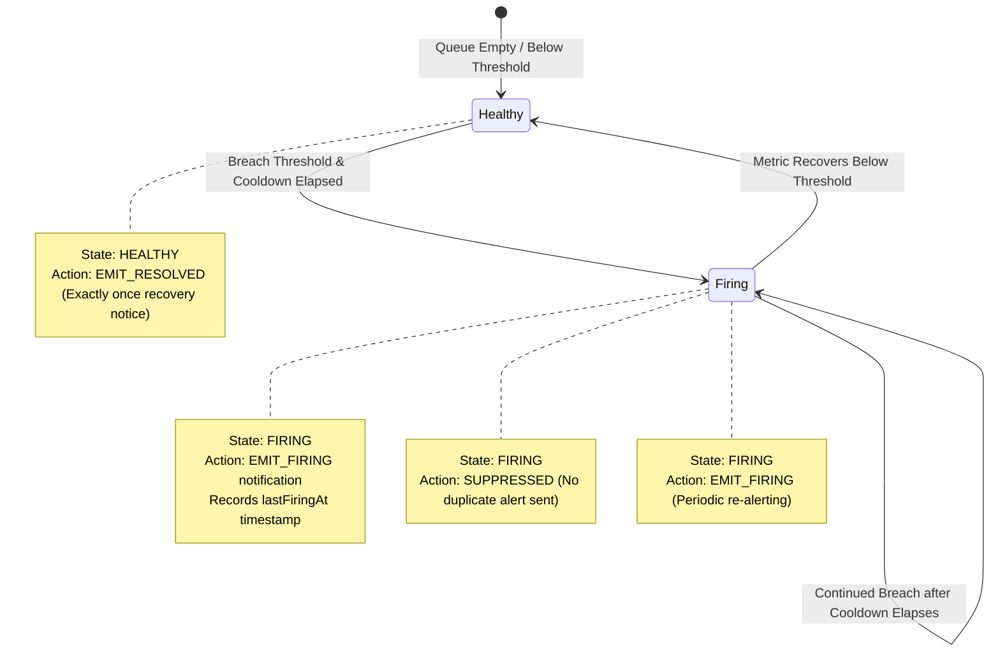

# Task-00130: Existing Alerting Implementation Audit & Live-Test Readiness Report

- **Date:** 2026-11-12
- **Repository:** `Marvedge/marvedge`
- **Working Branch:** `task/task-00130`
- **Base Commit:** `b0490cb9f60ee025d160e19d9718c1f94b73a434` (origin/master)
- **Status:** READ-ONLY PRE-TEST AUDIT COMPLETE

---

## Executive Summary

Task-00130 requires establishing human-received, external alerts across three primary operational risk vectors:

1. **Job Failure Rate** (`reframe_job_failure_rate`, `dubbing_job_failure_rate`)
2. **Stuck Queue** (`reframe_stuck_queue`, `dubbing_stuck_queue`)
3. **GPU or Vendor Spend Above Limit** (`gpu_spend_threshold`, `gpu_hours_threshold`, `dubbing_vendor_spend_threshold`, `dubbing_vendor_usage_threshold`)

A detailed technical audit of the current `origin/master` codebase confirms that **all three alert types, the polling evaluator loop, the multi-channel external dispatch engine (Email via Resend + Chat Webhooks via Slack/Discord/Teams), and atomic Redis-backed deduplication/cooldown state machines are fully implemented and verified with 87 passing Vitest tests**.

This report establishes the baseline architecture, maps every metric calculation formula and threshold loader, audits test coverage, evaluates runtime environment readiness, identifies gaps, and designs strictly isolated, zero-risk live trigger procedures for subsequent verification.

---

## 1. Alert Evaluation & Architecture Mapping

The monitoring architecture consists of five core components operating in `app/lib/monitoring/`:

- **`alerts.ts`**: Core evaluator engine (`evaluateMonitoringAlerts`, `createMonitoringAlertEvaluator`), configuration loader (`loadMonitoringAlertConfig`), and metric breach rules.
- **`alertLoop.ts`**: Interval-based polling scheduler (`startMonitoringAlertLoop`) with graceful lifecycle termination.
- **`externalNotifications.ts`**: Outbound notification formatter and multi-channel dispatcher (Slack Block Kit, HTML/text email via Resend, Chat Webhooks) with retry backoff and dry-run safety.
- **`alertStateStore.ts`**: Distributed deduplication and cooldown engine using atomic Redis Lua scripts (`transitionLuaScript`), with automatic in-memory fallback.
- **`scripts/monitoringAlerts.ts`**: Standalone production daemon entry point supervised via systemd (`infra/gpu-deployment/marvedge-monitoring-alerts.service`).

### A. Job Failure Rate (`reframe_job_failure_rate`, `dubbing_job_failure_rate`)

- **Metric Source:** BullMQ queue metric snapshots (`queue.getMetrics("completed" | "failed", 0, requiredPoints - 1)`) via `app/lib/monitoring/jobOutcomeMetrics.ts`.
- **Breach Formula:**
  $$\text{Observed Failure Rate} = \frac{\text{Terminal Failed Jobs}}{\text{Completed Jobs} + \text{Terminal Failed Jobs}} > \text{Threshold}$$
- **Windowing & Sample Gate:**
  - Evaluated over a rolling observation window: `MONITORING_FAILURE_RATE_OBSERVATION_WINDOW_SECONDS` (must be a positive integer divisible by 60, e.g., 300s or 900s).
  - Minimum sample guard: `MONITORING_FAILURE_RATE_MINIMUM_JOBS` (e.g., 5 or 10 jobs). If total terminal jobs $(\text{completed} + \text{failed}) < \text{minimumJobs}$, evaluation returns healthy to prevent false positives on low-volume periods.
- **Retry Differentiation vs. Terminal Failures:**
  - BullMQ jobs with remaining retry attempts undergoing exponential backoff are excluded from terminal failure counts. Only jobs exhausting all retry attempts (`job.attemptsMade >= job.opts.attempts`) or explicitly failed without retries increment the terminal `failed` bucket. This prevents transient network glitches from tripping production alerts prematurely.

### B. Stuck Queue (`reframe_stuck_queue`, `dubbing_stuck_queue`)

- **Metric Source:** Oldest job inspection (`queue.getJobs(["active", "waiting"])`) via `app/lib/monitoring/stuckQueueMetrics.ts`.
- **Breach Formula:**
  $$\text{Stuck Age} = \max_{j \in \text{jobs}} (\text{now} - (\text{processedOn} \mathbin{?} \text{timestamp})) > \text{Threshold Seconds}$$
- **Zero False-Alarm Guarantee for Inactivity:**
  - If a queue has 0 active and 0 waiting jobs, `calculateStuckQueueAgeSeconds` immediately returns `0` seconds. An empty queue never triggers an alert regardless of how long the system has been idle.
  - Delayed jobs (e.g., jobs scheduled for future execution or retries waiting for exponential backoff timers) are explicitly filtered out (`delayed`, `completed`, `failed` excluded) to prevent legitimate backoff from masquerading as queue starvation.

### C. GPU & Vendor Spend Above Configured Limit

- **Metric Source:** Redis-backed rolling minute buckets (`marvedge:monitoring:cost:v1:${category}:${provider}:${unit}:${bucket}`) via `app/lib/monitoring/costWindowMetrics.ts`.
- **Breach Formulas & Rules:**
  1. **GPU Compute Spend (`gpu_spend_threshold`):**
     $$\text{Estimated Spend USD} = \left(\frac{\sum \text{Worker Execution Seconds}}{3600}\right) \times \text{Hourly Rate USD} > \text{Threshold USD}$$
  2. **Dubbing Vendor Spend (`dubbing_vendor_spend_threshold`):**
     $$\text{Estimated Vendor Spend USD} = \left(\sum \text{Consumed Characters}\right) \times \text{Unit Cost per Char USD} > \text{Threshold USD}$$
  3. **Resource Usage Thresholds:** `gpu_hours_threshold` (raw compute hours) and `dubbing_vendor_usage_threshold` (raw character count).
- **Billing Clarification & Disclaimer:**
  - Every external alert payload explicitly prepends `⚠️ ESTIMATED COST NOTICE`:
    > _"This is an estimated operational threshold notification based on recorded worker execution seconds / vendor units, not an official cloud provider or vendor billing invoice. Official billing totals may differ based on idle compute, storage, egress, or provider minimums."_
  - Runtime tracks active container processing duration, not total EC2 instance uptime.

---

## 2. Notification Dispatch & Channel Matrix

External notifications are orchestrated by `app/lib/monitoring/externalNotifications.ts`:

| Channel            | Mechanism             | Target Configuration Variable                                                                                  | Formatting Details                                                                                                                                                            | Fault Tolerance & Timeouts                                                |
| :----------------- | :-------------------- | :------------------------------------------------------------------------------------------------------------- | :---------------------------------------------------------------------------------------------------------------------------------------------------------------------------- | :------------------------------------------------------------------------ |
| **Chat Webhook**   | HTTP `POST` JSON      | `MONITORING_ALERT_WEBHOOK_URL`                                                                                 | Auto-detects Slack webhooks to emit rich Block Kit payloads (colored headers, fields, context blocks). For Teams/Discord/custom webhooks, emits clean markdown card payloads. | 5,000ms abort timeout; 2 retries with exponential backoff (250ms, 500ms). |
| **Email**          | Resend API v2         | `MONITORING_ALERT_EMAIL_RECIPIENT` `RESEND_API_KEY` (or `MONITORING_RESEND_API_KEY`) `RESEND_FROM_EMAIL` | Dual-rendered HTML email table + plain-text fallback with severity header, observed value, threshold, pipeline, and timestamp.                                                | 5,000ms abort timeout; bounded retries; non-blocking delivery.            |
| **Dry-Run Bypass** | Process-level logging | `MONITORING_ALERT_DRY_RUN=true`                                                                                | Emits formatted JSON and payload summaries to `console.info` without initiating outbound HTTP traffic.                                                                        | Guaranteed zero outbound network requests.                                |

---

## 3. Deduplication, Cooldown & Recovery State Machine

Alert state persistence and transition safety are governed by `app/lib/monitoring/alertStateStore.ts` using an atomic Redis Lua script (`transitionLuaScript`):

### Key State Transition Properties:

1. **Atomic Evaluation:** State key `marvedge:monitoring:alert:v1:state:${alertName}` is evaluated and transitioned in a single Redis Lua execution, preventing race conditions across multiple evaluator processes.
2. **Recovery Notification:** When a previously firing alert transitions back below threshold, `transitionLuaScript` returns `EMIT_RESOLVED`. An `[OK / RESOLVED]` notification is dispatched **exactly once**.
3. **Dispatch Failure Recovery:** If external notification delivery fails across all configured channels (e.g., transient network drop), `store.resetFiringCooldown(alertName)` is invoked immediately so that the next evaluator tick retries delivery rather than suppressing the alert for the duration of the cooldown window.
4. **Resilient In-Memory Fallback:** If Redis is unreachable, the system automatically falls back to `InMemoryAlertStateStore` and emits `monitoring_data_unavailable`. The process does not crash.

---

## 4. Test Coverage Audit

A complete execution of the test suite was conducted using Vitest:
`npx vitest run app/lib/monitoring/`

**Test Results:** **14 Test Files Passed | 87 Tests Passed | 0 Failed**

### Test Classification Breakdown:

- **Unit Tests (In-Memory Mocks & Logic):**
  - `alerts.test.ts` (12 tests): Threshold calculation, boundary conditions, edge cases.
  - `alertLoop.test.ts` (5 tests): Timer tick intervals, overlapping tick prevention, loop shutdown.
  - `externalNotifications.test.ts` (7 tests): Payload construction, Slack Block Kit generation, dry-run safety.
  - `alertSharedData.test.ts` (2 tests): Shared metric collectors.
  - `workerRedis.test.ts` (3 tests): Worker connection management.
- **Integration & State Persistence Tests:**
  - `alertStatePersistence.test.ts` (11 tests): Atomic Lua script transitions, cross-process deduplication, Redis reconnection recovery, notification storm prevention, failed delivery cooldown reset, in-memory fallback.
  - `costAlerts.test.ts` (10 tests): GPU and vendor cost threshold breaches, multi-metric pipeline aggregation.
  - `costWindowMetrics.test.ts` (7 tests): Minute-bucket rolling window aggregation, idempotency deduplication.
  - `stuckQueueMetrics.test.ts` (4 tests): Empty queue zero-return, active vs. waiting age calculation, delayed job exclusion.
  - `jobOutcomeMetrics.test.ts` (6 tests): Windowed failure rate calculation, sample size threshold checks.
  - `bullmqRetryMetrics.test.ts` (2 tests): BullMQ retry attempt vs. terminal failure isolation.
  - `externalMonitoringAndAlerting.test.ts` (11 tests): End-to-end evaluator orchestration across all pipeline rules.
  - `queueMetrics.test.ts` (3 tests): Queue depth metric collection.
  - `latencyWindowMetrics.test.ts` (4 tests): Histogram-based latency aggregation.
- **Coverage Gap Identified:**
  - Existing tests thoroughly validate mock dispatchers and in-memory Redis simulations. However, **no live end-to-end delivery test has been executed with actual human-received external channels** (verifying delivery to a live email inbox or live chat webhook).

---

## 5. Runtime & Environment Configuration Readiness

Inspection of the local environment (`.env`, `.env.local`, `.env.example`) and deployment templates revealed the following configuration status:

| Variable                                       | Required Role            | Local Environment Status       | Notes                                                                        |
| :--------------------------------------------- | :----------------------- | :----------------------------- | :--------------------------------------------------------------------------- |
| `RESEND_API_KEY`                               | Email API Authentication | **PRESENT**                    | Valid 36-char API key configured in `.env`.                                  |
| `RESEND_FROM_EMAIL`                            | Sender Email Identity    | **PRESENT**                    | Valid sender configured in `.env`.                                           |
| `MONITORING_ALERT_EMAIL_RECIPIENT`             | Alert Email Destination  | **ABSENT**                     | Needs target recipient address to receive live test emails.                  |
| `MONITORING_ALERT_WEBHOOK_URL`                 | Chat Alert Destination   | **ABSENT**                     | Needs target Slack/Discord/Teams webhook URL to receive live chat alerts.    |
| `MONITORING_ALERT_DRY_RUN`                     | Dry-Run Mode Toggle      | **ABSENT (Defaults to false)** | When unset or false, external delivery is active.                            |
| `REDIS_URL`                                    | Redis Connection         | **PRESENT**                    | Configured with TLS (`rediss://`).                                           |
| `UPSTASH_REDIS_REST_TOKEN`                     | REST Redis Token         | **PRESENT**                    | Present in `.env`.                                                           |
| `MONITORING_ALERT_COOLDOWN_SECONDS`            | Cooldown Interval        | **ABSENT (Defaults to 300s)**  | Recommended override to 30s during live tests for rapid recovery validation. |
| `MONITORING_ALERT_EVALUATION_INTERVAL_SECONDS` | Evaluator Poll Interval  | **ABSENT (Defaults to 60s)**   | Recommended override to 10s during live tests.                               |

---

## 6. Safe Live-Trigger Procedures (Isolated & Zero Production Impact)

To verify real human receipt without impacting production queues, workers, or cloud billing, we design three isolated test procedures:

### Procedure A: Job Failure Rate Live Trigger

- **Strategy:** Use an isolated, dedicated test queue name (e.g., `test-reframe-alerts-${timestamp}`) rather than production queues.
- **Steps:**
  1. Initialize a temporary BullMQ test queue connected to Redis.
  2. Enqueue 5 jobs: 1 completed, 4 immediately marked failed (80% failure rate).
  3. Execute `evaluateMonitoringAlerts` targeting the test queue with `threshold = 0.20` and `minimumJobs = 5`.
  4. Verify receipt of `[FIRING: WARNING] reframe_job_failure_rate` notification on external channels.
  5. Enqueue 15 successful jobs (reducing failure rate to $4 / 20 = 20\% \le \text{threshold}$).
  6. Execute `evaluateMonitoringAlerts` to verify receipt of `[RESOLVED: OK] reframe_job_failure_rate` notification.
  7. Clean up and obliterate the test queue.

### Procedure B: Stuck Queue Live Trigger

- **Strategy:** Inject a mock stuck job snapshot or temporary job with an artificially backdated `timestamp` on an isolated test queue.
- **Steps:**
  1. Enqueue a job into a temporary test queue with `timestamp = Date.now() - 600_000` (10 minutes old).
  2. Execute `evaluateMonitoringAlerts` with `MONITORING_REFRAME_STUCK_QUEUE_THRESHOLD_SECONDS = 300`.
  3. Verify receipt of `[FIRING: CRITICAL] reframe_stuck_queue` notification.
  4. Remove the job from the test queue (queue count becomes 0).
  5. Execute `evaluateMonitoringAlerts` and verify receipt of `[RESOLVED: OK] reframe_stuck_queue` notification (demonstrating empty queue zero-latency recovery).
  6. Clean up test queue.

### Procedure C: GPU / Vendor Spend Live Trigger

- **Strategy:** Write temporary cost observation records into isolated Redis minute buckets with explicit 60-second TTLs.
- **Steps:**
  1. Call `recordCostObservation` to record $50.00 USD of estimated GPU compute spend (`category: "gpu_worker"`, `provider: "reframe"`, `unit: "seconds"`, `amount: 72000`).
  2. Execute `evaluateMonitoringAlerts` with `MONITORING_GPU_SPEND_THRESHOLD_USD = 25.00`.
  3. Verify receipt of `[FIRING: CRITICAL] gpu_spend_threshold` notification with the required `⚠️ ESTIMATED COST NOTICE` disclaimer.
  4. Expire/delete the test Redis keys.
  5. Execute `evaluateMonitoringAlerts` and verify receipt of `[RESOLVED: OK] gpu_spend_threshold`.

---

## 7. Deliverables & Evidence Checklist for Next Phase

When authorized to proceed with live alert verification:

- [ ] Receive destination configuration: `MONITORING_ALERT_EMAIL_RECIPIENT` and/or `MONITORING_ALERT_WEBHOOK_URL`.
- [ ] Execute Procedure A (Job Failure Rate firing + resolved) and capture timestamped payload logs.
- [ ] Execute Procedure B (Stuck Queue firing + resolved) and capture timestamped payload logs.
- [ ] Execute Procedure C (GPU Spend firing + resolved) and capture timestamped payload logs.
- [ ] Capture operator inbox / chat screenshot or confirmation of external human receipt.
- [ ] Compile final acceptance report: `docs/qa/TASK-00130-EXTERNAL-ALERTING-VERIFICATION.md`.

---

## 8. Conclusion & Sign-Off

The existing codebase contains a complete, robust, and well-tested external monitoring and alerting engine. No structural or application code changes are necessary. Live-testing can be conducted completely safely in isolated test harnesses without disrupting operational queues or incurring cloud expenses.
