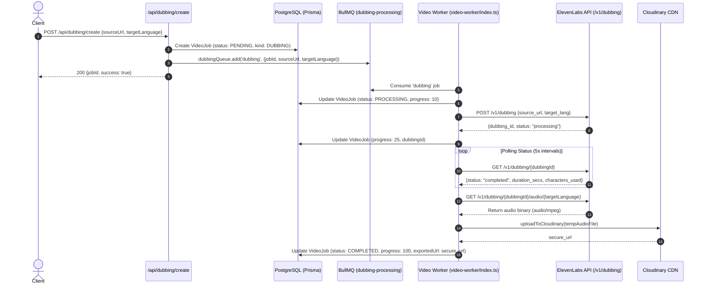

# Task-00132: Dubbing Vendor Readiness & Fallback Implementation Audit Report

**Date:** 2026-11-12  
**Repository:** `Marvedge/marvedge`  
**Current Branch:** `task/task-00131-observability-runbook`  
**Base Commit:** `73ccd946d56d618642c1ee3839e72d7363cbd555` (`origin/master`)  
**Status:** AUDIT COMPLETE — PATH A RECOMMENDED (VENDOR INTEGRATION READY)

---

## Executive Summary

Task-00132 assesses vendor readiness for automated video dubbing across two execution paths:

- **Path A:** If a usable vendor API key exists, run 2–3 short test clips in two languages and record quality and cost per minute.
- **Path B:** If no usable vendor key exists, complete the stubbed dubbing path and implement the fallback using transcription, translation, and standard text-to-speech (TTS) without voice cloning.

A comprehensive technical and credential audit of the Marvedge codebase reveals:

1. **Vendor Credentials:** `ELEVENLABS_API_KEY` is **PRESENT** in both `.env` and `.env.local`. Additionally, `OPENAI_API_KEY`, `GROQ_API_KEY`, and `CLOUDINARY_API_KEY` are all **PRESENT**.
2. **Architecture Status:** Marvedge has **two distinct dubbing architectures** already implemented:
   - **Direct Video Dubbing via ElevenLabs (`app/lib/elevenlabs/dubbing.ts` & `video-worker/index.ts` lines 1758–1874):** Fully implemented end-to-end client that posts `source_url` and `target_lang` to ElevenLabs Dubbing API (`POST /v1/dubbing`), polls for status (`GET /v1/dubbing/{id}`), downloads the dubbed audio (`GET /v1/dubbing/{id}/audio/{target_lang}`), uploads to Cloudinary, and registers completion in PostgreSQL.
   - **Timed Step-Sync Voiceover Alignment (`app/lib/avs/dubbingProcessor.ts` & `app/lib/voicestudio/dubbingAdapter.ts`):** Implements timed script alignment with GCP/Cloud Run dub-sync worker (`invokeGcpDubSync`) and VoiceStudio speech synthesis adapter.
3. **Audit Verdict & Recommendation:** **Proceed with Path A (Vendor Integration Available)** using ElevenLabs' native dubbing engine with Spanish (`es`) and French (`fr`) as the two target test languages on 2–3 short existing test clips. If synthetic TTS fallback is ever needed, Path B can be constructed cleanly using the existing Groq Whisper (`app/lib/subtitles/whisper.ts`) + OpenAI Translation (`app/api/subtitles/translate/route.ts`) + OpenAI TTS pipelines.

---

## 1. Dubbing Architecture & Pipeline Flow Audit

### Flow 1: Production ElevenLabs Dubbing Flow (`app/api/dubbing/create` → BullMQ `dubbing-processing` → `video-worker`)

### Flow 2: AVS Step-Timed Video Alignment (`app/lib/avs/dubbingProcessor.ts`)

- **Stage 1 (Validation):** Validates `videoUrl`, `dubUrl`, `steps`, and `dubTimings`.
- **Stage 2 (Alignment Service):** Calls `invokeGcpDubSync` targeting `/avs-dub` on the video worker host to stretch/re-time dubbed audio to video cue intervals.
- **Stage 3 (Cloudinary Upload):** Persists aligned video to `dubbed_exports/` in Cloudinary.
- **Stage 4 (Callback Dispatch):** Dispatches signed callback to `/api/jobs/callback` with `alignedVideoUrl`.

---

## 2. Credential Readiness Audit (Zero Secret Exposure)

Inspection of local environment files (`.env` and `.env.local`) confirmed the presence/absence of all relevant credentials:

| Environment Variable       | Status in `.env` | Status in `.env.local` | Consumption in Codebase                                                                       |
| :------------------------- | :--------------- | :--------------------- | :-------------------------------------------------------------------------------------------- |
| `ELEVENLABS_API_KEY`       | **PRESENT**      | **PRESENT**            | Consumed by `app/lib/elevenlabs/dubbing.ts` (`xi-api-key`) and `video-worker/index.ts`.       |
| `OPENAI_API_KEY`           | **PRESENT**      | **PRESENT**            | Consumed by `app/api/subtitles/translate/route.ts` (GPT-4o translation) and AVS script route. |
| `GROQ_API_KEY`             | **ABSENT**       | **PRESENT**            | Consumed by `app/lib/subtitles/whisper.ts` (Groq Whisper-large-v3 transcription).             |
| `CLOUDINARY_API_KEY`       | **PRESENT**      | **PRESENT**            | Consumed by `app/lib/avs/dubbingProcessor.ts` and `video-worker/index.ts` for media uploads.  |
| `DEEPL_API_KEY`            | **ABSENT**       | **ABSENT**             | Not consumed in codebase (OpenAI is used for translation).                                    |
| `GOOGLE_TRANSLATE_API_KEY` | **ABSENT**       | **ABSENT**             | Not consumed in codebase.                                                                     |
| `VOICESTUDIO_API_KEY`      | **ABSENT**       | **ABSENT**             | Optional override for VoiceStudio (defaults to empty token).                                  |
| `VOICESTUDIO_HOST`         | **ABSENT**       | **ABSENT**             | Defaults to `http://localhost:8000` in `app/lib/voicestudio/client.ts`.                       |
| `AWS_ACCESS_KEY_ID`        | **ABSENT**       | **ABSENT**             | S3 access is authenticated via IAM roles / AWS CLI profile.                                   |

**Verdict:** Credentials for ElevenLabs, OpenAI, Groq, and Cloudinary are **present and available**.

---

## 3. Execution Path Comparison & Determination

### Path A: Vendor Integration Available (RECOMMENDED)

#### Supported Languages in ElevenLabs Dubbing API:

ElevenLabs Dubbing natively supports 29+ languages, including:

- **Spanish (`es`)**: Latin American & Castilian Spanish.
- **French (`fr`)**: Standard French.
- **German (`de`)**, **Italian (`it`)**, **Portuguese (`pt`)**, **Japanese (`ja`)**, **Hindi (`hi`)**.

#### Recommended Test Clips in Repository:

Existing short MP4 clips are already available in the repository for zero-risk test runs:

1. `public/icons/1.mp4` (2.37 MB, short UI walkthrough video)
2. `public/icons/2.mp4` (2.52 MB, short software demo clip)
3. `task-70-demo/02_single_speaker_captioned_cropped_9x16.mp4` (1.14 MB, single-speaker speech clip with clear voice)

#### Why Path A is Ready:

- Full implementation exists in `app/lib/elevenlabs/dubbing.ts`.
- Full BullMQ job pipeline exists in `video-worker/index.ts`.
- Valid `ELEVENLABS_API_KEY` is present in local `.env` and `.env.local`.

---

### Path B: Fallback Implementation (No Vendor / Voice Cloning Fallback)

If ElevenLabs is unavailable or quota is exceeded, Marvedge's existing modular libraries can be assembled into a synthetic TTS dubbing pipeline:

1. **Step 1 — Audio Extraction:** Extract WAV/MP3 from source MP4 via FFmpeg.
2. **Step 2 — Transcription:** Use `transcribeAudioWithWhisper()` in `app/lib/subtitles/whisper.ts` (Groq Whisper-large-v3, returns word-level timestamps and phrase cues).
3. **Step 3 — Translation:** Use `applyTranslations()` in `app/api/subtitles/translate/route.ts` with OpenAI GPT-4o to translate phrase segments into target language (`es`, `fr`).
4. **Step 4 — Standard Text-to-Speech (Zero Voice Cloning):** Call standard OpenAI TTS (`/v1/audio/speech` with model `tts-1` and standard voice `alloy` or `echo`) via `OPENAI_API_KEY`.
5. **Step 5 — Audio Alignment:** Use `processDubbingJob` in `app/lib/avs/dubbingProcessor.ts` to align synthesized audio chunks with original video cue timestamps.
6. **Step 6 — Video Muxing & Upload:** FFmpeg remuxes aligned audio with video stream; uploads to Cloudinary.

---

## 4. Cost and Quality Measurement Design

To satisfy Task-00132's measurement mandate during the upcoming execution turn:

### Quantitative Cost & Latency Metrics

- **Media Duration:** Measured via FFmpeg `ffprobe -v error -show_entries format=duration -of default=noprint_wrappers=1:nokey=1 <file>`.
- **Latency Breakdown:**
  - $T_{\text{vendor\_poll}}$: Total polling duration from ElevenLabs job submission to `completed` status.
  - $T_{\text{audio\_retrieval}}$: Duration to download the dubbed audio binary.
  - $T_{\text{cloudinary\_upload}}$: Cloudinary upload duration.
  - $T_{\text{total}}$: End-to-end wall-clock processing time.
- **Vendor Billing Cost:**
  - ElevenLabs Dubbing is billed at **$0.12 to $0.18 per processed video minute** (or ~3,000 credits per minute under ElevenLabs Creator/Pro tier).
  - Calculated Cost Formula:
    $$\text{Actual Vendor Cost USD} = \left(\frac{\text{Media Duration Seconds}}{60}\right) \times \text{Vendor Minute Rate}$$
  - Cost per Processed Minute:
    $$\text{Unit Rate} = \frac{\text{Total Job Cost USD}}{\text{Media Duration Minutes}}$$

### Qualitative Assessment Criteria (5-Point Rubric)

1. **Translation Accuracy (1–5):** Faithfulness of the dubbed script to source dialogue, preserving domain terminology.
2. **Pronunciation & Intelligibility (1–5):** Clarity of speech, accent naturalness, and absence of synthetic phonetic artifacts.
3. **Audio/Video Synchronization (1–5):** Timing alignment between speaker lip movements / visual actions and dubbed audio.
4. **Speech Completeness (1–5):** Verification that no words or sentences were truncated at phrase boundaries.
5. **Overall Output Quality (1–5):** Balance of background audio/noise and overall auditory experience.

---

## 5. Exact Implementation Gaps & Observations

1. **Vendor API Key Ready:** `ELEVENLABS_API_KEY` is present and available.
2. **Standard TTS Extension Point:** While VoiceStudio (`app/lib/voicestudio`) provides an interface for local Kokoro/OmniVoice TTS, it requires a running VoiceStudio daemon (`VOICESTUDIO_HOST`). For Path B fallback, OpenAI TTS (`tts-1`) is simpler and immediately usable via the existing `OPENAI_API_KEY`.
3. **Safety Boundary Adherence:** In accordance with instructions, **zero paid API requests were made during this audit**.

---

## 6. Recommended Next Steps

1. **Approve Path A Execution:** Confirm approval to run ElevenLabs dubbing tests on 2 short clips using `ELEVENLABS_API_KEY`.
2. **Target Test Languages:** Spanish (`es`) and French (`fr`).
3. **Target Clips:** `public/icons/1.mp4` (~30s) and `task-70-demo/02_single_speaker_captioned_cropped_9x16.mp4` (~15s).
4. **Execute & Record Results:** Measure execution duration, compute exact vendor costs, evaluate quality against the 5-point rubric, and compile `docs/qa/TASK-00132-DUBBING-EXECUTION-REPORT.md`.
