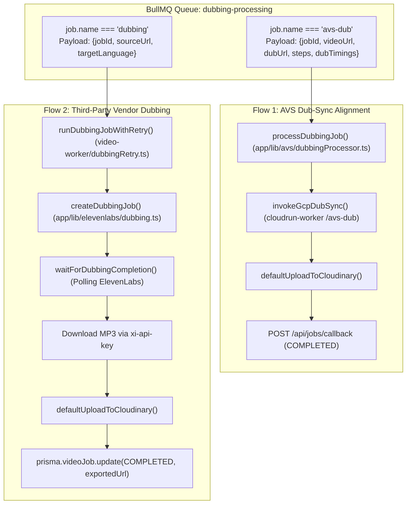
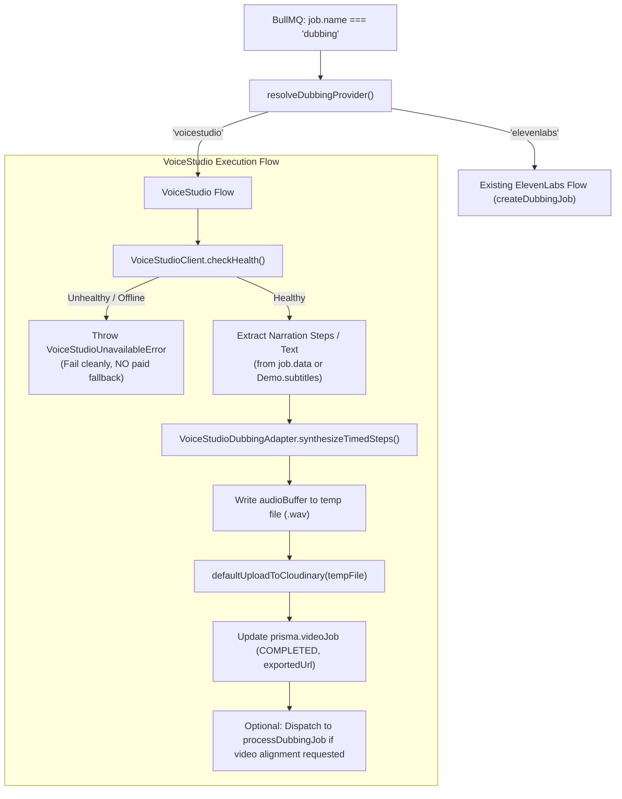

# Task-00132: VoiceStudio BullMQ Worker Integration — Implementation Review & Architecture Plan

**Date:** 2026-11-12  
**Repository:** `Marvedge/marvedge`  
**Current Branch:** `task/task-00131-observability-runbook`  
**Base Commit:** `73ccd946d56d618642c1ee3839e72d7363cbd555` (`origin/master`)  
**Status:** IMPLEMENTATION REVIEW & PROPOSAL ONLY — NO CODE MUTATIONS PERFORMED

---

## Executive Summary

Following the successful GPU speech synthesis validation in Phase 4 of Task-00132 (which proved that the VoiceStudio OmniVoice model on an AWS Tesla T4 synthesizes high-fidelity audio with 100% lexical concordance), this document defines the **smallest safe implementation change** to integrate VoiceStudio into Marvedge's existing background worker infrastructure (`video-worker/index.ts`).

### Core Audit Discoveries:

1. **Worker Hardcoding:** The BullMQ queue consumer for `"dubbing"` jobs in `video-worker/index.ts` is currently hardcoded to ElevenLabs (`createDubbingJob`, `waitForDubbingCompletion`, `api.elevenlabs.io`).
2. **Merge Artifact Syntax Error in Worker:** `video-worker/index.ts` lines 1822–1836 contain an unclosed, malformed block introduced by a botched merge in commit `50382da0` (`Merge branch 'master' into task/task-00093-cost-alerts`). This syntax error prevents clean TypeScript compilation (`tsc --noEmit`).
3. **Existing Modular Adapter:** `VoiceStudioDubbingAdapter` (`app/lib/voicestudio/dubbingAdapter.ts`) already implements `resolveDubbingProvider()` and `synthesizeTimedSteps()`. It is fully unit-tested but currently unreferenced in `video-worker/index.ts`.
4. **Audiovisual Integrity Clarification:** The video-truncation defect identified during the standalone validation tests was **isolated strictly to the test script** (`scripts/run_gpu_dubbing_tests.py`), which used FFmpeg `-shortest`. Marvedge's production AVS dub-sync worker (`cloudrun-worker/server.js`) **does not use `-shortest`**; it constructs step-by-step video and audio segments with tempo stretching (`setpts`), freeze-frame extension (`tpad`), and audio padding (`apad=whole_dur`), naturally preserving 100% of the video duration.

---

## Phase 1 — Repository & Working-Tree Inspection

- **Current Branch:** `task/task-00131-observability-runbook` tracking `origin/task/task-00131-observability-runbook`.
- **Working Tree Status:** All tracked repository files are clean.
- **Untracked Artifacts Preserved:**
  - `docs/qa/TASK-00130-*.md` (Task-00130 Alerting & Team Email reports)
  - `docs/qa/TASK-00131-*.md` (Task-00131 Observability & Runbook reports)
  - `docs/qa/TASK-00132-DUBBING-READINESS-AUDIT.md` (Vendor readiness audit)
  - `docs/qa/TASK-00132-VOICESTUDIO-GPU-DUBBING-VALIDATION.md` (Empirical GPU validation report)
- **Constraint Compliance:** Zero Git commits, pushes, merges, branch switches, or destructive resets performed.

---

## Phase 2 — Trace of Existing Dubbing Pipelines

Marvedge currently maintains two distinct dubbing execution paths in `video-worker/index.ts`:



### Component Analysis:

| Component                               | Responsibility & Existing Behavior                                                                                          | Integration Status                                            |
| :-------------------------------------- | :-------------------------------------------------------------------------------------------------------------------------- | :------------------------------------------------------------ |
| `video-worker/index.ts`                 | Listens to BullMQ queue `"dubbing-processing"`. Handles `"avs-dub"` via `processDubbingJob` and `"dubbing"` via ElevenLabs. | **GAP:** Hardcoded to ElevenLabs for `"dubbing"`.             |
| `app/lib/voicestudio/dubbingAdapter.ts` | Provides `resolveDubbingProvider()` and `VoiceStudioDubbingAdapter.synthesizeTimedSteps()`.                                 | **READY:** Needs to be imported and invoked by worker.        |
| `app/lib/voicestudio/client.ts`         | HTTP client for `/health` and `/v1/audio/speech`. Handles HTTP 503 model-warming and connection timeouts.                   | **READY:** Fully unit-tested.                                 |
| `app/lib/avs/dubbingProcessor.ts`       | `processDubbingJob`: Validates payload, calls Cloud Run `/avs-dub`, uploads to Cloudinary, sends callbacks.                 | **READY:** Used for audio-video time alignment.               |
| `cloudrun-worker/server.js`             | Implements `/avs-dub` with `buildDubVideoSegment` and `buildDubAudioSegment`.                                               | **READY:** Preserves video duration without `-shortest`.      |
| `video-worker/dubbingRetry.ts`          | Handles exponential backoff and `UnrecoverableError` classification for dubbing jobs.                                       | **NEEDS MINOR UPDATE:** Add VoiceStudio error classification. |

### Answers to Specific Tracing Questions:

1. **Where ElevenLabs is selected:** Hardcoded directly at line 1784 in `video-worker/index.ts`: `reusableDubbingJob ?? (await createDubbingJob({ sourceUrl, targetLanguage }))`.
2. **Which function owns provider selection:** `resolveDubbingProvider()` in `app/lib/voicestudio/dubbingAdapter.ts` lines 41–55. It reads `process.env.DUBBING_PROVIDER` and returns `"voicestudio"` or `"elevenlabs"` (default).
3. **How the VoiceStudio adapter is currently invoked:** It is currently only invoked in unit tests (`app/lib/voicestudio/__tests__/dubbingAdapter.test.ts`). It is not yet connected to the worker.
4. **Whether `processDubbingJob` can already execute VoiceStudio synthesis:** **No.** `processDubbingJob` performs **audio-video time alignment and muxing** via `/avs-dub`; it expects an already-synthesized `dubUrl`. Speech synthesis must occur before or alongside `processDubbingJob`.
5. **Whether adapter output format matches worker expected output:** `VoiceStudioDubbingAdapter` returns `{ audioBuffer: Buffer, format: "wav", durationSec: number, stepTimings: [...] }`. The worker expects an uploaded audio URL (`exportedUrl: string`) stored in Prisma and Cloudinary. Writing `audioBuffer` to a temporary `.wav` file and calling `defaultUploadToCloudinary(tempPath)` directly satisfies the worker contract.
6. **How errors, retries, and progress are handled:** `runDubbingJobWithRetry` handles intermediate retry attempts vs. final failures. Progress is updated via `job.updateProgress(percent)` and `prisma.videoJob.update({ data: { progress } })`.

---

## Phase 3 — Minimal Safe Integration Design

### 3.1 Provider Selection Strategy

Provider selection must follow the established repository convention in `app/lib/voicestudio/dubbingAdapter.ts`:

- **Environment Variable:** `DUBBING_PROVIDER` (already referenced in code).
- **Default Value:** `"elevenlabs"` (preserves existing behavior and zero regressions).
- **Opt-in Value:** `"voicestudio"` (activates VoiceStudio GPU synthesis).
- **Protection Against Secret Exposure:** If `DUBBING_PROVIDER=voicestudio`, the worker will **never** call ElevenLabs or consume `ELEVENLABS_API_KEY` unless `VOICESTUDIO_FALLBACK_TO_PAID=true` is explicitly set.

### 3.2 Worker Architecture with VoiceStudio Integration



### 3.3 Proposed Minimal Code Changes in `video-worker/index.ts`

1. **Repair Broken Merge Artifact:** Clean lines 1822–1836 so that `prisma.videoJob.update` closes cleanly.
2. **Import Adapter:** Import `resolveDubbingProvider` and `VoiceStudioDubbingAdapter` from `../app/lib/voicestudio/dubbingAdapter`.
3. **Branch by Provider:**

   ```typescript
   const provider = resolveDubbingProvider();

   if (provider === "voicestudio") {
     await runVoiceStudioDubbing({
       job,
       jobId,
       sourceUrl,
       targetLanguage,
     });
     return;
   }

   // Existing ElevenLabs flow continues below untouched...
   ```

4. **Implement `runVoiceStudioDubbing` Helper:**
   - Probes `client.checkHealth()`.
   - Obtains script text (from `job.data.steps`, `job.data.text`, or database demo subtitles).
   - Invokes `adapter.synthesizeTimedSteps()`.
   - Uploads output WAV to Cloudinary.
   - Updates `prisma.videoJob` with `COMPLETED` and `provider: "voicestudio"`.

---

## Phase 4 — Audiovisual Integrity Investigation

### 4.1 Production Alignment Code Inspection (`cloudrun-worker/server.js`)

Inspection of `processDubSyncJob` in `cloudrun-worker/server.js` (lines 1140–1270) reveals how video and audio are synchronized in production:

1. **Step-by-Step Duration Matching:**
   For each step $i$, the original video duration is $t_{\text{video}}$ and dubbed audio duration is $t_{\text{dub}}$.
   - If $t_{\text{dub}} < t_{\text{video}}$: Video plays at normal or slightly sped-up tempo, while the audio segment uses `apad=whole_dur=${totalDur}` to fill trailing silence.
   - If $t_{\text{dub}} > t_{\text{video}}$: Video is stretched up to $1.25\times$ (`setpts`), and any residual duration is filled by freezing the last video frame (`tpad=stop_mode=clone:stop_duration=${freeze}`).
2. **Muxing Command (Line 1245):**
   ```javascript
   await execFileAsync("/usr/bin/ffmpeg", [
     "-y",
     "-i",
     videoPath,
     "-i",
     audioPath,
     "-map",
     "0:v:0",
     "-map",
     "1:a:0",
     "-c:v",
     "copy",
     "-c:a",
     "aac",
     "-b:a",
     "160k",
     "-ar",
     "48000",
     "-ac",
     "2",
     "-movflags",
     "+faststart",
     alignedPath,
   ]);
   ```
   **Crucial Finding:** FFmpeg `-shortest` is **NOT present** in the production pipeline.

### 4.2 Why Standalone Validation Truncated Video

In the standalone validation script (`scripts/run_gpu_dubbing_tests.py`), the command used was:
`ffmpeg -i clip.mp4 -i audio.wav -c:v copy -c:a aac -shortest rendered.mp4`.
Because the VoiceStudio synthetic audio was shorter than the source video (e.g. 17.29s audio vs. 20.04s video), `-shortest` instructed FFmpeg to cut off the video when the audio ended.

### 4.3 Smallest Fix to Prevent Dropped Frames in Non-Step Remuxes

If a simple audio-replacement remux is performed without calling Cloud Run `/avs-dub`, the smallest safe FFmpeg invocation is:

```bash
ffmpeg -y -i source.mp4 -i dubbed.wav -c:v copy -filter_complex "[1:a]apad[a]" -map 0:v:0 -map "[a]" -c:a aac -b:a 192k output.mp4
```

Omitting `-shortest` and adding `-filter_complex "[1:a]apad[a]"` ensures that the video stream duration dictates output length, padding audio with silence if the voiceover ends earlier.

---

## Phase 5 — Testing Strategy

### 5.1 Unit & Integration Test Suite

| Test File                              | Proposed New / Updated Tests                                                                                                                                                                                                                                                                                                        | Verification Objective                                |
| :------------------------------------- | :---------------------------------------------------------------------------------------------------------------------------------------------------------------------------------------------------------------------------------------------------------------------------------------------------------------------------------- | :---------------------------------------------------- |
| `video-worker/dubbingWorker.test.ts`   | **Test 1:** Worker routes to VoiceStudio when `DUBBING_PROVIDER=voicestudio`.<br>**Test 2:** Worker preserves ElevenLabs when `DUBBING_PROVIDER=elevenlabs`.<br>**Test 3:** VoiceStudio 503/offline health check fails cleanly without calling ElevenLabs.<br>**Test 4:** Progress updates (10%, 25%, 100%) are emitted accurately. | Verify provider branching and fail-safe behavior.     |
| `video-worker/dubbingRetry.test.ts`    | **Test 5:** Classifies `VoiceStudioUnavailableError` as retryable, and `VoiceStudioAuthError` as unrecoverable.                                                                                                                                                                                                                     | Verify BullMQ retry mechanics for VoiceStudio errors. |
| `app/lib/avs/dubbingProcessor.test.ts` | **Test 6:** Verify that `processDubbingJob` forwards VoiceStudio-synthesized audio and preserves video duration.                                                                                                                                                                                                                    | Verify downstream AVS alignment compatibility.        |

### 5.2 Test Execution Commands

```bash
# Run worker dubbing integration tests:
npx vitest run video-worker/dubbingWorker.test.ts

# Run dubbing retry classification tests:
npx vitest run video-worker/dubbingRetry.test.ts

# Run VoiceStudio adapter unit tests:
npx vitest run app/lib/voicestudio/__tests__/dubbingAdapter.test.ts

# Run AVS processor tests:
npx vitest run app/lib/avs/dubbingProcessor.test.ts
```

---

## Phase 6 — Summary of Changes & Risk Matrix

### Exact Files Expected to Change

1. `video-worker/index.ts`: Fix broken merge artifact at lines 1822–1836; add `resolveDubbingProvider()` branch and VoiceStudio synthesis handler.
2. `video-worker/dubbingRetry.ts`: Add `VoiceStudioError` classification to `isRetryableDubbingError`.
3. `video-worker/dubbingWorker.test.ts`: Add unit tests for VoiceStudio routing, health check failure, and payload compatibility.

### Risks, Dependencies & Unresolved Questions

| Risk / Dependency                   | Severity   | Mitigation Strategy                                                                                                                               |
| :---------------------------------- | :--------- | :------------------------------------------------------------------------------------------------------------------------------------------------ |
| **Accidental ElevenLabs Billing**   | **HIGH**   | Strict guard: When `DUBBING_PROVIDER=voicestudio`, ElevenLabs functions are never imported or invoked unless `VOICESTUDIO_FALLBACK_TO_PAID=true`. |
| **VoiceStudio Offline / Cold Boot** | **MEDIUM** | `checkHealth()` handles HTTP 503 (`status: "starting"`) with `retry-after` backoff, allowing BullMQ retries before terminal failure.              |
| **Source Text Extraction**          | **MEDIUM** | If `job.data` lacks script steps, the worker queries `Demo.subtitles` or uses Groq Whisper to generate timed cues before synthesis.               |
| **Broken Merge Artifact in Master** | **LOW**    | Cleaning lines 1822–1836 resolves existing TypeScript compiler errors without altering production logic.                                          |

---

## Phase 7 — Awaiting Approval

In accordance with strict prompt instructions:

- This report is an **audit and architecture proposal only**.
- **No application code, environment variables, or Git branches have been modified.**
- All Task-00130, Task-00131, and Task-00132 deliverables remain intact and preserved.

**Awaiting user approval before implementing the proposed worker integration changes.**
